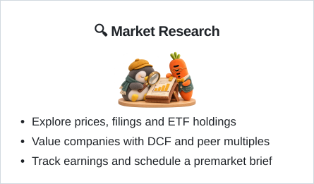
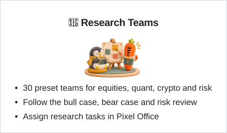
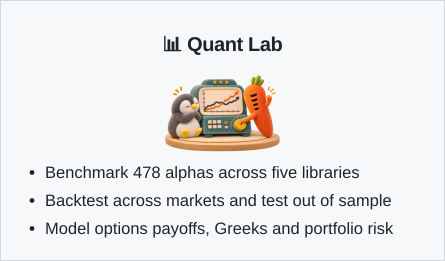
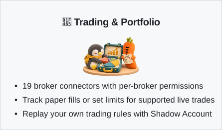

<p align="center">
  <b>English</b> | <a href="README_zh.md">中文</a> | <a href="README_ja.md">日本語</a> | <a href="README_ko.md">한국어</a> | <a href="README_ar.md">العربية</a> | <a href="README_es.md">Español</a> | <a href="README_id.md">Bahasa Indonesia</a>
</p>

<p align="center">
  
</p>

<h1 align="center">Vibe-Trading: Your Personal Trading Agent</h1>

<p align="center">
  <b>One Command to Empower Your Agent with Comprehensive Trading Capabilities</b>
</p>

<p align="center">
  <a href="https://www.star-history.com/HKUDS/Vibe-Trading"></a>
  <a href="https://trendshift.io/repositories/25527"></a>
  <a href="https://www.star-history.com/HKUDS/Vibe-Trading"></a>
</p>

<p align="center">
  <b>GitHub topic rankings by stars</b> · Nov 4, 2026<br>
  <a href="https://github.com/search?q=topic%3Abacktesting&amp;type=repositories&amp;s=stars&amp;o=desc">#1 Backtesting</a> &nbsp;·&nbsp;
  <a href="https://github.com/search?q=topic%3Aalgorithmic-trading&amp;type=repositories&amp;s=stars&amp;o=desc">#3 Algorithmic Trading</a> &nbsp;·&nbsp;
  <a href="https://github.com/search?q=topic%3Aquantitative-finance&amp;type=repositories&amp;s=stars&amp;o=desc">#4 Quantitative Finance</a>
</p>

<p align="center">
  
  
  
  <a href="https://pypi.org/project/vibe-trading-ai/"></a>
  <a href="LICENSE"></a>
  <br>
  <a href="https://github.com/HKUDS/.github/blob/main/profile/README.md"></a>
  <a href="https://github.com/HKUDS/.github/blob/main/profile/README.md"></a>
  <a href="https://discord.gg/6TdQnT5xcF"></a>
</p>

<p align="center">
  <a href="https://vibetrading.wiki/">Website</a> &nbsp;&middot;&nbsp;
  <a href="https://vibetrading.wiki/docs/">Docs</a> &nbsp;&middot;&nbsp;
  <a href="#-news">News</a> &nbsp;&middot;&nbsp;
  <a href="#-key-features">Features</a> &nbsp;&middot;&nbsp;
  <a href="#accounts-and-trading">Shadow Account</a> &nbsp;&middot;&nbsp;
  <a href="#-demo">Demo</a> &nbsp;&middot;&nbsp;
  <a href="#-quick-start">Quick Start</a> &nbsp;&middot;&nbsp;
  <a href="#-examples">Examples</a> &nbsp;&middot;&nbsp;
  <a href="#-api-server">API / MCP</a> &nbsp;&middot;&nbsp;
  <a href="#-roadmap">Roadmap</a> &nbsp;&middot;&nbsp;
  <a href="#contributors">Contributors</a>
</p>

<p align="center">
  <a href="#-quick-start"></a>
</p>

## 📰 News

- **2026-11-12** 🛠️ **Backtest timing, report figures and research completion fixes** — Shadow Account now uses the requested starting capital; token-truncated worker replies no longer count as completed. Committee PMs can synthesize valid upstream reports without fetching the same data again, and the native Anthropic adapter defaults to a configurable 16,384 output tokens.
  Generated strategies reject detected extra shifts on output targets unless explicitly declared intentional, while indicator lookbacks remain valid. Grounding now accepts supported magnitude spellings and precise observed declarations without weakening evidence checks. SPY/GLD backtests match an independent ledger on all 206/140 fills and total returns. **Unreleased.**

- **2026-11-11** 🧾 **Paper-trade partial fills and ledger reconciliation** — Opt into per-order volume caps, partial fills and reported order states for A-share 5-minute paper simulations ([#2128](https://github.com/HKUDS/Vibe-Trading/pull/2128)). Independently reconcile fees, cash, positions and NAV arithmetic from returned fills with the new `paper_trade_reconcile` Agent/MCP tool ([#2197](https://github.com/HKUDS/Vibe-Trading/pull/2197)).
  Correctly handle supported wrapped percentage headers and explicitly quoted document integers while preserving their source labels ([#2185](https://github.com/HKUDS/Vibe-Trading/pull/2185), [#2192](https://github.com/HKUDS/Vibe-Trading/pull/2192)). Also fix strict factor benchmark inputs ([#2195](https://github.com/HKUDS/Vibe-Trading/pull/2195)) and prevent timed-out channel turns from returning an earlier answer ([#2194](https://github.com/HKUDS/Vibe-Trading/pull/2194)).
  Thanks [@shadowinlife](https://github.com/shadowinlife), [@he-yufeng](https://github.com/he-yufeng), [@Jackzigen](https://github.com/Jackzigen) and [@divya0795](https://github.com/divya0795)! **On `main`, for the next pip release.**

- **2026-11-10** 📊 **Interactive IV surfaces and options analysis fixes** — Edit strike/expiry IV grids in Options Lab, with observed/interpolated labels and no extrapolation ([#2186](https://github.com/HKUDS/Vibe-Trading/pull/2186)).
  Fix low-price presets, quantities, expiry dates, retries, language-switch loading and the 20-leg limit. Bare three-digit Zhengzhou contracts such as `CF501` now use China futures rules ([#2193](https://github.com/HKUDS/Vibe-Trading/pull/2193)).
  Thanks [@he-yufeng](https://github.com/he-yufeng) and [@GPT-AGI](https://github.com/GPT-AGI)! **On `main`, for the next pip release.**

- **2026-11-09** 🧭 **Export a selected revision comparison; backtests refuse codes they cannot place** — Download the exact pair of research revisions you are comparing as JSON or Markdown from the Web, API or CLI ([#2189](https://github.com/HKUDS/Vibe-Trading/pull/2189)). A backtest code no market rule recognises (such as `local:BHP.AX` or `7203.T`) is now refused before any data is fetched instead of running on A-share rules; bare six-digit and `.SS` Shanghai codes still work. OpenRouter replies no longer show the model name twice ([#2191](https://github.com/HKUDS/Vibe-Trading/pull/2191)), and an empty revision id in `research-artifact export` is now an error. Thanks [@he-yufeng](https://github.com/he-yufeng) and [@Gloubiboulgator](https://github.com/Gloubiboulgator)! **On `main`, for the next pip release.**

<details>
<summary>Earlier news</summary>

- **2026-11-08** 📝 **Research revision comparison and full-history export** — Compare content, evidence and metadata between any two revisions ([#2168](https://github.com/HKUDS/Vibe-Trading/pull/2168)), and export the complete research history as JSON or Markdown ([#2170](https://github.com/HKUDS/Vibe-Trading/pull/2170)). Switching research records now ignores stale responses, and Markdown exports preserve original content in isolated code blocks. Also fix missing factor weights, partial-return attribution, insufficient IC samples, non-finite valuation inputs and margin calculations for negative entry prices. **On `main`, for the next pip release.**

- **2026-11-07** 🧪 **Research Lab: trading costs and out-of-sample testing** — Rerun saved price inputs under different fees and slippage; select parameters using training results only, then freeze them for out-of-sample tests and a separate final holdout. The [Research Lab](guides/research-lab.md) shares Web, CLI, API and Agent/MCP workflows, with all eleven UI languages. Also correct window-boundary returns and factor warmup/long-window calculations, and add 20 offline task-replay cases that keep missing evidence visible. Versioned research artifacts can now store structured financial facts ([#2164](https://github.com/HKUDS/Vibe-Trading/pull/2164)), and bare Chinese futures contract codes resolve correctly ([#2177](https://github.com/HKUDS/Vibe-Trading/pull/2177)). **On `main`, for the next pip release.**

- **2026-11-06** 📈 **Implied-volatility grids and paper-trading fixes** — Build strike-by-expiry IV grids from supplied option observations, with observed/interpolated labels and no extrapolation ([#2172](https://github.com/HKUDS/Vibe-Trading/pull/2172)). Extreme numeric inputs now produce finite results or explicit errors. A-share 5m market orders blocked by a price limit are canceled immediately ([#2176](https://github.com/HKUDS/Vibe-Trading/pull/2176)); the matcher also processes symbols chronologically so later proceeds cannot fund earlier orders. **On `main`, for the next pip release; public 5m requests still support one symbol per step.**

- **2026-11-05** 🚀 **v0.1.19 released** ([Release notes](https://github.com/HKUDS/Vibe-Trading/releases/tag/v0.1.19), `pip install -U vibe-trading-ai`): research that outlives the chat — save versioned research artifacts with their evidence and revise them, reuse backtests from earlier turns and sessions, and edit a research goal in place. New opt-ins: a five-minute A-share paper simulation, and Gildata financial queries, stock screening and Shannon portfolio diagnosis (QVeris is removed; an existing `GILDATA_TOKEN` alone now enables nothing). Also Argentina (BYMA) backtests, Parallel web search, Codex OAuth model discovery, and both 0.1.18 regressions fixed. 116 merged pull requests plus 21 landed through maintainer commits, from 26 contributors ([CHANGELOG](CHANGELOG.md)).
  **Fixed today:** a backtest reports the benchmark it actually evaluated, long/short books get a risk x-ray, GTJA alpha 17 stays missing while its inputs warm up, the Shannon panel speaks all eleven UI languages, and two reviewed contributor fixes that had not landed are in ([#2042](https://github.com/HKUDS/Vibe-Trading/pull/2042) TTM sums across a missing quarter, [#1985](https://github.com/HKUDS/Vibe-Trading/pull/1985) 3:2 split detection). Thanks [@rudycelekli](https://github.com/rudycelekli), [@he-yufeng](https://github.com/he-yufeng), [@Jackzigen](https://github.com/Jackzigen), [@Shizoqua](https://github.com/Shizoqua), [@cgycorey](https://github.com/cgycorey), [@dajiaohuang](https://github.com/dajiaohuang), [@zeus229](https://github.com/zeus229), [@alexwan02](https://github.com/alexwan02), [@BHhhh-123](https://github.com/BHhhh-123), [@remote-controlled-man](https://github.com/remote-controlled-man), [@shadowinlife](https://github.com/shadowinlife), [@TWJxi](https://github.com/TWJxi), [@lishuanghong1989-netizen](https://github.com/lishuanghong1989-netizen), [@TerryF7](https://github.com/TerryF7), [@davidalmeida90](https://github.com/davidalmeida90), [@DrDLyuan](https://github.com/DrDLyuan), [@goatyyc](https://github.com/goatyyc), [@hnq-ai](https://github.com/hnq-ai), [@kadyrbekovhamit-cyber](https://github.com/kadyrbekovhamit-cyber), [@MetaAviator](https://github.com/MetaAviator), [@octo-patch](https://github.com/octo-patch), [@RowanAldean](https://github.com/RowanAldean), [@VectorPeak](https://github.com/VectorPeak), [@wavebyrd](https://github.com/wavebyrd) and [@yufengsika](https://github.com/yufengsika)!
  **On main after the release (next pip release):** backtest benchmarks are bought at the first evaluated open, as the strategy is, instead of from the last warm-up close; excess return no longer includes that move (AAPL 20/60 SMA example: 22.5% → 18.4%).

- **2026-11-04** 📊 **Gildata financial queries, stock screening and Shannon portfolio diagnosis** — Screen stocks by market cap and retrieve their half-year revenue in one request, or inspect portfolio factor exposures and each holding’s contribution to volatility. All nine Gildata features are opt-in, including for existing token holders. Free data sources never fall back to Gildata. [#2117](https://github.com/HKUDS/Vibe-Trading/pull/2117) · [#2118](https://github.com/HKUDS/Vibe-Trading/pull/2118) · [#2119](https://github.com/HKUDS/Vibe-Trading/pull/2119)
  Also clarified next-bar backtest fills, fixed false Swarm timeouts on Unicode heartbeats and sped up research artifact deduplication. [#2137](https://github.com/HKUDS/Vibe-Trading/pull/2137) · [#2155](https://github.com/HKUDS/Vibe-Trading/pull/2155) · [#2159](https://github.com/HKUDS/Vibe-Trading/pull/2159)

- **2026-11-03** 🛠️ **Runtime integrity and localization follow-ups**: Preserve U+2028/U+2029 inside trace, audit-ledger and session-search JSONL records, keep ledger appends valid after such payloads, normalize underscored model labels, and preserve handoff summaries during layer-2 compaction. Also accept BOM-prefixed frontmatter and keep the welcome surface aligned in RTL locales. Add regression coverage.

- **2026-11-02** 🛠️ **Frontmatter, result safety and welcome polish**: Unquote quoted scalar metadata, fall back to a readable truncation when an oversized result cannot be encoded, and refine the welcome layout and featured cards. Add regression coverage.

- **2026-11-01** 🛠️ **Session timestamps, theme contrast and welcome interactions**: Stamp session updates in UTC, keep dark-mode primary buttons legible, and make side-panel examples clickable with clear category labels. Add regression coverage.

- **2026-10-31** 🛠️ **Welcome and ticker parsing polish**: Move the welcome surface to a warm paper palette and two-column layout, make featured examples and side-panel actions clearer, and stop trailing ticker letters from being interpreted as A-share or A/H constraints.

[Full news archive](guides/news.md) · [Changelog](CHANGELOG.md)

</details>

## ✨ Key Features

<div align="center">
<a href="assets/feature-market-research-card.svg"></a><a href="assets/feature-research-teams-card.svg"></a><br/>
<a href="assets/feature-quant-lab-card.svg"></a><a href="assets/feature-trading-portfolio-card.svg"></a>
</div>

## 💡 What Is Vibe-Trading?

Vibe-Trading turns finance questions into research reports, runnable backtests and paper portfolios. You can also authorize a supported broker to execute live trades within a mandate you set and can halt. Your funds stay with the broker.

## ✨ What You Can Do

| Task | Where to start |
|---|---|
| Research markets, filings or uploaded documents | Ask in Web chat or [attach a report](guides/research.md#upload--analyze-documents). |
| Backtest a strategy or benchmark alphas | Inspect charts and trades in Run Detail, or compare factors in `/alpha-zoo`. |
| Simulate trading or replay a journal | Track daily fills and NAV in `/paper-trading`. Use `/journal` and `/shadow` in the CLI to review your trades. |
| Combine accounts or compare allocations | Open `/portfolio` for holdings and proposed allocation changes. [Broker support](#broker-support-at-a-glance) |
| Explore options and correlations | Open `/options` for multi-leg payoffs and Greeks, or `/correlation` for market regimes. |
| Coordinate or repeat research | Run a [Swarm team](guides/research.md#swarm-workflows), assign work in Pixel Office or schedule a brief in `/scheduled`. |
| Revisit research with dated evidence | Search `/research-artifacts`, compare any two revisions, and export a full series or selected comparison as JSON or Markdown. [Versioned research](guides/research.md#versioned-research-artifacts) |

## ⚡ Quick Example

Once you have run `vibe-trading init`, you can ask for a backtest in plain English or benchmark an existing alpha library from the terminal.

```bash
vibe-trading run -p "Backtest a BTC-USDT 20/50 moving-average crossover for 2024. Compare it with buy-and-hold and report maximum drawdown."
vibe-trading alpha bench --zoo gtja191 --universe csi300 --period 2018-2025 --top 20
```

Open **Run Detail** to compare the crossover with buy-and-hold, inspect the trades behind a drawdown and check the data source on the run card.

## 🧪 Research Workflow

| Step | In the crossover example |
|---|---|
| Plan | Identify the trading pair, date range, moving averages and benchmark from the prompt. |
| Ground | Fetch historical bars for BTC-USDT. Check the source and dates before interpreting the result. |
| Execute | Write the strategy and run the backtest. The run directory holds the strategy, trades and equity curve. |
| Validate | Compare the result with buy-and-hold. Inspect turnover, drawdown and validation warnings alongside return. |
| Revisit | Open the saved run or ask a follow-up with different parameters. You can also save a dated research conclusion and revise it when new evidence arrives. |

## 📡 Data Sources & Smart Fallback

The loader supports **28 market-data sources**. With `source: "auto"`, it infers the market from the symbol and tries the configured sources in order.

| Market | How a request is filled |
|---|---|
| A-shares and Hong Kong | Start with Tencent. If it cannot supply the bars, try Eastmoney and then the remaining sources for that market. |
| US equities | Start with Yahoo. Stooq and Sina are the next two sources in the chain. |
| Crypto | Try OKX, Binance and CCXT before falling back to other sources. |
| Futures | Chinese contracts can use AKShare or local bars. Supply local bars for global contracts. |

You can also choose a source explicitly. For example, installing `vibe-trading-ai[ashare]` adds the token-free BaoStock loader for daily A-share bars. The [data source reference](guides/capabilities.md#-data-sources--smart-fallback) lists the full chains and credential requirements.

## 🔩 Detailed Capabilities

### Market research

| Feature | What you can do |
|---|---|
| Filings and holdings | Compare a manager’s SEC 13F holdings across quarters, or look through an ETF to its underlying positions. Each holdings report carries its reporting date. |
| Company valuation | Use `/dcf` to see how a valuation changes with the discount rate and terminal growth. Use `/comps` for peer multiples, or build a linked three-statement model and export the results to Excel. |
| Papers and documents | Search arXiv and OpenAlex for a signal, inspect the authors’ definition, then test it on your own universe. Upload a filing, spreadsheet or slide deck for questions about a specific exhibit. |
| Stock screening | With Gildata enabled, screen companies by market cap and retrieve half-year revenue in one request. Screening and portfolio factor diagnosis each have their own opt-in. |

### Quant research

| Feature | What you can do |
|---|---|
| Alpha Zoo | Benchmark signals from Qlib, Alpha101, GTJA and the academic and fundamental libraries. Compare information coefficients across horizons, then check whether the result survives a walk-forward test. |
| Backtest engines | Model A-share price limits, crypto funding or futures margin. Use a shared capital pool for a cross-market strategy and inspect the individual fills behind its returns. |
| Options Lab | Build a spread leg by leg. Compare its expiry payoff with the Greeks and see how the position responds to a change in spot price and implied volatility. |
| Portfolio risk | Inspect drawdowns, estimate value at risk and expected shortfall, or use Brinson attribution to separate allocation from stock selection. The correlation view shows when markets start moving together. |
| Strategy tracking | Register a strategy with its evidence and track how its Sharpe ratio or factor information coefficient changes as new results come in. |

### Accounts and trading

| Feature | What you can do |
|---|---|
| Portfolio | Bring read-only broker holdings into one snapshot or import an extraETF export. Enter target weights to preview the value change for each holding. |
| Paper trading | Advance a saved account one trading day and inspect fills, cash and NAV. You can also replay an A-share session in five-minute steps in a separate simulation. The `paper_trade_reconcile` agent/MCP tool independently checks fees, cash, positions and NAV arithmetic without market or broker access. |
| Shadow Account | Import your broker’s trade journal, inspect fees and trading habits, then compare the actual trades with a rule-based replay. |
| Broker connections | Set up a connection in the CLI or Web and test it with a read. For supported live profiles, set symbol, order and exposure limits before enabling trading. The kill switch halts live activity. |

### Teams and recurring research

| Feature | What you can do |
|---|---|
| Swarm and Pixel Office | Run a bull–bear investment committee or a quant research desk and inspect the workers’ reports. In Pixel Office, assign a task to a teammate and record the result on the shared board. |
| Scheduled briefs | Start from a premarket brief, an earnings tracker or a portfolio checkup. Choose a schedule and send the report to a configured channel such as Slack, Telegram or email. |
| Research history | Search older sessions and reopen a saved run. Save a dated conclusion with its evidence and compare revisions when the investment case changes. |
| Run records | Inspect the data source, model, execution record and metric references behind a backtest. Reopen the saved trades and equity curve to check a reported figure. |

<!-- BEGIN GENERATED broker-capability-matrix -->

### Broker support at a glance

<details>
<summary>Compare read-only, paper and live support by broker</summary>

**Read** means a dedicated read-only profile. **Sim** means paper orders through a broker sandbox or local simulation. **Live** means live orders under a mandate.

Yes indicates a declared capability. A dash means no matching profile is declared.

| Broker | Read | Sim | Live |
| --- | :---: | :---: | :---: |
| alpaca | Yes | Yes | Yes |
| binance | Yes | Yes | Yes |
| dhan | Yes | Yes | — |
| etoro | Yes | Yes | Yes |
| futu | Yes | Yes | Yes |
| ibkr | Yes | — | — |
| kis | Yes | Yes | — |
| longbridge | Yes | Yes | — |
| mstock | Yes | — | — |
| mt5 | Yes | Yes | Yes |
| okx | Yes | Yes | Yes |
| robinhood | Yes | — | Yes |
| scalable | Yes | — | — |
| shoonya | Yes | Yes | — |
| tiger | Yes | Yes | Yes |
| toss | Yes | — | — |
| trading212 | Yes | — | — |
| upbit | Yes | Yes | — |
| zerodha | Yes | Yes | — |

</details>

[Full permissions by profile](guides/portfolio-and-brokers.md#full-broker-permissions)

<!-- END GENERATED broker-capability-matrix -->

## 🎬 Demo

<table>
<tr><th width="50%">Web · From prompt to backtest</th><th width="50%">CLI · Interactive terminal</th></tr>
<tr>
<td width="50%" valign="top">

https://github.com/user-attachments/assets/2c595ee1-c577-481a-9460-34ea12bcf41c

</td>
<td width="50%" valign="top">

https://github.com/user-attachments/assets/ac79426e-f3f7-4349-b0d5-d997a2725784

</td>
</tr>
<tr><td>Send a strategy request, follow the agent’s work and inspect the resulting run.</td><td>Browse the research playbooks and open the pre-market brief in the terminal.</td></tr>
</table>

## 🚀 Quick Start

**Terminal.** Install the package with Python 3.11+, choose a model provider in the setup wizard, then open the interactive CLI.

```bash
pip install vibe-trading-ai
vibe-trading init
vibe-trading
```

**Web app.** Docker serves the frontend and API together at `http://localhost:8899`. From a fresh checkout, configure your provider before starting the container.

```bash
git clone https://github.com/HKUDS/Vibe-Trading.git
cd Vibe-Trading
cp agent/.env.example agent/.env
# Set your provider and API key in agent/.env.
docker compose up --build
```

The PyPI package includes the CLI, API and MCP server. For a frontend development setup or a local model, see the [installation guide](guides/installation.md).

## 🖥 CLI Reference

Start `vibe-trading` for the interactive terminal. Type `/help` at the prompt to browse commands or use these shortcuts during research.

| Command | Use it to |
|---|---|
| `/model` | Switch the provider or model for the session. |
| `/history` | Browse and resume a prior conversation. |
| `/show <run-id>` | Inspect the results of a saved run. |
| `/pine` | Export the current strategy as a Pine Script indicator. |

From the shell, `vibe-trading alpha list` browses the factor libraries and `vibe-trading playbook list` shows the scheduled research templates.

## 💡 Examples

- **Compare stocks.** Ask “Compare AAPL and MSFT over 2024. Which month accounts for the largest gap in returns?” Resume the conversation later with `/history`.
- **Review your trades.** Use `/journal` to analyze your exported trade history, then `/shadow` to compare your trades with a rule-based alternative.
- **Run an investment committee.** Choose a stock and follow the bull and bear cases through to the final report.

```bash
vibe-trading --swarm-run investment_committee '{"target":"TSLA","market":"US"}'
```

## 🌐 API Server

Start a local server with `vibe-trading serve --port 8899`. In a second terminal, run `curl http://localhost:8899/runs` to list saved runs. Use the returned ID with `GET /runs/{run_id}` to inspect its results.

| To run a research session over HTTP | Endpoint |
|---|---|
| Create the conversation | `POST /sessions` |
| Send the research question | `POST /sessions/{id}/messages` |
| Follow progress as it happens | `GET /sessions/{id}/events` |

Open `http://localhost:8899/docs` to try the endpoints interactively. [Authenticated clients](guides/cli-and-api.md#security-defaults) send the API key in the `Authorization: Bearer` header.

## 🔌 MCP Plugin

MCP clients can launch the same package over stdio. Add this entry to Claude Desktop’s `claude_desktop_config.json`, restart the client and call `list_skills`.

```json
{
  "mcpServers": {
    "vibe-trading": { "command": "vibe-trading-mcp" }
  }
}
```

For other clients or a custom output directory, see the [MCP configurations](guides/mcp.md).

## 🏛 Ecosystem

Vibe-Trading is part of the **[HKUDS](https://github.com/HKUDS)** agent ecosystem:

<table>
  <tr>
    <td align="center" width="20%">
      <a href="https://github.com/HKUDS/nanobot"><b>NanoBot</b></a><br>
      <sub>Ultra-Lightweight Personal AI Assistant</sub>
    </td>
    <td align="center" width="20%">
      <a href="https://github.com/HKUDS/AI-Trader"><b>AI-Trader</b></a><br>
      <sub>Agent-Native Signal &amp; Copy Trading Platform</sub>
    </td>
    <td align="center" width="20%">
      <a href="https://github.com/HKUDS/CLI-Anything"><b>CLI-Anything</b></a><br>
      <sub>Making All Software Agent-Native</sub>
    </td>
    <td align="center" width="20%">
      <a href="https://github.com/HKUDS/OpenSpace"><b>OpenSpace</b></a><br>
      <sub>Self-Evolving AI Agent Skills</sub>
    </td>
    <td align="center" width="20%">
      <a href="https://github.com/HKUDS/ClawTeam"><b>ClawTeam</b></a><br>
      <sub>Agent Swarm Intelligence</sub>
    </td>
  </tr>
</table>

---

## 🗺 Roadmap

| Area | Available now | Next |
|---|---|---|
| Paper trading | Daily accounts persist cash, fills and NAV between sessions. A separate simulation replays an A-share session in five-minute steps. | Opt-in volume-share matching ([#2128](https://github.com/HKUDS/Vibe-Trading/pull/2128), draft). |
| Research | Run cards record metrics and evidence for a completed backtest. Dated research artifacts keep revision history and are searchable. | Structured financial facts in research artifacts ([#2164](https://github.com/HKUDS/Vibe-Trading/pull/2164), in review). |
| Options Lab | Explore multi-leg payoffs, Greeks and spot × IV scenarios. | Interactive volatility surface grid at `/options`. |

## Contributing

Pick a [good first issue](https://github.com/HKUDS/Vibe-Trading/issues?q=is%3Aissue+is%3Aopen+label%3A%22good+first+issue%22) or open an issue to discuss a larger change. The [contributing guide](CONTRIBUTING.md) covers local setup and checks to run before opening a pull request.

## Contributors

Thank you to everyone who has contributed to Vibe-Trading.

### v0.1.19 contributors

- @rudycelekli — 58 PRs (12 landed as maintainer ports): GTJA alpha formulas restored to the report (#2036/#2037/#2038/#2039/#2040/#2051), loaders that ask each vendor for the ticker form it serves and page at its own cap (Alpha Vantage #1997, AKShare #1998, CCXT #1999, Tushare minute lots #2001, Tiingo/Stooq class shares #2010/#2012, Nobitex Tehran days #1989, push2 decimals #1988), futures and market fees (micro index price limits #1992, the 30-year treasury fee #1994, India stamp duty on short covers #1995), quant-library and governance fixes (#1950/#1959/#1960/#1962/#1963/#2000/#2017), sub-penny prices kept in trades and charts (#1987/#1990), TTM sums that stop at a missing quarter (#2042), 3:2 splits and ST board limits in paper trading (#1985/#1984), a live halt key that cannot alias the global halt (#2003), session, memory, CLI and API fixes (#1969/#1970/#1982/#2002/#2006), and a string-"false" sweep across ten tools (#1976/#1977/#2008/#2009/#2011/#2013/#2014/#2015/#2016/#2018)
- @he-yufeng — 18 PRs (5 landed as ports): versioned research artifacts (#2079/#2159), background tasks scoped to their owner, reaped on cancel and reconciled after a restart (#2092/#2098/#2100/#2157), silent provider streams interrupted (#2099), cache and reasoning tokens kept in `llm_usage` (#2109), one tool policy across providers (#2087), Claude CLI tool-attempt recovery and structured finals (#2048/#2064/#2120), Qlib BETA/RESI/ROC/CORD semantics (#2062/#2069), magnitude suffixes in derived formulas (#2134), long/short risk x-ray and validation that refuses non-positive equity (#2162/#2161), and Unicode-safe swarm heartbeats (#2155)
- @Jackzigen — the bar-agnostic paper order lifecycle (#2066), swarm runs that stop when cancelled from the chat (#2059/#2060), document figures and percentage points in grounding (#2058/#2108), Robinhood portfolio reads with account selection (#2054), Moonshot reasoning effort for kimi-k3.1-pro (#2043), and Eastmoney JSONP, AKShare 1.20 forex and bare US ETF symbol fixes (#2082/#2083/#2086)
- @Shizoqua — research goals edited in place (#2093), Feishu, Teams, WeChat, WhatsApp and Discord channel fixes (#1957/#1958/#1967/#2078/#2114), heredoc commands in the bash tool (#2077), path-escape tests (#2094), and a run-directory fallback that no longer depends on the process cwd (#2116, landed as a port)
- @cgycorey — global futures priced on real contract multipliers and micro rates, with generic defaults reported (#1965/#1966/#1968/#1972), and a shadow account that honours every entry condition and currency (#2073/#2075)
- @dajiaohuang — transfer flow signs (#2023), aligned attribution benchmarks (#2044), overflow-free weight normalisation (#2046), and boolean payoff quantities refused (#2049)
- @zeus229 — the BYMA engine for Argentine shares and CEDEARs (#2071), backtests reused across turns and sessions (#2074), Codex OAuth model discovery (#2080), and financial units kept in grounding evidence (#2072)
- @alexwan02 — Longbridge per-currency cash (#1940), `.env` read by the MCP server (#1974), and Futu US symbol mapping (#2076)
- @BHhhh-123 — cross-sectional factor combination with walk-forward weights (#1953), field-level data availability in alpha bench (#2057), and factor research provenance (#2067)
- @remote-controlled-man — comma-grouped document integers (#2135), one bounded retry for a withheld final answer (#2136), and A-share source setup docs (#2138)
- @shadowinlife — the opt-in five-minute A-share paper step and its bar-by-bar matching (#2110/#2111), and JoinQuant limit fills (#2127, landed as a port)
- @TWJxi and @lishuanghong1989-netizen — Gildata stock discovery and financial queries (#2117), stock screening with report-period indicators (#2118), and Shannon portfolio style and risk analysis (#2119)
- @TerryF7 — IBKR and Futu gateway endpoints per connection (#1983), and connection deletion without a credential vault (#2153, landed as a port)
- @davidalmeida90 — the next-bar signal delay documented in the strategy skill (#2137)
- @DrDLyuan — STAR Market and Beijing buys sized on their own order grid (#2105)
- @goatyyc — Binance HTTP 451 read failures explained (#1937)
- @hnq-ai — a crawlable documentation wiki (#2165, landed as a port)
- @kadyrbekovhamit-cyber — Heston prices for short expiries (#2140)
- @MetaAviator — invalid journal quantities refused (#2052)
- @octo-patch — MiniMax M3.1 Flash as the default MiniMax model (#1936)
- @RowanAldean — optional Parallel search in `web_search` (#2113)
- @VectorPeak — voice notes forwarded in four IM adapters (#2106)
- @wavebyrd — Yahoo three-letter `=X` forex symbols read as USD pairs (#1980)
- @yufengsika — non-finite and boolean inputs refused by financial rigor checks (#2053)

<details>
<summary>v0.1.17 and v0.1.18 cycle contributors</summary>

**v0.1.18** · @warren618 (Haozhe Wu) shipped on-demand tool schemas, preserved large research results in run artifacts and fixed usage accounting for interrupted model calls.

- @rudycelekli — a 92-PR correctness sweep (13 of them landed as maintainer ports): quant-library guards and edge cases (implied-vol price tolerance #1657, gaps in VaR breach transitions #1658, Heston inputs #1719, scheduled CDS coupons #1716, Carino coincidence #1943, undefined probabilistic-Sharpe and bond-accrual inputs #1821/#1822), missing prices kept out of risk x-ray return pairs and OU lag pairs (#1717/#1713), an undefined three-scenario upside and unbounded journal ratios reported as such (#1921/#1884), document reading that keeps PDF text, Word order, PowerPoint groups and Excel missing-value markers (#1838/#1839/#1840/#1841), session search limits, locking and snippets (#1827/#1828/#1832/#1834), more secret formats redacted (#1874/#1880), A-share board limits and Beijing codes (#1913/#1914), standalone revalidation and attribution on the run's own annualisation (#1915/#1948), and settings the selected engine ignores now warned about (#1947)
- @Shizoqua — 25 PRs (2 landed as ports): memory and cross-session search that read back clean and match non-English text (#1682/#1686/#1697/#1771/#1772), skill headings and saved skill names resolved consistently (#1797/#1858), Telegram and Matrix replies no longer dropped when the stream preview never sent and one WeCom stream id per reply (#1860/#1903/#1929), SSE events no longer double-delivered on reconnect (#1798), parallel CLI tool results paired with their own call (#1859), goal evidence confined to the claimed run (#1895), Carhart momentum no longer leaking today's price (#1578), Wilder RSI in the shadow account (#1457), direct-SDK positions priced from `current_price`/`ltp`/`market_val` (#1581), the email SPF/DKIM spoofing check (#1508), and swarm artifacts cleared before each fresh task (#1455)
- @he-yufeng — 24 PRs (2 landed as ports): the declared grounding-check registry and the fired checks recorded in the validation artifact (#1628/#1691/#1661), corrections that keep the figures already passed (#1702), percent-named evidence read as points in derived checks (#1823), additive A-share qfq converted to multiplicative when the offsets validate (#1551), mootdx retired from the default A-share chain and the health canary (#1730), the channel-authoring contract (#1630), the compaction-helper split out of `loop.py` (#1631), the first bar's result counted against initial capital in the options engine and per-bar returns (#1750/#1844), config keys nothing reads warned about (#1935), the US early-bell close on half-days (#1706), and the ReportLab fallback for Shadow Account PDFs (#1683)
- @shadowinlife — 19 PRs (5 landed as ports): daily paper trading with saved accounts across CLI, API and Web (#1939), the shared scheduler kernel adopted by the research, back-office and live loops (#1893/#1899), token usage in Run Detail, chat and swarm (#1890), `read_run_artifact` and a structured backtest tool summary (#1647/#1646), `get_southbound_flow` and a northbound flow that no longer serves a silent empty envelope (#1486/#1484), guided Web UI setup for Feishu, Slack and Discord with runtime errors surfaced in channel status (#1572/#1764/#1777/#1738/#1737), and thirteen fundamental and valuation factors, industry-neutral A-share value alphas and a monthly-horizon IC bench (#1787/#1788/#1802/#1801)
- @zeus229 — 18 PRs (4 landed as ports): grounding that fails closed on unresolved derived refs and suggests exact refs (#1835/#1837/#1638), parses complete derived formulas after labels (#1728), keeps identity in ticker-keyed metrics and blank-corner matrices (#1851/#1850) and leaves execution metadata out of numeric evidence (#1767); rich Email scheduled reports with optional PDF password protection (#1680/#1709), channel-aware scheduled-run editing (#1649), reproducible indicator reads and pinned portfolio snapshots (#1768/#1769), redundant MCP payload copies removed before agent context (#1634), and goal tool-call provenance (#1688)
- @alexwan02 — 16 PRs (4 landed as ports): the `claude-cli` provider backed by a local `claude -p` (#1804), Hong Kong orders sized on each symbol's own board lot (#1813), the Longbridge SDK config built through `from_apikey` (#1805), Futu multi-currency balances with average-cost basis (#1814), SDM registration that keeps its trading rules and records bench history for decay monitoring (#1848/#1849), a lightweight run preview built off the event loop (#1853), run trades listed newest first from the full trades.csv (#1865), trades.csv entry rows, offline benchmarks and Brinson weights fixed (#1780/#1781/#1782), and runtime connectors ordered by status (#1845)
- @Jackzigen — 13 PRs (2 landed as ports): the first `loop.py` extractions for tool-result helpers, run outcome and tuning (#1636/#1641/#1678), a byte-stable system prompt for prefix caching (#1708), after-close SEC filings kept out of the IC until the next bar (#1794), a free BaoStock fallback for `val:*` panels (#1799), undefined correlation pairs published as null instead of 0.0 (#1933), journal PnL pooled per settlement currency (#1811), `BASE-USDT-PERP` routed to the crypto market (#1864), the mStock read-only profile (#1675), and the shared OHLCV contract assertion in per-loader suites (#1725)
- @cgycorey — 12 PRs (3 landed as ports): only the engine's own output grounds a backtest report (#1685), adjusted and raw prices never mixed in one series (#1684), a stooq challenge latch that stops probing and sees every refusal (#1637/#1640), a loader health lane that says why a source is empty and keeps labelled credentials out (#1643/#1698), `get_macro_series` reporting when it caps a series (#1676), env-style credential names, URL userinfo and Basic auth redacted (#1765/#1742/#1744/#1846), and suffixed HK codes normalized for the duplicate-asset guard (#1746)
- @MetaAviator — 12 PRs (2 landed as ports): full-sample downside deviation for Sortino in the metrics and options engines (#1693/#1727), initial capital in Monte Carlo path metrics (#1664), missing equity kept out of adjacent validation returns (#1754), standalone revalidation that honours saved settings and entry dates (#1815/#1842), break-even exits and zero-bar trades kept in trade artifacts and holding periods (#1779/#1876), and trade-journal fixes for reversal fees, split date/time columns, equal timestamps and invalid dates (#1891/#1900/#1941/#1942)
- @lorenzozanee — unsupported Robinhood option orders gated before the broker (#1585), run cards that flag backtests possibly inside the model's training data (#1618), and option evidence in the broker bring-up checklist (#1770)
- @Mikesad — LLM usage accounting extracted from `loop.py` (#1662), swarm presets that take their variables from the prompt (#1674, landed as a port), and the factor registry suite running without symlink privileges (#1696)
- @remote-controlled-man — options legs priced on the run's bar cadence (#1753), the Futu journal format claimed only when its value columns exist (#1766), and three-statement balance tolerance threaded into projected periods (#1786, landed as a port)
- @Romzhou — a kill-switch sweep that fails closed on its own bookkeeping and input (#1703), and a runner driver kept alive for the scheduler's lifetime (#1704)
- @sambazhu — three Gildata research tools with off-exchange fund NAV (#1485), and an env-configurable ReAct iteration cap (#1833)
- @wavebyrd — spread and swap rates for Yahoo `=X` forex pairs (#1930), and per-cent multipliers for ICE coffee, sugar and cotton (#1944)
- @BHhhh-123 — factor neutralisation and PCA in the quant library (#1817, landed as a port)
- @Bortlesboat — Calmar kept finite on explosive equity paths (#1901)
- @bygordon130-hub — Pixel Office, a shared manual research-task board, and the Turkish locale (#1616)
- @davidalmeida90 — profit factor reported as undefined when no trade lost (#1602)
- @DrDLyuan — the equity.csv drawdown peak seeded with initial capital (#1818)
- @Emad211 — per-channel configuration, custom providers and the Persian locale (#1264)
- @Frank-zhu2000 — Futu profiles no longer pinning the HK trade market (#1812)
- @goatyyc — Binance balances that survive clock skew, with unpriced assets marking the snapshot incomplete (#1505)
- @hunters1011-ctrl — symlink tests skipped where symlinks are unavailable (#1803)
- @incorpore — Brazil (B3) market data and an opt-in ZimaOS template (#1783, landed as a port)
- @mdb1230 — five example options strategies and a candidate study of which to paper-trade (#1774)
- @mminkus — the interactive message cap raised to match the scheduled-run path (#1701)
- @passionbull — KIS reads that see SOR fills and recover from a server-invalidated token (#1726)
- @rwxyx518-prog — the Portfolio page's holdings table and history chart following the display currency (#1810)
- @ThreeTima — currency identity checked in financial figure grounding (#1905)
- @tomaszkubiak-courses — strategy provenance model fields set on the loop, so writing a strategy file no longer raises `AttributeError` (#1673)
- @xaritoku — dotenv loaded in the `alpha bench` / `alpha compare` CLI handlers (#1806)

</details>

<details>
<summary>v0.1.16 cycle contributors</summary>

- @Shizoqua — a 55-PR correctness sweep (one landed as a port) across nearly every layer: quant-library fixes and input guards (Patell z degrees of freedom #1449, copula ties #1453, Kyle's lambda intercept #1477, HRP labels #1555, non-finite impact and yield-curve inputs #1557/#1558), Alpha Zoo NaN propagation and formula fixes (gtja191_038 #1523, alpha101_074 #1534, qlib158 WVMA #1594, GTJA HIGHDAY/LOWDAY #1604), backtest sizing for negative futures prices and shorts (#1547/#1548), venue bars per year in Monte Carlo validation (#1546), options annual return over elapsed bars (#1458), memory, swarm-store and session robustness (#1450/#1525/#1545/#1536/#1579), DingTalk, Signal, Slack and Discord channel fixes (#1506/#1478/#1524/#1537), Argentina listing identity in grounding (#1575), and a mandate narrowed to zero exposure stored as zero (#1593)
- @zeus229 — grounding that reads locale decimals and grouped numbers with precision-aware rounding (#1517/#1588), resolves explicit symbols and exact field refs from observed evidence (#1584/#1586), preserves `latest_date` timestamps (#1590) and keeps corrections text-only (#1600); Argentina (`.BA`) market data through Yahoo (#1543), ISO-4217 portfolio currencies with isolated FX failures (#1510), explicit header names compared case-insensitively (#1568), technical-indicator volume statistics and their replay after compaction (#1571/#1601), and bounded read-only replay after compaction (#1488)
- @cgycorey — a read-only extraETF export reader (#1406) and the read-only Scalable Capital MCP connector (#1417), run cards that keep non-scalar metrics (#1424), the backtest tool naming the directory it looked in (#1429), a tool-declared swarm `run_dir` confined to the workspace and worker message logs persisted on every terminal path (#1430/#1439), qlib158 CNTP/CNTN/CNTD NaN propagation (#1459), custom zoo roots that no longer replace the bundled module (#1468), `get_shareholder_count` answering again (#1490), Tencent's A-share and HK calibers stamped correctly (#1497)
- @shadowinlife — IM channels configured from the Web UI, with QQ, Email and WebSocket guided setups (#1520/#1529/#1544), stdlib logging placeholders across 12 channel adapters (#1533), Tencent history paginated backward from the end of the window (#1411), `state.json` written by the backtest tool so tool-driven runs are ingestible (#1413), per-worker swarm skill allowlists (#1414), the `1M` interval no longer folding to one minute (#1487), and welcome quick actions with a real selected state (#1500)
- @he-yufeng — tail-risk measure and confidence kept through the grounding gate (#1444), full history in the risk x-ray instead of sampled rows (#1462), shareholder-count history from the per-period report (#1518), backtests attaching to a running MT5 terminal without credentials (#1598), a per-read BaoStock socket deadline (#1615), the weekly live-source health canary (#1627), the broker capability matrix generated into the README (#1629), and the channel `stop_all` and WebSocket logger fixes carried over from #1521
- @lorenzozanee — dragon-tiger seat reports and lockup expiry data restored (#1512/#1513), malformed Robinhood buying power rejected (#1526), broker-only MT5 symbols resolved in `search_symbol` (#1597), hash-only traces and citations on run cards (#1612), expired Copilot CLI tokens refreshed (#1619), and Telegram polling ownership documented (#1583)
- @chiww — the Stooq warning naming the override variable the config layer reads (#1402), A-shares routed by market for sources without a dedicated branch (#1431), the declared interval checked against the served bars before annualising (#1432), and `_NO_NETWORK_FALLBACK_SOURCES` honoured for per-symbol gaps (#1441)
- @as950118 — three Korean broker connectors: KIS with separate paper and live hosts (#1407), Upbit capped at paper plus read-only (#1408), and read-only Toss Securities (#1409)
- @0xouzm — SDM decay metrics that treat NaN and infinite bench results as missing (#1447)
- @alanwilhelm — synchronized cold loader-registry initialization, so concurrent first lookups no longer see an empty registry (#1405)
- @modelpath-dev — the description-driven strategy-store adaptation substrate (#1391)
- @sambazhu — the Gildata A-share OHLCV loader over its raw-api MCP endpoint (#1474)
- @tingkk — broker-neutral SDK diagnostics across all locales (#1436)
- @tonydo — OpenCode as a built-in provider, sending the `x-opencode-session` header OpenCode Go requires (#1416)
- @woshi77777stars — the `Trigger.market` default restored on non-market triggers (#1599)
- @Yoruxyv — the Bahasa Indonesia UI locale and `README_id.md` (#1482)

</details>

<details>
<summary>v0.1.15 cycle contributors</summary>

- @Shizoqua — 28 PRs: NaN propagated through 16 GTJA and Alpha101 alphas instead of fabricated values (#1371/#1372/#1373/#1374/#1379/#1380/#1381/#1382/#1383) and Alpha Zoo returns no longer forward-filling gaps (#1172), missing-price gaps preserved in the SDM template and cross-market volatility weights (#1397/#1398), multi-factor and social-media factor evaluation fixes (#1399/#1400), walk-forward ML training without future-label leakage (#1392), China futures product codes parsed for digit-prefixed, month-code-colliding and lower-case symbols (#1369/#1389), composite sub-engines synced before every dispatch (#1370), per-regime position sizing in strategy discovery (#1368), MCP goal sessions isolated per connection with current-goal defaults (#1173/#1331), Codex token usage and model metadata (#1334/#1348), and swarm cancellation reaching the in-flight worker (#1175)
- @he-yufeng — 26 PRs, mostly fail-closed live trading and backtest semantics: broker API errors and error envelopes fail closed in position reads and the halt sweep (#1212/#1232), the flatten latch persists across restarts (#1233), market-triggered ticks skip closed markets (#1253) and buy-limit orders are sized at the worse of quote and limit (#1312); the price-adjustment caliber stamped on served frames (#1317) with adjusted Yahoo prices (#1287), unresolved symbols retried down the fallback chain (#1288) and the stooq anti-bot challenge flagged (#1342); short option legs holding margin (#1306), perpetual funding settled by bar span (#1307), A-share and India rules enforced through composite state (#1309) and halted positions marked at the last traded close (#1332); Shadow Account PnL, attribution, FIFO short lots and cache keys (#1217/#1310/#1311/#1314); and each monitor's latest verdict rendered on the list (#1156)
- @cgycorey — 23 PRs: UK (LSE `.L`) equity support (#1206), swarm replay/resume of failed runs keeping completed artifacts (#1158), market-data validation of codes, dates and sources with aligned FX/index search and fetch (#1185/#1316), dotted US class shares routed as US equity (#1351), backtest execution fixes — requested targets separated from executed fills, 1x shorts liquidated, option signals filled on the next bar, default IV for HV warm-up and over-committed baskets scaled (#1281/#1298/#1299/#1305/#1344); live halt-sweep envelopes, per-episode latches and MCP buy-limit sizing (#1244/#1254/#1361); grounding clause and metric-table gates (#1326/#1338/#1375/#1378); the registry NaN contract on declared dependencies (#1377); compaction sized by tool-call arguments (#1352); and report audits that fail closed when nothing was verified (#1362)
- @santhreal — 16 PRs extending the quant library: factor risk decomposition, event-study rank and sign tests, OU calibration, drawdown analytics, barrier options, single-name CDS, key-rate duration, IC time series, Vasicek credit loss and group-purged CV (#1159–#1168), Heston pricing, HRP allocation, copulas and market microstructure (#1195–#1198), finite-difference barrier Greeks (#1203), and multi-segment test sets in cross-validation (#1204)
- @AirHua-byte — multi-file drag-and-drop and paste uploads (#1179), interrupted replies recovered after a service restart (#1180), shared HTTP clients preserved during cleanup (#1182), agent-confirmed scheduled research tasks (#1187), persisted Feishu QR login credentials (#1188), explicit market context kept in grounding (#1269), and the offline harness artifact verifier (#1271)
- @lorenzozanee — silent order-plan rejections surfaced through an `_on_plan_rejected` hook (#1245), the temperature self-heal on the OpenAI-compatible path (#1246), escalating stream retry delays that honour Retry-After (#1247), USD-M tolerance calibration (#1248), FMP's Stable endpoint with no silent fallback for an explicit source (#1276), adjusted prices on the FMP and Tiingo paths (#1320), and EPERM handled in desktop updater shutdown checks (#1284)
- @goatyyc — the read-only multi-broker portfolio dashboard and connection framework (#1072) with connector onboarding contracts (#1250), IBKR official MCP OAuth with verified read tools (#1190), and an isolated portfolio OAuth reconnect lifecycle with classified failures (#1211/#1251)
- @saju01 — the agent loop keeping tool results the model still needs (#1341), compacted results reconciled by exact call identity (#1358), and grounding that no longer reads percentage-point deltas as quoted prices (#1346/#1357)
- @aminak58 — symbol identity for bare joined crypto pairs (#1265), FX, metals and futures (#1280), and spot-gold aliases (#1282)
- @averatec0773 — the Anthropic static prefix cached with cache usage recorded (#1366), relocated `extra_body.temperature` stripped in the Anthropic self-heal (#1330), and an attempt start persisted so the elapsed clock survives navigation and reload (#1340)
- @Elfsa-Miranda — Alpaca submissions owned before broker writes, then recovered by exact client id and exact fills across restarts (#1213/#1221/#1222)
- @ethanstoner — skill-relative reference links resolved in `read_file` and on GitHub (#1252/#1328), and strategy-store history that is really newest first (#1347)
- @iagop03 — Web UI fixes: a stale `streamingSessionId` cleared on reopen, a scrollable main region with collapsed long prompts, and non-backtest runs pointed to Studio (#1257/#1258/#1259)
- @Robin1987China — non-finite inputs refused across valuation and credit-risk functions (#1184/#1215), and Archimedean copula CDFs stabilized under large parameters (#1386)
- @Emad211 — cross-platform locks and path handling for Windows (#1261), and read-only Nobitex and Wallex market-data sources (#1263)
- @honginp — read-only Binance USD-M account snapshots (#1229) and USD-M drift evidence artifacts (#1230)
- @pengpengyi92 — bounded backoff on swarm worker retries (#1210), and crypto pairs resolved through an active Binance connector (#1242)
- @ashutoshsinghpr7 — the Zerodha Kite Connect broker for Indian equities (#1193)
- @be-student — the no-progress stop for repeated discovery without new evidence (#1363)
- @BigFishEmily — paginated Tencent finance history requests (#1154)
- @birdxs — Docker CI actions upgraded to Node.js 24 compatible versions (#1359)
- @bonyohana — the survivorship-bias disclosure rendered in the HTML bench report (#1289)
- @c020627 — the IBKR official read-only MCP seed pointed at `/mcp-public` (#1178)
- @guestccc — `/api` routes proxied in the Vite dev server (#1319)
- @Jackzigen — mandate adjustments that enforce narrowing for non-numeric and list fields (#1285)
- @JaxonHu1024 — Futu HKD valuations preserved in the portfolio (#1228)
- @laiyierjiangsu — HK-prefixed symbols (`HK.06693` → `06693.HK`) locked in grounding (#1384)
- @nandofmike — the Brazilian Portuguese (pt-BR) locale (#1327)
- @P1Piyush — metals treated as metals in the forex backtest: pip size, lot size and spreads (#1226)
- @sambazhu — per-market data-source priority in Settings and `MARKET_DATA_ORDER_*` (#1231)
- @SiMinus — `vibe-trading swarm retry` with a resume option (#1194)
- @sykuang — the IBKR public MCP OAuth flow (#1186)
- @thisisjun786 — calendar-triggered partial rebalancing (#1277)
- @wiliao — a run-stall watchdog, a bash tree-kill timeout and a compaction verification ledger (#1169)
- @youngjincho02-arch — the historical VaR quantile formula fixed in the risk-analysis skill (#1189)

</details>

<details>
<summary>v0.1.14 cycle contributors</summary>

- @Shizoqua — a 13-PR correctness sweep across nearly every subsystem: grounding auto-recovers identity and price evidence within a bounded budget (#1092), swarm isolates worker artifacts between retries (#1053), rejects raw `ok`/`success` tool-result envelopes (#1052) and truncates oversized results with the shared notice (#1110), MCP gains offset paging for SEC filings and statements (#1138), routes `load_skill` through the registry so oversized skills page (#1137) and carries market-data provenance on `get_market_data` (#1131), plus `excess_return` consistency (#1058), Wilder-EWM RSI (#1056), the FTS5 tokenizer floor (#1071), non-finite prediction-market fields (#1136), in-flight delivery protection (#1140) and preserved backtest validation evidence (#1139)
- @shadowinlife — the run-analysis surface, four pages in one cycle: Options Lab (#1096), the Factor Research panel with its new IC correlation matrix (#1099), positions structure visualization (#1097) and the tearsheet tab (#1091); plus evidence-gated Strategy Discovery Phase 1 (#978) and Phase 2 decay monitoring (#1007), per-market volume units in market-data provenance (#1065) and baostock volume normalized to board lots (#1067)
- @pengpengyi92 — five quantlib numerics fixes: `xirr` and money-weighted return survive long-horizon discount underflow (#1119), zero-volatility options discount their forward value (#1066), the fixed-income curve keeps decay inside the requested bounds (#1076), event studies anchor to the prior session (#1078) and cross-validation aligns label ends to the prior observation (#1079)
- @cgycorey — reasoning effort honoured in chat completions (#1025), the per-task swarm `ChatLLM` closed to stop a pooled-connection leak (#1145) and the same for one-shot clients (#1153), `gross_profit` derived from revenue minus COGS when the SEC tag is absent (#1111), and `vibe-trading show <run_id>` dispatching its run id instead of the flag (#1147)
- @lorenzozanee — the test suite stopped escaping into the real config root and its live audit ledger (#1118, closes #1116), recovery steering delivered as user messages with inline system tags (#1112), and unsupported ticker-plus-name symbol queries marked skipped rather than failed (#1114)
- @AndyLongest — the interactive backtest research dashboard (#1084), the engine reporting actual post-fill positions (#1082), and grounding ignoring identity constants in rate formulas (#1083)
- @ofeksh-tr — eToro runtime UI parity for SDK connector status (#1051) and its crypto browse and flat market-data quotes (#1070), plus an empty `Response` for the `scheduled-runs` DELETE 204 (#1068)
- @wiliao — the agent-run reliability pass: grounding false-rejections, the final-answer gate and LLM timeouts (#1105), with prompt wording and support/resistance masking (#1060)
- @jay79-boop — a selectable IBKR market-data tier with starved quotes reported as `no_data` (#1075), and strict alpha t-stats surfaced in the bench JSON and HTML report (#1085)
- @Robin1987China — DCF refusing non-finite inputs instead of a silent negative share price (#1121), and grounding masking ISO dates that run into CJK text (#1132)
- @zzz607 — grounding masking line-leading ordered-list markers before number extraction (#1063), and the East Money research-report endpoint given the time parameters it now requires (#1077)
- @Echoandelementwebsites — worker prompts ordered for prompt-cache-friendly prefixes (#1057), and tool-less agents no longer instructed to call `write_file` (#1144)
- @549236606-oss — seven extended read-only Futu connector endpoints, each fail-closed through the existing gateway envelope (#1135)
- @QCYTSN — the desktop update safety boundary: PID-scoped shutdown, dormant candidate verification, interrupted-attempt recovery, and a tested tampered/unsigned/wrong-publisher/downgrade rejection matrix (#1101)
- @honginp — offline USD-M account reconciliation with immutable snapshot contracts and deterministic drift reporting (#1106)
- @he-yufeng — each monitor's latest verdict parsed server-side and persisted on the job for the Market Watch list (#1152)
- @sykuang — GitHub Copilot as a provider through the official SDK, with no borrowed client ID and no editor-impersonation headers (#990)
- @miguelangelo78 — the hosted TickerAll MetaTrader 5 data source, so forex and metals backtests need no local MT5 terminal (#968)
- @ngoanpv — Vietnam equity (HOSE) support: `.VN` no longer executes under China A-share rules (#1033)
- @jax-novita — Novita AI registered as a built-in OpenAI-compatible provider (#1059)
- @daviddaco1 — the Spanish locale and `README_es.md`, the sixth README (#1087)
- @1psconstructor — German (Deutsch) UI support (#1117)
- @x-lambda — the tencent loader building its SSL context from the certifi CA bundle, unblocking HK quotes (#1113)
- @er-s-an — `build_registry()` reporting partial construction instead of silently returning a short tool list (#1129)
- @straun-repo — reasoning effort passed through to the Anthropic adapter (#1115)
- @nstavros — `connector orders` rendering broker_sdk rows, with SDK enum reprs stripped and class-B tickers left intact (#1150)
- @lukiod — `.env.partial` created with owner-only permissions (#1086)
- @fixXxerTech — inferred strategy labels marked as inferred in the run dashboard (#1134)
- @birdxs — Docker images carrying the Feishu and Telegram channel dependencies, with a GHCR/Docker Hub build workflow (#1088)
- @zhiwuyazhe-fjr — a Docker Codex OAuth EOF that explains itself (#1054)

</details>

<details>
<summary>v0.1.13 cycle contributors</summary>

- @santhreal — a 21-PR correctness sweep: trade-journal date and format parsing for Excel serials, UTF-16 BOM CSVs and BTCUSDT-style symbols (#778/#794/#811/#862/#868), loader interval mapping (#812/#838), skill frontmatter closed at EOF (#861), exact memory anchors and result bounds (#956/#957), negative-equity drawdown, insolvent empty cross accounts and `inf` from zero equity (#958/#959/#1041), NaN/inf in the grounding block (#1043), null and non-finite tool arguments (#911/#913), and resource-leak and robustness fixes in the rate limiter, HTTP throttle, event bus, store and Shoonya connector (#1039/#1047/#1046/#1045/#1038)
- @Robin1987China — read-only `technical_indicators` and `sentiment` tools (#921/#939), the final report aggregator stage for `quant_strategy_desk` (#1048), annualisation entries for 15 more data sources (#891), `factor_analysis` realigned on MCP to the registered tool's contract (#715), blank symbol rows skipped in the Futu and generic journal parsers (#749), loader payloads handled without sampling indicator inputs (#1005), and a real account label in CLI balances (#843)
- @he-yufeng — the options payoff and scenario explorer (#883, rebuilt by the maintainer as #946), the strict alpha bench gate via `alpha bench --strict` (#796), composable optimizer weight constraints (#818), rebalance notes and risk x-ray artifacts for portfolio runs (#795/#900), yfinance crypto routed to the crypto engine (#970), and memory entries written with their `.md` suffix (#984)
- @shadowinlife — memory Phase 1 lifecycle management and Tier 2 structural organization (#733/#815), JSON-string list/dict arguments accepted from MCP clients (#993), HK fallback routing repaired with a Tencent HK source (#1000), and MT5 `trading_history` numpy scalars made JSON-safe (#776)
- @honginp — USD-M perpetual realism: margin state contracts, isolated and cross liquidation risk, the funding and liquidation lifecycle and persisted fidelity evidence (#798/#889/#903/#936), plus opt-in atomic rebalancing integrated with strict USD-M positions (#951/#1019)
- @Shizoqua — swarm detection of `ok:false` / `success:false` tool failures (#1028), importance decay in FTS5 memory ranking (#1032), remote server identity in the MCP specs cache key (#1049), and lowercase `4h` requests resampled in the yfinance loader (#1013)
- @tyj147454413-cmd — three fixes split from #543 that landed with their authorship: one run per session with honest terminal states (#676), redaction of free-text tool results (#675), and durable trace records and sidecars (#662)
- @cgycorey — Alpha Zoo tools exposed on MCP with a bounded `alpha_bench` (#979), and mapping-shaped Responses stream events accepted (#1034)
- @darkknight4563 — opt-in non-positive prices in the daily-bar validator (#816, closes #571), and `bar_returns` keeping the real move across a long trading halt (#895)
- @MuggleJinx — sessions, runs and uploads stored under the user runtime root instead of the code tree (#925), and the `connector` CLI loading `~/.vibe-trading/.env` (#902)
- @00EVA — a model dropdown that resizes so full provider/model slugs are readable (#1006)
- @AmirF194 — universe metadata forwarded into the `alpha bench` JSON and HTML output (#841)
- @CRui5in — Web UI LLM settings saved on Windows without an HTTP 500 (#561)
- @ddy4633 — the correlation matrix no longer forward-filling missing closes (#873)
- @Echoandelementwebsites — dataclass tool results serialized without a false circular-reference crash (#849)
- @g0rdonL — historical USD-M funding consumed, with settlement jitter rounded (#819)
- @JungHoonGhae — Korea equity (KRX: KOSPI/KOSDAQ) as a backtest engine (#693, landed as a port)
- @klmtseng — restated PIT fundamentals deduplicated without regressing to an older fiscal period (#772)
- @ngoanpv — timezone-aware local schedules for scheduled research (#954)
- @QCYTSN — live model discovery and runtime identity in Settings (#924)
- @sambazhu — `temperature=1` forced for the whole Kimi K-series (#701)
- @shugaoye — the OpenBB Workspace bridge (#817, landed as a port)
- @TSENGCHIENFENG — the read-only Taiwan stock snapshot tool (#848, landed as a port)
- @wiliao — TSX/TSXV symbols end to end, with bash-written run-dir OHLC CSVs counted as observed evidence (#1037)
- @x-lambda — a config option to disable the agent proxy (#995)
- @xkam7ar — partial market-data results completed through the fallback chain instead of shrinking the universe (#689, landed as a port)
- @y85998607 — the vn.py export skill updated for the vn.py 4.x layout (#869)
- @yagnikpipaliya — the Anthropic adapter self-healing models that deprecate `temperature` (#890)
- @yrk111222 — ModelScope as an OpenAI-compatible provider (#1011)

</details>

<details>
<summary>v0.1.12 cycle contributors</summary>

- @santhreal — a 30-PR correctness sweep: strict-JSON / finite-number hardening across metrics, factors, pattern, and options (#764/#765/#766/#767/#739/#740/#744), loader correctness (#761 yahoo 1m bars), and session / journal robustness (#762/#763/#768/#769/#770)
- @xkam7ar — broad reliability across packaging, web, scheduler, swarm, and CLI (#584), cancellation before the first AgentLoop iteration (#641, closes #638), CI / OOS gates (#630/#632), and journal month-filter / side-parse fixes (#626/#628)
- @shadowinlife — the Strategy Development Manager skill (#457, closes #455), pluggable OCR + LLM-vision extraction (#548), centralized provider credentials (#563), the 80× signal-alignment vectorization (#698), and swarm MCP-discovery caching (#704)
- @ebujinovch — the correlation regime timeline endpoint + UI (#756, closes #719) and its `correlation-regime` skill (#557), plus the `academic_corr_rewire` factor (#705)
- @honginp — Binance USD-M routing with execution/mark separation (#470/#716) and the maintenance-bracket decouple that keeps `-PERP` backtests zero-credential (#757)
- @StaniellG — the MetaTrader 5 (Exness) broker connector + `mt5` data source (#481)
- @tyj147454413-cmd — the Binance fallback loader (#643), bounded OKX history with rate-limit handling (#644), and codex stream-failure classification (#663)
- @Marnie0415 — composite sub-engine fallback for unknown symbols (#734) and the frontend `insertBefore` streaming DOM-race fix (#717)
- @YZY0108 — the look-ahead-bias fix across all five portfolio optimizers (#487)
- @UNHNQ — the SiliconFlow CN + Global providers (#565)
- @FenjuFu — the iFlytek Spark provider (#537)
- @jelech — the native Anthropic Messages API adapter (#695)
- @octo-patch — MiniMax regional API endpoints (#731)
- @Thibaultjaigu — the Requesty OpenAI-compatible gateway provider (#474)
- @Robin1987China — realized portfolio turnover metrics for every optimizer (#478)
- @YogeshModi24 — the Frazzini-Pedersen betting-against-beta academic factor (#480)
- @0xZKnw — opt-in TAP mode for Alpaca (#377)
- @sambazhu — the fundamental zoo `_VALID_ZOOS` whitelist (#707)
- @nareshkps — Robinhood connector `account_number` wiring (#726)
- @darkknight4563 — user swarm-presets directory discovery (#570)
- @MikeCer — IBKR thread-local connection pool + snapshot quotes (#636)
- @Shizoqua — `local` loader interval resampling (#467)
- @roberttidball — FastMCP transport import compatibility (#469)
- @yxhuang — bare-ticker resolution in the correlation matrix (#472, closes #471)
- @Bortlesboat — stale `OPENAI_BASE_URL` provider-switch fix (#484, closes #482)
- @ananaymital — preflight `EnvConfig` stale-cache fix (#479, closes #477)
- @GabbaTauchi — reported the native zai streaming / base-URL bug (#758)
- @warren618 / Haozhe Wu — the correlation regime backend integration, the zai provider streaming + base-URL resolution fix (#758), release integration, and open-PR/issue triage

</details>

<details>
<summary>v0.1.11 cycle contributors</summary>

- @shadowinlife — the `api_server` modularization capstone (1,103 → 371 lines, #424 closing #331), centralized env config with the AST CI gate (#440), loader `fetch()` protocol conformance (#437), and the Strategy Development Manager RFC in review (#455/#457) — 12 merged PRs this cycle
- @Robin1987China — Research Autopilot Phase 3 loop closure (#267), 4 canonical academic alphas (#277), Shadow Account PIT-safe entry conditions (#302/#314/#316), the turnover-aware portfolio optimizer (#466), scheduled-research route tests (#452), and test-coverage batches for trade-journal / pattern / loader layers (#268/#269/#276)
- @muku314115 — first-class Indian equity (NSE/BSE) support: the `IndiaEquityEngine`, cost stack, `.NS`/`.BO` routing, and the `india_broker` bridge (#305)
- @mvanhorn — the end-to-end scheduled-research executor (#278), the Trading 212 read-only connector (#321), OpenAI default-model resolution (#319), and Robinhood config validation (#320)
- @fei-moss — the `analyze_image` vision tool (#464), NapCat DM pairing (#463), and the IM-media allowed-roots report (#465)
- @sambazhu — the value-investing toolkit: financial-rigor + report-audit tools, 4 skills, and the `value_investing_committee` preset (#407/#408)
- @Elfsa-Miranda — the evidence-bound alpha research pipeline exploration (#405/#416, since re-scoped into #442)
- @Hinotoi-agent — loopback CSRF rejection (#293) and authenticated remote same-origin UI requests (#304)
- @dpersek — configurable IM reply timeout (#413) and the provider-preflight redirect fix (#404)
- @digger-yu — cross-platform `setup`/`dev` commands (#292) and dev-dependency pre-checks (#349)
- @skloxo — tilde expansion + file-roots safety fallback (#299) and reactive zh-CN localization (#301)
- @kadaliao — the beginner tutorial (#393) and Alpha Library social cards (#396)
- @morluto — CLI resume first-message preservation (#448) and the Codex OAuth default model (#446)
- @yxhuang — the Kimi for Coding provider (#435) and the precise #433 diagnosis behind the governance-stack revert
- @isaveall — the `validation.json` artifacts-dir fix (#429) and clearer `--swarm-run` errors (#428)
- @mustafakamal88 — timezone-aware UTC timestamps (#397)
- @irfanallana-oss — the zero-size order guard in `trading_place_order` (#417)
- @Shizoqua — the central OHLC-invariant loader guard (#274)
- @hobostay — SSRF-guard hardening for CGNAT/mesh ranges + the QQ media redirect fix (#389)
- @aeonframework — Pillow / langchain CVE floor bumps (#390)
- @hannibal-lee — the pandas version-constraint fix (#329)
- @MarkfuGod — dynamic data-source counts + token-gated microcompaction (#296)
- @gyx09212214-prog — strict JSON validation outputs (#306)
- @LemonCANDY42 — the backtest report library (#224)
- @fanfpy — Longbridge Decimal→float serialization (#459)
- @asahikiko — packaged SKILL.md capability-count sync + the manifest guard test (#461)
- @wison1717-maker — the mandate second-confirmation dialog + unified error toasts (#453)
- @imsankz — opencode provider mappings (#444)
- @flash1234pku — the tushare reference code-fence fix (#449)
- @Penn-Live — the Docker startup route-iteration crash report (#450)
- @warren618 / Haozhe Wu — the fundamental factor layer (PIT-safe SEC panels), the IM channel runtime, India-equity integration review, CN search fallbacks, and release integration

</details>

<details>
<summary>v0.1.10 cycle contributors</summary>

- @Hinotoi-agent — a security-hardening wave: local-shutdown auth (#241), loopback-host rebinding rejection (#242), agent shell-tool opt-in (#243), settings-write auth (#245), mandate proposal-id containment (#256), persistent-memory type validation (#257), and MCP swarm run-id containment (#258)
- @mvanhorn — the opt-in local data cache (#177), Gemini thoughtSignature round-trip over OpenAI-compat tool calls (#176), the custom data loader guide (#194), and the glm/zhipu provider alias + model-name inference (#247)
- @gyx09212214-prog — loader robustness for malformed crypto/RSSHub timeout env vars (#227, #240), requested yfinance end-date inclusion (#226), strict run-card JSON for non-finite metrics (#238), and ddgs retry-fallback coverage (#239)
- @BillDin — swarm agent status in the chat UI (#188), explicit preset-name handling (#189), the loader-backed market-data tool for swarm workers (#199), and preset-context continuations (#200)
- @Robin1987China — the Research Autopilot goal-hypothesis bridge (#260), the local CSV/Parquet/DuckDB data loader (#252), and an assistant-prefill fix + configurable Kimi User-Agent (#248)
- @LemonCANDY42 — the read-only runtime status dashboard (#210), persisted AgentLoop usage artifacts (#223), and opt-in Run Detail chart payloads (#225)
- @zwrong — the trace.jsonl overhaul with zero truncation + offload (#206) and session-id on exit + `resume <session-id>` (#218)
- @forge-builder — the AI contributor guide (#173) and the OpenClaw MCP research-only smoke-test docs (#165)
- @skloxo — Chinese (zh-CN) frontend localization (adopted from #217)
- @LeeCQiang — Chinese docstrings across all 452 Alpha Zoo factors (#180)
- @KaiLuettmann — GHCR pre-built image publishing on release (#187)
- @ngoanpv — Gemini thought_signature preservation through the AgentLoop dict path (#184)
- @ShahNewazKhan — Docker host-Ollama reachability via host.docker.internal (#196)
- @sambazhu — frontend sync of completed chat attempts (#236)
- @bhlt — baostock-native code format support (#230)
- @octo-patch — MiniMax M3 default model upgrade (#162)
- @warren618 / Haozhe Wu — the global data layer (8 sources + 18 read-only data tools), the 10 broker SDK connectors, the alpha-compare full stack, the provider-reliability overhaul, multi-engine web_search fallback, responsive Stop + SSE reconnect, and release integration

</details>

<a href="https://github.com/HKUDS/Vibe-Trading/graphs/contributors"></a>

## Disclaimer

Vibe-Trading is research and trading software. It is not investment advice, holds no funds, and runs no execution venue. Trading through a broker channel you explicitly authorize (e.g. Robinhood Agentic Trading) happens only within the limits you set and which you can halt at any time. This broker-trading capability is experimental and not verified by us against a real broker account — use it at your own risk. Past performance does not guarantee future results.

## License

MIT License — see [LICENSE](LICENSE)
