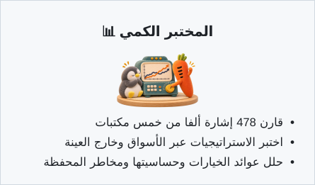

<p align="center">
  <a href="README.md">English</a> | <a href="README_zh.md">中文</a> | <a href="README_ja.md">日本語</a> | <a href="README_ko.md">한국어</a> | <b>العربية</b> | <a href="README_es.md">Español</a> | <a href="README_id.md">Bahasa Indonesia</a>
</p>

<p align="center">
  
</p>

<h1 align="center">Vibe-Trading: وكيل التداول الشخصي الخاص بك</h1>

<p align="center">
  <b>أمر واحد يمنح وكيلك قدرات تداول شاملة</b>
</p>

<p align="center">
  <a href="https://www.star-history.com/HKUDS/Vibe-Trading"></a>
  <a href="https://trendshift.io/repositories/25527"></a>
  <a href="https://www.star-history.com/HKUDS/Vibe-Trading"></a>
</p>

<p align="center">
  <b>ترتيب مستودعات GitHub حسب النجوم داخل كل موضوع</b> · 4 نوفمبر 2026<br>
  <a href="https://github.com/search?q=topic%3Abacktesting&amp;type=repositories&amp;s=stars&amp;o=desc">#1 الاختبار التاريخي</a> &nbsp;·&nbsp;
  <a href="https://github.com/search?q=topic%3Aalgorithmic-trading&amp;type=repositories&amp;s=stars&amp;o=desc">#3 التداول الخوارزمي</a> &nbsp;·&nbsp;
  <a href="https://github.com/search?q=topic%3Aquantitative-finance&amp;type=repositories&amp;s=stars&amp;o=desc">#4 التمويل الكمي</a>
</p>

<p align="center">
  
  
  
  <a href="https://pypi.org/project/vibe-trading-ai/"></a>
  <a href="LICENSE"></a>
  <br>
  <a href="https://github.com/HKUDS/.github/blob/main/profile/README.md"></a>
  <a href="https://github.com/HKUDS/.github/blob/main/profile/README.md"></a>
  <a href="https://discord.gg/6TdQnT5xcF"></a>
</p>

<p align="center">
  <a href="https://vibetrading.wiki/">الموقع</a> &nbsp;&middot;&nbsp;
  <a href="https://vibetrading.wiki/docs/">الوثائق</a> &nbsp;&middot;&nbsp;
  <a href="#-الأخبار">الأخبار</a> &nbsp;&middot;&nbsp;
  <a href="#-الميزات-الرئيسية">الميزات الرئيسية</a> &nbsp;&middot;&nbsp;
  <a href="#الحسابات-والتداول">حساب الظل</a> &nbsp;&middot;&nbsp;
  <a href="#-العروض">العروض</a> &nbsp;&middot;&nbsp;
  <a href="#-البدء-السريع">البدء السريع</a> &nbsp;&middot;&nbsp;
  <a href="#-أمثلة">أمثلة</a> &nbsp;&middot;&nbsp;
  <a href="#-خادم-api">API / MCP</a> &nbsp;&middot;&nbsp;
  <a href="#-خارطة-الطريق">خارطة الطريق</a> &nbsp;&middot;&nbsp;
  <a href="#المساهمون">المساهمون</a>
</p>

<p align="center">
  <a href="#-البدء-السريع"></a>
</p>

## 📰 الأخبار

- **2026-11-12** 🛠️ **إصلاح توقيت الاختبارات الرجعية وأرقام التقارير وتقييم اكتمال البحث** — يستخدم الحساب الظلي رأس المال الابتدائي المحدد، ولا تُعد ردود العامل المبتورة بسبب حد رموز الإخراج مكتملة. يستطيع مدير محفظة اللجنة تلخيص التقارير السابقة الصالحة دون جلب البيانات مجدداً. أصبح الحد الافتراضي للإخراج في محوّل Anthropic الأصلي 16,384 رمزاً مع إمكانية تغييره.
  تُرفض الإزاحات الإضافية المكتشفة في إشارات الخرج للاستراتيجيات المولّدة ما لم يُصرّح بأنها تأخير مقصود، مع السماح بالرجوع إلى الفترات السابقة لحساب المؤشرات. يدعم Grounding صيغ وحدات المقدار المختلفة والتصريح بالقيم المرصودة الدقيقة مع الحفاظ على التحقق من الأدلة. تطابقت الاختبارات الرجعية الفعلية لـ SPY وGLD مع حساب مستقل في جميع عمليات التنفيذ البالغ عددها 206 و140 على الترتيب وفي العائد الإجمالي. **لم يُنشر في إصدار بعد.**

- **2026-11-11** 🧾 **تنفيذ جزئي في التداول التجريبي ومطابقة مستقلة للسجلات** — فعّل اختياريًا حدود حجم التداول لكل أمر، والتنفيذ الجزئي، وإظهار حالات الأوامر في محاكاة أسهم الصين من الفئة A بشموع مدتها خمس دقائق ([#2128](https://github.com/HKUDS/Vibe-Trading/pull/2128)). تتيح أداة Agent/MCP الجديدة `paper_trade_reconcile` مطابقة الرسوم والنقد والمراكز وحسابات صافي قيمة الأصول بصورة مستقلة، انطلاقًا من سجلات التنفيذ المُعادة ([#2197](https://github.com/HKUDS/Vibe-Trading/pull/2197)).
  تُعالَج بصورة صحيحة الأشكال المدعومة من رؤوس أعمدة النسب المئوية الممتدة عبر عدة أسطر، والاقتباسات الصريحة للأعداد الصحيحة في المستندات مع الحفاظ على تسمياتها الأصلية ([#2185](https://github.com/HKUDS/Vibe-Trading/pull/2185)، [#2192](https://github.com/HKUDS/Vibe-Trading/pull/2192)). صُحّحت أيضًا مدخلات التقييم المرجعي الصارم للعوامل ([#2195](https://github.com/HKUDS/Vibe-Trading/pull/2195))، ومُنعت إعادة إجابة سابقة عند انتهاء مهلة دور المحادثة عبر القنوات ([#2194](https://github.com/HKUDS/Vibe-Trading/pull/2194)).
  شكرًا لـ [@shadowinlife](https://github.com/shadowinlife) و[@he-yufeng](https://github.com/he-yufeng) و[@Jackzigen](https://github.com/Jackzigen) و[@divya0795](https://github.com/divya0795)! **متاح في `main` وسيُضمّن في إصدار pip القادم.**

- **2026-11-10** 📊 **أسطح تقلب ضمني تفاعلية وإصلاحات تحليل الخيارات** — حرّر شبكة التقلب الضمني حسب سعر التنفيذ والاستحقاق في Options Lab، مع تمييز القيم المرصودة عن المستوفاة ورفض الاستقراء خارج النطاق ([#2186](https://github.com/HKUDS/Vibe-Trading/pull/2186)).
  أُصلحت القوالب للأصول منخفضة السعر والكميات وتواريخ الاستحقاق وإعادة المحاولة وتعليق التحميل عند تغيير اللغة وحدّ 20 ساقًا. وتستخدم رموز عقود تشنغتشو ذات جزء الاستحقاق المكوّن من ثلاثة أرقام، مثل `CF501`، قواعد العقود الآجلة الصينية في الاختبار التاريخي ([#2193](https://github.com/HKUDS/Vibe-Trading/pull/2193)).
  شكرًا لـ [@he-yufeng](https://github.com/he-yufeng) و[@GPT-AGI](https://github.com/GPT-AGI)! **متاح على `main`، ويُضمّن في إصدار pip القادم.**

- **2026-11-09** 🧭 **تصدير مقارنة النسختين المحددتين، ورفض الرموز غير المعروفة في الاختبار الرجعي** — يمكن تنزيل نسختي البحث اللتين تقارنهما بصيغة JSON أو Markdown من الويب أو API أو CLI ([#2189](https://github.com/HKUDS/Vibe-Trading/pull/2189)). أصبح رمز الاختبار الرجعي الذي لا تتعرف عليه أي قاعدة سوق (مثل `local:BHP.AX` أو `7203.T`) يُرفض قبل جلب أي بيانات بدلًا من تشغيله وفق قواعد أسهم الصين من الفئة A؛ وتبقى الرموز المكوّنة من ستة أرقام فقط ورموز شنغهاي بلاحقة `.SS` مقبولة. لم تعد ردود OpenRouter تعرض اسم النموذج مرتين ([#2191](https://github.com/HKUDS/Vibe-Trading/pull/2191))، وأصبح تمرير معرّف نسخة فارغ إلى `research-artifact export` خطأً. شكرًا لـ [@he-yufeng](https://github.com/he-yufeng) و[@Gloubiboulgator](https://github.com/Gloubiboulgator)! **متاح في `main` وسيُضمّن في إصدار pip القادم.**

<details>
<summary>أخبار سابقة</summary>

- **2026-11-08** 📝 **مقارنة نسخ الأبحاث وتصدير السجل الكامل** — قارن المحتوى والأدلة والبيانات الوصفية بين أي نسختين ([#2168](https://github.com/HKUDS/Vibe-Trading/pull/2168))، وصدّر سجل البحث كاملًا بصيغة JSON أو Markdown ([#2170](https://github.com/HKUDS/Vibe-Trading/pull/2170)). تُتجاهل الردود القديمة عند الانتقال بين سجلات البحث، ويحفظ تصدير Markdown المحتوى الأصلي داخل كتل شيفرة معزولة. صُحّحت أيضًا أوزان العوامل المفقودة، وإسناد الأداء عند غياب بعض العوائد، وعدم كفاية عينات IC، ومدخلات التقييم غير المحدودة عدديًا، وحساب الهامش عند أسعار دخول سالبة. **متاح في `main` وسيُضمّن في إصدار pip القادم.**

- **2026-11-07** 🧪 **مختبر الأبحاث: تكاليف التداول والاختبار خارج العينة** — أعد الاختبار التاريخي ببيانات الأسعار المحفوظة مع تغيير الرسوم والانزلاق السعري. تُختار المعلمات من نتائج التدريب وحدها، ثم تُثبّت للاختبارات خارج العينة ولعينة نهائية محجوزة مستقلة. يستخدم [مختبر الأبحاث](guides/research-lab.md) المسار نفسه عبر Web وCLI وAPI وAgent/MCP، مع دعم لغات الواجهة الإحدى عشرة. صُحّحت أيضًا العوائد المفقودة عند حدود النوافذ وحسابات تهيئة العوامل والنوافذ الطويلة، وأُضيفت 20 حالة لإعادة التحقق من المهام دون اتصال مع إظهار نقص الأدلة بوضوح. ويمكن حفظ حقائق مالية منظّمة في سجلات البحث ذات الإصدارات ([#2164](https://github.com/HKUDS/Vibe-Trading/pull/2164))، كما صُحّح التعرّف على رموز العقود الآجلة الصينية دون لاحقة البورصة ([#2177](https://github.com/HKUDS/Vibe-Trading/pull/2177)). **متاح في `main` وسيُضمّن في إصدار pip القادم.**

- **2026-11-06** 📈 **شبكات التقلب الضمني وإصلاحات التداول التجريبي** — إنشاء شبكات IV حسب سعر التنفيذ ووقت الاستحقاق من بيانات الخيارات المقدّمة، مع تمييز القيم المرصودة عن المستوفاة ورفض الاستقراء خارج نطاق البيانات ([#2172](https://github.com/HKUDS/Vibe-Trading/pull/2172)). تعيد المدخلات العددية المتطرفة نتائج محدودة أو أخطاء واضحة. في محاكاة أسهم A بشموع خمس دقائق، تُلغى فورًا أوامر السوق التي تمنع حدود الأسعار تنفيذها ([#2176](https://github.com/HKUDS/Vibe-Trading/pull/2176))؛ ويعالج المحرك الرموز بترتيب زمني حتى لا تموّل حصيلة بيع لاحق أمر شراء سابقًا. **متاح في `main` وسيُضمّن في إصدار pip القادم؛ تظل طلبات الخمس دقائق المتاحة للمستخدم مقتصرة على رمز واحد لكل خطوة.**

- **2026-11-05** 🚀 **صدور v0.1.19** ([ملاحظات الإصدار](https://github.com/HKUDS/Vibe-Trading/releases/tag/v0.1.19), `pip install -U vibe-trading-ai`): أبحاث تبقى بعد انتهاء المحادثة: احفظ نسخًا مؤرخة من الأبحاث مع أدلتها ونقّحها، وأعد استخدام الاختبارات التاريخية من الأدوار والجلسات السابقة، وعدّل هدف البحث في مكانه. ميزات اختيارية جديدة: محاكاة تجريبية لأسهم A بخطوات خمس دقائق، والاستعلامات المالية وفرز الأسهم عبر Gildata وتشخيص المحافظ عبر Shannon (أُزيل QVeris، ولم يعد وجود `GILDATA_TOKEN` وحده يفعّل أي ميزة). وأيضًا اختبارات تاريخية لسوق الأرجنتين (BYMA)، والبحث في الويب عبر Parallel، واكتشاف النماذج عبر Codex OAuth، وإصلاح التراجعين اللذين ظهرا في 0.1.18. ‏116 طلب سحب مدموجًا، إضافة إلى 21 دخلت عبر إيداعات المشرفين، من 26 مساهمًا ([CHANGELOG](CHANGELOG.md)).
  **إصلاحات اليوم:** يعرض الاختبار التاريخي المؤشر المرجعي الذي قيّمه فعلًا، وتحصل المحافظ الطويلة/القصيرة على فحص المخاطر (risk x-ray)، ويبقى عامل GTJA رقم 17 فارغًا ما دامت مدخلاته في فترة الإحماء، وتتوفر لوحة Shannon بلغات الواجهة الإحدى عشرة، ودخل إصلاحان من المساهمين كانا قد رُوجعا ولم يُدمجا ([#2042](https://github.com/HKUDS/Vibe-Trading/pull/2042) مجاميع TTM التي تمتد عبر ربع سنة مفقود، [#1985](https://github.com/HKUDS/Vibe-Trading/pull/1985) رصد تجزئة الأسهم بنسبة 3:2). شكرًا لـ [@rudycelekli](https://github.com/rudycelekli)، [@he-yufeng](https://github.com/he-yufeng)، [@Jackzigen](https://github.com/Jackzigen)، [@Shizoqua](https://github.com/Shizoqua)، [@cgycorey](https://github.com/cgycorey)، [@dajiaohuang](https://github.com/dajiaohuang)، [@zeus229](https://github.com/zeus229)، [@alexwan02](https://github.com/alexwan02)، [@BHhhh-123](https://github.com/BHhhh-123)، [@remote-controlled-man](https://github.com/remote-controlled-man)، [@shadowinlife](https://github.com/shadowinlife)، [@TWJxi](https://github.com/TWJxi)، [@lishuanghong1989-netizen](https://github.com/lishuanghong1989-netizen)، [@TerryF7](https://github.com/TerryF7)، [@davidalmeida90](https://github.com/davidalmeida90)، [@DrDLyuan](https://github.com/DrDLyuan)، [@goatyyc](https://github.com/goatyyc)، [@hnq-ai](https://github.com/hnq-ai)، [@kadyrbekovhamit-cyber](https://github.com/kadyrbekovhamit-cyber)، [@MetaAviator](https://github.com/MetaAviator)، [@octo-patch](https://github.com/octo-patch)، [@RowanAldean](https://github.com/RowanAldean)، [@VectorPeak](https://github.com/VectorPeak)، [@wavebyrd](https://github.com/wavebyrd) و[@yufengsika](https://github.com/yufengsika)!
  **أُصلح على main بعد الإصدار (يصل في إصدار pip التالي):** يُشترى معيار المقارنة في الاختبار الرجعي الآن عند سعر افتتاح أول شريط مُقيَّم، كما تُنفَّذ الاستراتيجية، بدلًا من آخر سعر إغلاق في فترة الإحماء؛ ولم يعد العائد الزائد يتضمن هذه الحركة (مثال AAPL بمتوسطي 20/60: من 22.5% إلى 18.4%).

- **2026-11-04** 📊 **الاستعلامات المالية وفرز الأسهم عبر Gildata وتشخيص المحافظ عبر Shannon** — يمكن باستعلام واحد عرض أكبر ثلاثة أسهم من حيث القيمة السوقية وإيراداتها نصف السنوية. يعرض Shannon تعرّض المحفظة لعشرة عوامل ومساهمة كل مركز في تقلّباتها. تتطلب كل ميزة من الميزات التسع تفعيلًا منفصلًا حتى مع وجود رمز وصول محفوظ. لا ينتقل النظام إلى Gildata تلقائيًا إذا تعذّر جلب البيانات من المصادر المجانية. [#2117](https://github.com/HKUDS/Vibe-Trading/pull/2117) · [#2118](https://github.com/HKUDS/Vibe-Trading/pull/2118) · [#2119](https://github.com/HKUDS/Vibe-Trading/pull/2119)
  يوضح دليل الاختبار التاريخي أن الإشارة تُنفّذ عند افتتاح الشمعة التالية. كما صُحّح رصد انتهاء مهلة مهام Swarm وتسارع التحقق من تكرار الأبحاث. [#2137](https://github.com/HKUDS/Vibe-Trading/pull/2137) · [#2155](https://github.com/HKUDS/Vibe-Trading/pull/2155) · [#2159](https://github.com/HKUDS/Vibe-Trading/pull/2159)

- **2026-11-03** 🛠️ **سلامة السجلات ودعم اللغات**. تحتفظ سجلات التتبع والتدقيق والبحث في الجلسات بالرمزين U+2028/U+2029 داخل JSONL وتظل الإضافات اللاحقة سليمة. وُحّدت أسماء النماذج ذات الشرطة السفلية وحُفظت خلاصات التسليم في مرحلة الضغط الثانية. أضيف دعم ترويسات BOM وضُبطت محاذاة شاشة الترحيب للغات من اليمين إلى اليسار مع اختبارات لمنع التراجع.

- **2026-11-02** 🛠️ **البيانات الوصفية وعرض النتائج**. تُقرأ القيم المفردة المحاطة بعلامات اقتباس بصورة صحيحة وتُعرض نسخة مختصرة مقروءة إذا تعذر ترميز نتيجة كبيرة. حُسّن ترتيب شاشة الترحيب والبطاقات المميزة وأضيفت اختبارات.

- **2026-11-01** 🛠️ **توقيت الجلسة والتباين والأمثلة**. تُسجل تحديثات الجلسة بتوقيت UTC وتظهر الأزرار الأساسية بوضوح في الوضع الداكن. أصبحت أمثلة اللوحة الجانبية قابلة للنقر ولها تصنيفات واضحة مع اختبارات لمنع التراجع.

- **2026-10-31** 🛠️ **الترحيب وتحليل الرموز**. اعتُمد تصميم بعمودين وألوان ورقية دافئة لتمييز الأمثلة والإجراءات. لم تعد الأحرف في نهاية رمز السهم تُفسر على أنها قيود للأسهم الصينية A أو A/H.

[أرشيف الأخبار](guides/news.md) · [سجل التغييرات](CHANGELOG.md)

</details>

## ✨ الميزات الرئيسية

<div align="center">
<a href="assets/features/ar/feature-market-research-card.svg"></a><a href="assets/features/ar/feature-research-teams-card.svg"></a><br/>
<a href="assets/features/ar/feature-quant-lab-card.svg"></a><a href="assets/features/ar/feature-trading-portfolio-card.svg"></a>
</div>

## 💡 ما هو Vibe-Trading؟

حوّل الأسئلة المالية إلى تقارير بحث واختبارات تاريخية قابلة للتنفيذ ومحافظ تجريبية. يمكنك تفويض وسيط مدعوم بالتداول ضمن حدود تضعها وإيقافه في أي وقت. تبقى أموالك لدى الوسيط.

## ✨ ما الذي يمكنك فعله؟

| المهمة | من أين تبدأ |
|---|---|
| دراسة السوق أو الإفصاحات | اسأل في محادثة الويب أو [أرفق تقريرا](guides/research.md#upload--analyze-documents). |
| اختبار استراتيجية أو عامل | راجع الرسوم والصفقات في Run Detail أو قارن العوامل في `/alpha-zoo`. |
| المحاكاة ومراجعة التداول | تابع التنفيذ اليومي وصافي الأصول في `/paper-trading` وراجع صفقاتك عبر `/journal` و`/shadow` في الطرفية. |
| جمع الحسابات ومقارنة التوزيع | افتح `/portfolio` للاطلاع على المراكز والتغييرات المقترحة. [دعم الوسطاء](#دعم-الوسطاء) |
| الخيارات والارتباطات | استخدم `/options` لعوائد المراكز متعددة الأطراف وحساسيتها، أو `/correlation` لدراسة أحوال السوق. |
| تنسيق البحث وتكراره | شغّل [فريق Swarm](guides/research.md#swarm-workflows) أو وزع المهام في Pixel Office أو جدول تقريرا في `/scheduled`. |
| مراجعة الأدلة السابقة | ابحث في `/research-artifacts` عن [نسخ الأبحاث المؤرخة](guides/research.md#versioned-research-artifacts)، وقارن بين أي نسختين، وصدّر السلسلة الكاملة أو المقارنة المحددة بصيغة JSON أو Markdown. |

## ⚡ مثال سريع

بعد تشغيل `vibe-trading init` يمكنك طلب اختبار تاريخي بلغتك أو تقييم مكتبة عوامل من الطرفية.

```bash
vibe-trading run -p "اختبر تقاطع المتوسطين المتحركين لفترتي 20 و50 لزوج BTC-USDT في 2024. قارن النتيجة بالشراء والاحتفاظ واذكر أقصى تراجع."
vibe-trading alpha bench --zoo gtja191 --universe csi300 --period 2018-2025 --top 20
```

افتح **Run Detail** للمقارنة بالشراء والاحتفاظ وفحص الصفقات أثناء التراجع ومصدر البيانات في بطاقة التشغيل.

## 🧪 مسار البحث

| الخطوة | مثال تقاطع المتوسطين |
|---|---|
| التخطيط | حدد الزوج والفترة والمتوسطين والمعيار المرجعي من السؤال. |
| البيانات | اجلب شموع BTC-USDT التاريخية وتحقق من مصدرها وتواريخها. |
| التنفيذ | اكتب الاستراتيجية واختبرها. يحفظ مجلد التشغيل الاستراتيجية والصفقات ومنحنى رأس المال. |
| التحقق | قارن بالشراء والاحتفاظ وراجع معدل الدوران والتراجع وتنبيهات التحقق إلى جانب العائد. |
| المراجعة | افتح تشغيلا محفوظا أو غيّر المعلمات. يمكنك أيضًا حفظ استنتاج بتاريخ محدد وتنقيحه عند ظهور أدلة جديدة. |

## 📡 مصادر البيانات والانتقال التلقائي

يدعم المحمّل **28 مصدرا لبيانات السوق**. عند تحديد `source: "auto"` يستنتج السوق من الرمز ويجرب المصادر بالترتيب المضبوط.

| السوق | ترتيب المصادر |
|---|---|
| الأسهم الصينية A وهونغ كونغ | يبدأ بـ Tencent ثم يجرب Eastmoney وبقية مصادر السوق إذا تعذر جلب الشموع. |
| الأسهم الأمريكية | يبدأ بـ Yahoo ثم Stooq ثم Sina. |
| العملات الرقمية | يجرب OKX ثم Binance ثم CCXT قبل المصادر الأخرى. |
| العقود الآجلة | للعقود الصينية استخدم AKShare أو شموعا محلية. للعقود العالمية وفر بيانات محلية. |

يمكنك اختيار المصدر مباشرة. أضف `vibe-trading-ai[ashare]` لجلب بيانات الأسهم الصينية A اليومية من BaoStock دون رمز دخول. يوضح [دليل المصادر](guides/capabilities.md#-data-sources--smart-fallback) الترتيب ومتطلبات الاعتماد.

## 🔩 تفاصيل الميزات

### أبحاث السوق

| الميزة | الاستخدام |
|---|---|
| الإفصاحات والمراكز | قارن إفصاحات المدير الفصلية لدى SEC في النموذج 13F أو افحص الأصول التي يحملها صندوق ETF. يبين كل تقرير تاريخ المراكز. |
| تقييم الشركات | اختبر أثر معدل الخصم والنمو النهائي عبر `/dcf` وقارن مضاعفات النظراء عبر `/comps` أو صدّر نموذجا يربط القوائم المالية الثلاث إلى Excel. |
| الأوراق والوثائق | ابحث عن إشارة في arXiv وOpenAlex وتحقق من تعريف المؤلفين ثم اختبرها على أصولك. ارفع إفصاحا أو جدولا أو عرضا واسأل عن شكل بعينه. |
| فرز الأسهم | عند تفعيل Gildata يمكنك الفرز بالقيمة السوقية وجلب إيرادات نصف السنة بطلب واحد. للفرز وتشخيص عوامل المحفظة إعدادان مستقلان. |

### البحث الكمي

| الميزة | الاستخدام |
|---|---|
| مكتبة ألفا | قيّم إشارات Qlib وAlpha101 وGTJA والمكتبتين الأكاديمية والأساسية. قارن معاملات المعلومات حسب الأفق ثم اختبر بنوافذ زمنية متعاقبة. |
| محركات الاختبار | حاك حدود أسعار الأسهم الصينية ورسوم تمويل العملات الرقمية وهوامش العقود الآجلة. شارك رأس المال بين الأسواق وراجع كل تنفيذ. |
| مختبر الخيارات | ابن فروق الخيارات طرفا تلو الآخر وقارن العائد عند الاستحقاق والحساسيات وأثر تغير السعر الفوري والتقلب الضمني. |
| مخاطر المحفظة | راجع التراجعات والقيمة المعرضة للخطر والخسارة المتوقعة في الذيل. افصل أثر التوزيع عن اختيار الأسهم بطريقة Brinson وتابع ارتباط الأسواق. |
| تتبع الاستراتيجيات | سجل الاستراتيجية وأدلتها وتابع تغير نسبة شارب أو معامل معلومات العامل مع ورود نتائج جديدة. |

### الحسابات والتداول

| الميزة | الاستخدام |
|---|---|
| المحفظة | اجمع مراكز حسابات القراءة فقط في لقطة واحدة أو استورد ملف extraETF. أدخل الأوزان المستهدفة لمعاينة تغير قيمة كل مركز. |
| التداول التجريبي | قدّم الحساب المحفوظ يوم تداول واحدا وراجع التنفيذ والنقد وصافي الأصول. ويمكنك أيضًا إعادة تشغيل جلسة لأسهم A بخطوات خمس دقائق في محاكاة منفصلة. تتحقق أداة `paper_trade_reconcile` عبر الوكيل/MCP بشكل مستقل من الرسوم والنقد والمراكز وحساب NAV دون الوصول إلى السوق أو الوسيط. |
| حساب الظل | استورد سجل الوسيط وافحص الرسوم وعادات التداول وقارن الصفقات الفعلية بإعادة تشغيل تستند إلى قواعد. |
| ربط الوسطاء | اضبط الاتصال من الويب أو الطرفية واختبره بطلب قراءة. حدد الرموز وحجم الأوامر والتعرض قبل تفعيل التداول الفعلي. يتيح مفتاح الإيقاف وقف النشاط. |

### الفرق والأبحاث الدورية

| الميزة | الاستخدام |
|---|---|
| Swarm وPixel Office | شغّل لجنة استثمار تجمع رأيي الصعود والهبوط أو فريق بحث كمي واقرأ تقارير الأعضاء. وزع المهام وسجل النتائج على اللوحة المشتركة في Pixel Office. |
| الموجزات الدورية | اختر موجز ما قبل الافتتاح أو متابعة الأرباح أو فحص المحفظة واضبط وقت الإرسال إلى Slack أو Telegram أو البريد المهيأ. |
| سجل البحث | ابحث في الجلسات السابقة وافتح تشغيلا محفوظا. احفظ الخلاصة وأدلتها بتاريخها وقارن النسخ عند تغير فرضية الاستثمار. |
| سجل التشغيل | راجع مصدر البيانات والنموذج وسجل التنفيذ ومراجع المقاييس، ثم افتح الصفقات ومنحنى رأس المال للتحقق من الأرقام. |

### دعم الوسطاء

<details>
<summary>قارن القراءة والتداول التجريبي والفعلي</summary>

القراءة تعني ملفا مخصصا للقراءة فقط. يستخدم التداول التجريبي بيئة الوسيط الاختبارية أو محاكاة محلية. يتطلب التداول الفعلي تفويضا بحدود. ✓ تعني دعما معلنا و— تعني غياب ملف مطابق.

<!-- BEGIN GENERATED broker-overview -->

| الوسيط | قراءة | تجريبي | فعلي |
| --- | :---: | :---: | :---: |
| alpaca | ✓ | ✓ | ✓ |
| binance | ✓ | ✓ | ✓ |
| dhan | ✓ | ✓ | — |
| etoro | ✓ | ✓ | ✓ |
| futu | ✓ | ✓ | ✓ |
| ibkr | ✓ | — | — |
| kis | ✓ | ✓ | — |
| longbridge | ✓ | ✓ | — |
| mstock | ✓ | — | — |
| mt5 | ✓ | ✓ | ✓ |
| okx | ✓ | ✓ | ✓ |
| robinhood | ✓ | — | ✓ |
| scalable | ✓ | — | — |
| shoonya | ✓ | ✓ | — |
| tiger | ✓ | ✓ | ✓ |
| toss | ✓ | — | — |
| trading212 | ✓ | — | — |
| upbit | ✓ | ✓ | — |
| zerodha | ✓ | ✓ | — |

<!-- END GENERATED broker-overview -->

</details>

[الصلاحيات الكاملة لكل ملف](guides/portfolio-and-brokers.md#full-broker-permissions)

## 🎬 العروض

<table>
<tr><th width="50%">الويب · من السؤال إلى الاختبار</th><th width="50%">CLI · الطرفية التفاعلية</th></tr>
<tr>
<td width="50%" valign="top">

https://github.com/user-attachments/assets/2c595ee1-c577-481a-9460-34ea12bcf41c

</td>
<td width="50%" valign="top">

https://github.com/user-attachments/assets/ac79426e-f3f7-4349-b0d5-d997a2725784

</td>
</tr>
<tr><td>أرسل طلب الاستراتيجية وتابع العمل وافحص نتيجة الاختبار.</td><td>تصفّح قوالب الأبحاث في الطرفية وافتح قالب موجز ما قبل الافتتاح.</td></tr>
</table>

## 🚀 البدء السريع

ثبّت الحزمة باستخدام Python 3.11 أو أحدث، واختر مزود النموذج في معالج الإعداد ثم افتح الطرفية التفاعلية.

```bash
pip install vibe-trading-ai
vibe-trading init
vibe-trading
```

يشغّل Docker الواجهة وAPI معا على `http://localhost:8899`. بعد نسخ المستودع اضبط المزود قبل تشغيل الحاوية.

```bash
git clone https://github.com/HKUDS/Vibe-Trading.git
cd Vibe-Trading
cp agent/.env.example agent/.env
# اضبط المزود ومفتاح API في agent/.env.
docker compose up --build
```

تتضمن حزمة PyPI سطر الأوامر وAPI وخادم MCP. لإعداد بيئة تطوير الواجهة أو نموذج محلي راجع [دليل التثبيت](guides/installation.md).

## 🖥 دليل سطر الأوامر

شغّل `vibe-trading` لفتح الطرفية واكتب `/help` لعرض الأوامر.

| الأمر | الغرض |
|---|---|
| `/model` | تبديل المزود أو النموذج للجلسة. |
| `/history` | استعراض محادثة سابقة واستئنافها. |
| `/show <run-id>` | فحص نتائج تشغيل محفوظ. |
| `/pine` | تصدير الاستراتيجية كمؤشر Pine Script. |

يعرض `vibe-trading alpha list` مكتبات العوامل، ويعرض `vibe-trading playbook list` قوالب البحث الدوري.

## 💡 أمثلة

- قارن AAPL وMSFT في 2024. في أي شهر كان الفرق في العائد أكبر؟ استأنف النقاش لاحقا عبر `/history`.
- حلل سجل التداول المصدّر عبر `/journal` وقارن صفقاتك ببديل مبني على قواعد عبر `/shadow`.
- اختر سهما وتابع حجج الصعود والهبوط حتى صدور تقرير اللجنة.

```bash
vibe-trading --swarm-run investment_committee '{"target":"TSLA","market":"US"}'
```

## 🌐 خادم API

شغّل `vibe-trading serve --port 8899`. في طرفية أخرى اعرض القائمة عبر `curl http://localhost:8899/runs` ثم استخدم المعرّف مع `GET /runs/{run_id}` للاطلاع على النتيجة.

| جلسة بحث عبر HTTP | المسار |
|---|---|
| إنشاء المحادثة | `POST /sessions` |
| إرسال السؤال | `POST /sessions/{id}/messages` |
| متابعة التقدم مباشرة | `GET /sessions/{id}/events` |

جرّب المسارات على `http://localhost:8899/docs`. ترسل [التطبيقات التي تتطلب المصادقة](guides/cli-and-api.md#security-defaults) المفتاح في ترويسة `Authorization: Bearer`.

## 🔌 إضافة MCP

تستطيع تطبيقات MCP تشغيل الحزمة نفسها عبر stdio. أضف الإعداد التالي إلى `claude_desktop_config.json` في Claude Desktop، ثم أعد تشغيله واستدعِ `list_skills`.

```json
{
  "mcpServers": {
    "vibe-trading": { "command": "vibe-trading-mcp" }
  }
}
```

للعملاء الآخرين أو لتخصيص مجلد المخرجات راجع [إعدادات MCP](guides/mcp.md).

## 🏛 المنظومة

Vibe-Trading جزء من نظام وكلاء **[HKUDS](https://github.com/HKUDS)**:

<table>
  <tr>
    <td align="center" width="20%">
      <a href="https://github.com/HKUDS/nanobot"><b>NanoBot</b></a><br>
      <sub>Ultra-Lightweight Personal AI Assistant</sub>
    </td>
    <td align="center" width="20%">
      <a href="https://github.com/HKUDS/AI-Trader"><b>AI-Trader</b></a><br>
      <sub>Agent-Native Signal &amp; Copy Trading Platform</sub>
    </td>
    <td align="center" width="20%">
      <a href="https://github.com/HKUDS/CLI-Anything"><b>CLI-Anything</b></a><br>
      <sub>Making All Software Agent-Native</sub>
    </td>
    <td align="center" width="20%">
      <a href="https://github.com/HKUDS/OpenSpace"><b>OpenSpace</b></a><br>
      <sub>Self-Evolving AI Agent Skills</sub>
    </td>
    <td align="center" width="20%">
      <a href="https://github.com/HKUDS/ClawTeam"><b>ClawTeam</b></a><br>
      <sub>Agent Swarm Intelligence</sub>
    </td>
  </tr></table>

---

## 🗺 خارطة الطريق

| المجال | متاح الآن | التالي |
|---|---|---|
| التداول التجريبي | تحتفظ الحسابات اليومية بالنقد والصفقات وصافي الأصول بين الجلسات. وتعيد محاكاة منفصلة تشغيل جلسة أسهم A بخطوات خمس دقائق. | مطابقة اختيارية بحسب حصة حجم التداول ([#2128](https://github.com/HKUDS/Vibe-Trading/pull/2128)، مسودة). |
| البحث | تسجل بطاقات التشغيل المقاييس والأدلة لكل اختبار. وتحتفظ الأبحاث المؤرخة بسجل مراجعاتها ويمكن البحث فيها. | بيانات مالية منظَّمة داخل الأبحاث المحفوظة ([#2164](https://github.com/HKUDS/Vibe-Trading/pull/2164)، قيد المراجعة). |
| مختبر الخيارات | عوائد متعددة الأطراف وحساسيات وسيناريوهات السعر الفوري والتقلب الضمني. | شبكة تفاعلية لسطح التقلب الضمني في `/options`. |

## كيفية المساهمة

اختر [مهمة مناسبة للمبتدئين](https://github.com/HKUDS/Vibe-Trading/issues?q=is%3Aissue+is%3Aopen+label%3A%22good+first+issue%22) أو افتح نقاشا قبل التغييرات الكبيرة. يغطي [دليل المساهمة](CONTRIBUTING.md) الإعداد المحلي والفحوص قبل فتح طلب دمج.

## المساهمون

شكراً لكل من ساهم في Vibe-Trading!

### v0.1.19 · المساهمون

- @rudycelekli — 58 PRs (12 landed as maintainer ports): GTJA alpha formulas restored to the report (#2036/#2037/#2038/#2039/#2040/#2051), loaders that ask each vendor for the ticker form it serves and page at its own cap (Alpha Vantage #1997, AKShare #1998, CCXT #1999, Tushare minute lots #2001, Tiingo/Stooq class shares #2010/#2012, Nobitex Tehran days #1989, push2 decimals #1988), futures and market fees (micro index price limits #1992, the 30-year treasury fee #1994, India stamp duty on short covers #1995), quant-library and governance fixes (#1950/#1959/#1960/#1962/#1963/#2000/#2017), sub-penny prices kept in trades and charts (#1987/#1990), TTM sums that stop at a missing quarter (#2042), 3:2 splits and ST board limits in paper trading (#1985/#1984), a live halt key that cannot alias the global halt (#2003), session, memory, CLI and API fixes (#1969/#1970/#1982/#2002/#2006), and a string-"false" sweep across ten tools (#1976/#1977/#2008/#2009/#2011/#2013/#2014/#2015/#2016/#2018)
- @he-yufeng — 18 PRs (5 landed as ports): versioned research artifacts (#2079/#2159), background tasks scoped to their owner, reaped on cancel and reconciled after a restart (#2092/#2098/#2100/#2157), silent provider streams interrupted (#2099), cache and reasoning tokens kept in `llm_usage` (#2109), one tool policy across providers (#2087), Claude CLI tool-attempt recovery and structured finals (#2048/#2064/#2120), Qlib BETA/RESI/ROC/CORD semantics (#2062/#2069), magnitude suffixes in derived formulas (#2134), long/short risk x-ray and validation that refuses non-positive equity (#2162/#2161), and Unicode-safe swarm heartbeats (#2155)
- @Jackzigen — the bar-agnostic paper order lifecycle (#2066), swarm runs that stop when cancelled from the chat (#2059/#2060), document figures and percentage points in grounding (#2058/#2108), Robinhood portfolio reads with account selection (#2054), Moonshot reasoning effort for kimi-k3.1-pro (#2043), and Eastmoney JSONP, AKShare 1.20 forex and bare US ETF symbol fixes (#2082/#2083/#2086)
- @Shizoqua — research goals edited in place (#2093), Feishu, Teams, WeChat, WhatsApp and Discord channel fixes (#1957/#1958/#1967/#2078/#2114), heredoc commands in the bash tool (#2077), path-escape tests (#2094), and a run-directory fallback that no longer depends on the process cwd (#2116, landed as a port)
- @cgycorey — global futures priced on real contract multipliers and micro rates, with generic defaults reported (#1965/#1966/#1968/#1972), and a shadow account that honours every entry condition and currency (#2073/#2075)
- @dajiaohuang — transfer flow signs (#2023), aligned attribution benchmarks (#2044), overflow-free weight normalisation (#2046), and boolean payoff quantities refused (#2049)
- @zeus229 — the BYMA engine for Argentine shares and CEDEARs (#2071), backtests reused across turns and sessions (#2074), Codex OAuth model discovery (#2080), and financial units kept in grounding evidence (#2072)
- @alexwan02 — Longbridge per-currency cash (#1940), `.env` read by the MCP server (#1974), and Futu US symbol mapping (#2076)
- @BHhhh-123 — cross-sectional factor combination with walk-forward weights (#1953), field-level data availability in alpha bench (#2057), and factor research provenance (#2067)
- @remote-controlled-man — comma-grouped document integers (#2135), one bounded retry for a withheld final answer (#2136), and A-share source setup docs (#2138)
- @shadowinlife — the opt-in five-minute A-share paper step and its bar-by-bar matching (#2110/#2111), and JoinQuant limit fills (#2127, landed as a port)
- @TWJxi and @lishuanghong1989-netizen — Gildata stock discovery and financial queries (#2117), stock screening with report-period indicators (#2118), and Shannon portfolio style and risk analysis (#2119)
- @TerryF7 — IBKR and Futu gateway endpoints per connection (#1983), and connection deletion without a credential vault (#2153, landed as a port)
- @davidalmeida90 — the next-bar signal delay documented in the strategy skill (#2137)
- @DrDLyuan — STAR Market and Beijing buys sized on their own order grid (#2105)
- @goatyyc — Binance HTTP 451 read failures explained (#1937)
- @hnq-ai — a crawlable documentation wiki (#2165, landed as a port)
- @kadyrbekovhamit-cyber — Heston prices for short expiries (#2140)
- @MetaAviator — invalid journal quantities refused (#2052)
- @octo-patch — MiniMax M3.1 Flash as the default MiniMax model (#1936)
- @RowanAldean — optional Parallel search in `web_search` (#2113)
- @VectorPeak — voice notes forwarded in four IM adapters (#2106)
- @wavebyrd — Yahoo three-letter `=X` forex symbols read as USD pairs (#1980)
- @yufengsika — non-finite and boolean inputs refused by financial rigor checks (#2053)

<details>
<summary>مساهمو دورتي v0.1.17 وv0.1.18</summary>

**v0.1.18** · @warren618 (Haozhe Wu) أضاف تحميل تعريفات الأدوات عند الطلب وحفظ نتائج البحث الكبيرة في ملفات التشغيل وصحح احتساب الاستخدام عند انقطاع استدعاء النموذج.

- @rudycelekli — a 92-PR correctness sweep (13 of them landed as maintainer ports): quant-library guards and edge cases (implied-vol price tolerance #1657, gaps in VaR breach transitions #1658, Heston inputs #1719, scheduled CDS coupons #1716, Carino coincidence #1943, undefined probabilistic-Sharpe and bond-accrual inputs #1821/#1822), missing prices kept out of risk x-ray return pairs and OU lag pairs (#1717/#1713), an undefined three-scenario upside and unbounded journal ratios reported as such (#1921/#1884), document reading that keeps PDF text, Word order, PowerPoint groups and Excel missing-value markers (#1838/#1839/#1840/#1841), session search limits, locking and snippets (#1827/#1828/#1832/#1834), more secret formats redacted (#1874/#1880), A-share board limits and Beijing codes (#1913/#1914), standalone revalidation and attribution on the run's own annualisation (#1915/#1948), and settings the selected engine ignores now warned about (#1947)
- @Shizoqua — 25 PRs (2 landed as ports): memory and cross-session search that read back clean and match non-English text (#1682/#1686/#1697/#1771/#1772), skill headings and saved skill names resolved consistently (#1797/#1858), Telegram and Matrix replies no longer dropped when the stream preview never sent and one WeCom stream id per reply (#1860/#1903/#1929), SSE events no longer double-delivered on reconnect (#1798), parallel CLI tool results paired with their own call (#1859), goal evidence confined to the claimed run (#1895), Carhart momentum no longer leaking today's price (#1578), Wilder RSI in the shadow account (#1457), direct-SDK positions priced from `current_price`/`ltp`/`market_val` (#1581), the email SPF/DKIM spoofing check (#1508), and swarm artifacts cleared before each fresh task (#1455)
- @he-yufeng — 24 PRs (2 landed as ports): the declared grounding-check registry and the fired checks recorded in the validation artifact (#1628/#1691/#1661), corrections that keep the figures already passed (#1702), percent-named evidence read as points in derived checks (#1823), additive A-share qfq converted to multiplicative when the offsets validate (#1551), mootdx retired from the default A-share chain and the health canary (#1730), the channel-authoring contract (#1630), the compaction-helper split out of `loop.py` (#1631), the first bar's result counted against initial capital in the options engine and per-bar returns (#1750/#1844), config keys nothing reads warned about (#1935), the US early-bell close on half-days (#1706), and the ReportLab fallback for Shadow Account PDFs (#1683)
- @shadowinlife — 19 PRs (5 landed as ports): daily paper trading with saved accounts across CLI, API and Web (#1939), the shared scheduler kernel adopted by the research, back-office and live loops (#1893/#1899), token usage in Run Detail, chat and swarm (#1890), `read_run_artifact` and a structured backtest tool summary (#1647/#1646), `get_southbound_flow` and a northbound flow that no longer serves a silent empty envelope (#1486/#1484), guided Web UI setup for Feishu, Slack and Discord with runtime errors surfaced in channel status (#1572/#1764/#1777/#1738/#1737), and thirteen fundamental and valuation factors, industry-neutral A-share value alphas and a monthly-horizon IC bench (#1787/#1788/#1802/#1801)
- @zeus229 — 18 PRs (4 landed as ports): grounding that fails closed on unresolved derived refs and suggests exact refs (#1835/#1837/#1638), parses complete derived formulas after labels (#1728), keeps identity in ticker-keyed metrics and blank-corner matrices (#1851/#1850) and leaves execution metadata out of numeric evidence (#1767); rich Email scheduled reports with optional PDF password protection (#1680/#1709), channel-aware scheduled-run editing (#1649), reproducible indicator reads and pinned portfolio snapshots (#1768/#1769), redundant MCP payload copies removed before agent context (#1634), and goal tool-call provenance (#1688)
- @alexwan02 — 16 PRs (4 landed as ports): the `claude-cli` provider backed by a local `claude -p` (#1804), Hong Kong orders sized on each symbol's own board lot (#1813), the Longbridge SDK config built through `from_apikey` (#1805), Futu multi-currency balances with average-cost basis (#1814), SDM registration that keeps its trading rules and records bench history for decay monitoring (#1848/#1849), a lightweight run preview built off the event loop (#1853), run trades listed newest first from the full trades.csv (#1865), trades.csv entry rows, offline benchmarks and Brinson weights fixed (#1780/#1781/#1782), and runtime connectors ordered by status (#1845)
- @Jackzigen — 13 PRs (2 landed as ports): the first `loop.py` extractions for tool-result helpers, run outcome and tuning (#1636/#1641/#1678), a byte-stable system prompt for prefix caching (#1708), after-close SEC filings kept out of the IC until the next bar (#1794), a free BaoStock fallback for `val:*` panels (#1799), undefined correlation pairs published as null instead of 0.0 (#1933), journal PnL pooled per settlement currency (#1811), `BASE-USDT-PERP` routed to the crypto market (#1864), the mStock read-only profile (#1675), and the shared OHLCV contract assertion in per-loader suites (#1725)
- @cgycorey — 12 PRs (3 landed as ports): only the engine's own output grounds a backtest report (#1685), adjusted and raw prices never mixed in one series (#1684), a stooq challenge latch that stops probing and sees every refusal (#1637/#1640), a loader health lane that says why a source is empty and keeps labelled credentials out (#1643/#1698), `get_macro_series` reporting when it caps a series (#1676), env-style credential names, URL userinfo and Basic auth redacted (#1765/#1742/#1744/#1846), and suffixed HK codes normalized for the duplicate-asset guard (#1746)
- @MetaAviator — 12 PRs (2 landed as ports): full-sample downside deviation for Sortino in the metrics and options engines (#1693/#1727), initial capital in Monte Carlo path metrics (#1664), missing equity kept out of adjacent validation returns (#1754), standalone revalidation that honours saved settings and entry dates (#1815/#1842), break-even exits and zero-bar trades kept in trade artifacts and holding periods (#1779/#1876), and trade-journal fixes for reversal fees, split date/time columns, equal timestamps and invalid dates (#1891/#1900/#1941/#1942)
- @lorenzozanee — unsupported Robinhood option orders gated before the broker (#1585), run cards that flag backtests possibly inside the model's training data (#1618), and option evidence in the broker bring-up checklist (#1770)
- @Mikesad — LLM usage accounting extracted from `loop.py` (#1662), swarm presets that take their variables from the prompt (#1674, landed as a port), and the factor registry suite running without symlink privileges (#1696)
- @remote-controlled-man — options legs priced on the run's bar cadence (#1753), the Futu journal format claimed only when its value columns exist (#1766), and three-statement balance tolerance threaded into projected periods (#1786, landed as a port)
- @Romzhou — a kill-switch sweep that fails closed on its own bookkeeping and input (#1703), and a runner driver kept alive for the scheduler's lifetime (#1704)
- @sambazhu — three Gildata research tools with off-exchange fund NAV (#1485), and an env-configurable ReAct iteration cap (#1833)
- @wavebyrd — spread and swap rates for Yahoo `=X` forex pairs (#1930), and per-cent multipliers for ICE coffee, sugar and cotton (#1944)
- @BHhhh-123 — factor neutralisation and PCA in the quant library (#1817, landed as a port)
- @Bortlesboat — Calmar kept finite on explosive equity paths (#1901)
- @bygordon130-hub — Pixel Office, a shared manual research-task board, and the Turkish locale (#1616)
- @davidalmeida90 — profit factor reported as undefined when no trade lost (#1602)
- @DrDLyuan — the equity.csv drawdown peak seeded with initial capital (#1818)
- @Emad211 — per-channel configuration, custom providers and the Persian locale (#1264)
- @Frank-zhu2000 — Futu profiles no longer pinning the HK trade market (#1812)
- @goatyyc — Binance balances that survive clock skew, with unpriced assets marking the snapshot incomplete (#1505)
- @hunters1011-ctrl — symlink tests skipped where symlinks are unavailable (#1803)
- @incorpore — Brazil (B3) market data and an opt-in ZimaOS template (#1783, landed as a port)
- @mdb1230 — five example options strategies and a candidate study of which to paper-trade (#1774)
- @mminkus — the interactive message cap raised to match the scheduled-run path (#1701)
- @passionbull — KIS reads that see SOR fills and recover from a server-invalidated token (#1726)
- @rwxyx518-prog — the Portfolio page's holdings table and history chart following the display currency (#1810)
- @ThreeTima — currency identity checked in financial figure grounding (#1905)
- @tomaszkubiak-courses — strategy provenance model fields set on the loop, so writing a strategy file no longer raises `AttributeError` (#1673)
- @xaritoku — dotenv loaded in the `alpha bench` / `alpha compare` CLI handlers (#1806)

</details>

<details>
<summary>مساهمو دورة v0.1.16</summary>

- @Shizoqua — a 55-PR correctness sweep (one landed as a port) across nearly every layer: quant-library fixes and input guards (Patell z degrees of freedom #1449, copula ties #1453, Kyle's lambda intercept #1477, HRP labels #1555, non-finite impact and yield-curve inputs #1557/#1558), Alpha Zoo NaN propagation and formula fixes (gtja191_038 #1523, alpha101_074 #1534, qlib158 WVMA #1594, GTJA HIGHDAY/LOWDAY #1604), backtest sizing for negative futures prices and shorts (#1547/#1548), venue bars per year in Monte Carlo validation (#1546), options annual return over elapsed bars (#1458), memory, swarm-store and session robustness (#1450/#1525/#1545/#1536/#1579), DingTalk, Signal, Slack and Discord channel fixes (#1506/#1478/#1524/#1537), Argentina listing identity in grounding (#1575), and a mandate narrowed to zero exposure stored as zero (#1593)
- @zeus229 — grounding that reads locale decimals and grouped numbers with precision-aware rounding (#1517/#1588), resolves explicit symbols and exact field refs from observed evidence (#1584/#1586), preserves `latest_date` timestamps (#1590) and keeps corrections text-only (#1600); Argentina (`.BA`) market data through Yahoo (#1543), ISO-4217 portfolio currencies with isolated FX failures (#1510), explicit header names compared case-insensitively (#1568), technical-indicator volume statistics and their replay after compaction (#1571/#1601), and bounded read-only replay after compaction (#1488)
- @cgycorey — a read-only extraETF export reader (#1406) and the read-only Scalable Capital MCP connector (#1417), run cards that keep non-scalar metrics (#1424), the backtest tool naming the directory it looked in (#1429), a tool-declared swarm `run_dir` confined to the workspace and worker message logs persisted on every terminal path (#1430/#1439), qlib158 CNTP/CNTN/CNTD NaN propagation (#1459), custom zoo roots that no longer replace the bundled module (#1468), `get_shareholder_count` answering again (#1490), Tencent's A-share and HK calibers stamped correctly (#1497)
- @shadowinlife — IM channels configured from the Web UI, with QQ, Email and WebSocket guided setups (#1520/#1529/#1544), stdlib logging placeholders across 12 channel adapters (#1533), Tencent history paginated backward from the end of the window (#1411), `state.json` written by the backtest tool so tool-driven runs are ingestible (#1413), per-worker swarm skill allowlists (#1414), the `1M` interval no longer folding to one minute (#1487), and welcome quick actions with a real selected state (#1500)
- @he-yufeng — tail-risk measure and confidence kept through the grounding gate (#1444), full history in the risk x-ray instead of sampled rows (#1462), shareholder-count history from the per-period report (#1518), backtests attaching to a running MT5 terminal without credentials (#1598), a per-read BaoStock socket deadline (#1615), the weekly live-source health canary (#1627), the broker capability matrix generated into the README (#1629), and the channel `stop_all` and WebSocket logger fixes carried over from #1521
- @lorenzozanee — dragon-tiger seat reports and lockup expiry data restored (#1512/#1513), malformed Robinhood buying power rejected (#1526), broker-only MT5 symbols resolved in `search_symbol` (#1597), hash-only traces and citations on run cards (#1612), expired Copilot CLI tokens refreshed (#1619), and Telegram polling ownership documented (#1583)
- @chiww — the Stooq warning naming the override variable the config layer reads (#1402), A-shares routed by market for sources without a dedicated branch (#1431), the declared interval checked against the served bars before annualising (#1432), and `_NO_NETWORK_FALLBACK_SOURCES` honoured for per-symbol gaps (#1441)
- @as950118 — three Korean broker connectors: KIS with separate paper and live hosts (#1407), Upbit capped at paper plus read-only (#1408), and read-only Toss Securities (#1409)
- @0xouzm — SDM decay metrics that treat NaN and infinite bench results as missing (#1447)
- @alanwilhelm — synchronized cold loader-registry initialization, so concurrent first lookups no longer see an empty registry (#1405)
- @modelpath-dev — the description-driven strategy-store adaptation substrate (#1391)
- @sambazhu — the Gildata A-share OHLCV loader over its raw-api MCP endpoint (#1474)
- @tingkk — broker-neutral SDK diagnostics across all locales (#1436)
- @tonydo — OpenCode as a built-in provider, sending the `x-opencode-session` header OpenCode Go requires (#1416)
- @woshi77777stars — the `Trigger.market` default restored on non-market triggers (#1599)
- @Yoruxyv — the Bahasa Indonesia UI locale and `README_id.md` (#1482)

</details>

<details>
<summary>مساهمو دورة v0.1.15</summary>

- @Shizoqua — 28 PRs: NaN propagated through 16 GTJA and Alpha101 alphas instead of fabricated values (#1371/#1372/#1373/#1374/#1379/#1380/#1381/#1382/#1383) and Alpha Zoo returns no longer forward-filling gaps (#1172), missing-price gaps preserved in the SDM template and cross-market volatility weights (#1397/#1398), multi-factor and social-media factor evaluation fixes (#1399/#1400), walk-forward ML training without future-label leakage (#1392), China futures product codes parsed for digit-prefixed, month-code-colliding and lower-case symbols (#1369/#1389), composite sub-engines synced before every dispatch (#1370), per-regime position sizing in strategy discovery (#1368), MCP goal sessions isolated per connection with current-goal defaults (#1173/#1331), Codex token usage and model metadata (#1334/#1348), and swarm cancellation reaching the in-flight worker (#1175)
- @he-yufeng — 26 PRs, mostly fail-closed live trading and backtest semantics: broker API errors and error envelopes fail closed in position reads and the halt sweep (#1212/#1232), the flatten latch persists across restarts (#1233), market-triggered ticks skip closed markets (#1253) and buy-limit orders are sized at the worse of quote and limit (#1312); the price-adjustment caliber stamped on served frames (#1317) with adjusted Yahoo prices (#1287), unresolved symbols retried down the fallback chain (#1288) and the stooq anti-bot challenge flagged (#1342); short option legs holding margin (#1306), perpetual funding settled by bar span (#1307), A-share and India rules enforced through composite state (#1309) and halted positions marked at the last traded close (#1332); Shadow Account PnL, attribution, FIFO short lots and cache keys (#1217/#1310/#1311/#1314); and each monitor's latest verdict rendered on the list (#1156)
- @cgycorey — 23 PRs: UK (LSE `.L`) equity support (#1206), swarm replay/resume of failed runs keeping completed artifacts (#1158), market-data validation of codes, dates and sources with aligned FX/index search and fetch (#1185/#1316), dotted US class shares routed as US equity (#1351), backtest execution fixes — requested targets separated from executed fills, 1x shorts liquidated, option signals filled on the next bar, default IV for HV warm-up and over-committed baskets scaled (#1281/#1298/#1299/#1305/#1344); live halt-sweep envelopes, per-episode latches and MCP buy-limit sizing (#1244/#1254/#1361); grounding clause and metric-table gates (#1326/#1338/#1375/#1378); the registry NaN contract on declared dependencies (#1377); compaction sized by tool-call arguments (#1352); and report audits that fail closed when nothing was verified (#1362)
- @santhreal — 16 PRs extending the quant library: factor risk decomposition, event-study rank and sign tests, OU calibration, drawdown analytics, barrier options, single-name CDS, key-rate duration, IC time series, Vasicek credit loss and group-purged CV (#1159–#1168), Heston pricing, HRP allocation, copulas and market microstructure (#1195–#1198), finite-difference barrier Greeks (#1203), and multi-segment test sets in cross-validation (#1204)
- @AirHua-byte — multi-file drag-and-drop and paste uploads (#1179), interrupted replies recovered after a service restart (#1180), shared HTTP clients preserved during cleanup (#1182), agent-confirmed scheduled research tasks (#1187), persisted Feishu QR login credentials (#1188), explicit market context kept in grounding (#1269), and the offline harness artifact verifier (#1271)
- @lorenzozanee — silent order-plan rejections surfaced through an `_on_plan_rejected` hook (#1245), the temperature self-heal on the OpenAI-compatible path (#1246), escalating stream retry delays that honour Retry-After (#1247), USD-M tolerance calibration (#1248), FMP's Stable endpoint with no silent fallback for an explicit source (#1276), adjusted prices on the FMP and Tiingo paths (#1320), and EPERM handled in desktop updater shutdown checks (#1284)
- @goatyyc — the read-only multi-broker portfolio dashboard and connection framework (#1072) with connector onboarding contracts (#1250), IBKR official MCP OAuth with verified read tools (#1190), and an isolated portfolio OAuth reconnect lifecycle with classified failures (#1211/#1251)
- @saju01 — the agent loop keeping tool results the model still needs (#1341), compacted results reconciled by exact call identity (#1358), and grounding that no longer reads percentage-point deltas as quoted prices (#1346/#1357)
- @aminak58 — symbol identity for bare joined crypto pairs (#1265), FX, metals and futures (#1280), and spot-gold aliases (#1282)
- @averatec0773 — the Anthropic static prefix cached with cache usage recorded (#1366), relocated `extra_body.temperature` stripped in the Anthropic self-heal (#1330), and an attempt start persisted so the elapsed clock survives navigation and reload (#1340)
- @Elfsa-Miranda — Alpaca submissions owned before broker writes, then recovered by exact client id and exact fills across restarts (#1213/#1221/#1222)
- @ethanstoner — skill-relative reference links resolved in `read_file` and on GitHub (#1252/#1328), and strategy-store history that is really newest first (#1347)
- @iagop03 — Web UI fixes: a stale `streamingSessionId` cleared on reopen, a scrollable main region with collapsed long prompts, and non-backtest runs pointed to Studio (#1257/#1258/#1259)
- @Robin1987China — non-finite inputs refused across valuation and credit-risk functions (#1184/#1215), and Archimedean copula CDFs stabilized under large parameters (#1386)
- @Emad211 — cross-platform locks and path handling for Windows (#1261), and read-only Nobitex and Wallex market-data sources (#1263)
- @honginp — read-only Binance USD-M account snapshots (#1229) and USD-M drift evidence artifacts (#1230)
- @pengpengyi92 — bounded backoff on swarm worker retries (#1210), and crypto pairs resolved through an active Binance connector (#1242)
- @ashutoshsinghpr7 — the Zerodha Kite Connect broker for Indian equities (#1193)
- @be-student — the no-progress stop for repeated discovery without new evidence (#1363)
- @BigFishEmily — paginated Tencent finance history requests (#1154)
- @birdxs — Docker CI actions upgraded to Node.js 24 compatible versions (#1359)
- @bonyohana — the survivorship-bias disclosure rendered in the HTML bench report (#1289)
- @c020627 — the IBKR official read-only MCP seed pointed at `/mcp-public` (#1178)
- @guestccc — `/api` routes proxied in the Vite dev server (#1319)
- @Jackzigen — mandate adjustments that enforce narrowing for non-numeric and list fields (#1285)
- @JaxonHu1024 — Futu HKD valuations preserved in the portfolio (#1228)
- @laiyierjiangsu — HK-prefixed symbols (`HK.06693` → `06693.HK`) locked in grounding (#1384)
- @nandofmike — the Brazilian Portuguese (pt-BR) locale (#1327)
- @P1Piyush — metals treated as metals in the forex backtest: pip size, lot size and spreads (#1226)
- @sambazhu — per-market data-source priority in Settings and `MARKET_DATA_ORDER_*` (#1231)
- @SiMinus — `vibe-trading swarm retry` with a resume option (#1194)
- @sykuang — the IBKR public MCP OAuth flow (#1186)
- @thisisjun786 — calendar-triggered partial rebalancing (#1277)
- @wiliao — a run-stall watchdog, a bash tree-kill timeout and a compaction verification ledger (#1169)
- @youngjincho02-arch — the historical VaR quantile formula fixed in the risk-analysis skill (#1189)

</details>

<details>
<summary>مساهمو دورة v0.1.14</summary>

- @Shizoqua — a 13-PR correctness sweep across nearly every subsystem: grounding auto-recovers identity and price evidence within a bounded budget (#1092), swarm isolates worker artifacts between retries (#1053), rejects raw `ok`/`success` tool-result envelopes (#1052) and truncates oversized results with the shared notice (#1110), MCP gains offset paging for SEC filings and statements (#1138), routes `load_skill` through the registry so oversized skills page (#1137) and carries market-data provenance on `get_market_data` (#1131), plus `excess_return` consistency (#1058), Wilder-EWM RSI (#1056), the FTS5 tokenizer floor (#1071), non-finite prediction-market fields (#1136), in-flight delivery protection (#1140) and preserved backtest validation evidence (#1139)
- @shadowinlife — the run-analysis surface, four pages in one cycle: Options Lab (#1096), the Factor Research panel with its new IC correlation matrix (#1099), positions structure visualization (#1097) and the tearsheet tab (#1091); plus evidence-gated Strategy Discovery Phase 1 (#978) and Phase 2 decay monitoring (#1007), per-market volume units in market-data provenance (#1065) and baostock volume normalized to board lots (#1067)
- @pengpengyi92 — five quantlib numerics fixes: `xirr` and money-weighted return survive long-horizon discount underflow (#1119), zero-volatility options discount their forward value (#1066), the fixed-income curve keeps decay inside the requested bounds (#1076), event studies anchor to the prior session (#1078) and cross-validation aligns label ends to the prior observation (#1079)
- @cgycorey — reasoning effort honoured in chat completions (#1025), the per-task swarm `ChatLLM` closed to stop a pooled-connection leak (#1145) and the same for one-shot clients (#1153), `gross_profit` derived from revenue minus COGS when the SEC tag is absent (#1111), and `vibe-trading show <run_id>` dispatching its run id instead of the flag (#1147)
- @lorenzozanee — the test suite stopped escaping into the real config root and its live audit ledger (#1118, closes #1116), recovery steering delivered as user messages with inline system tags (#1112), and unsupported ticker-plus-name symbol queries marked skipped rather than failed (#1114)
- @AndyLongest — the interactive backtest research dashboard (#1084), the engine reporting actual post-fill positions (#1082), and grounding ignoring identity constants in rate formulas (#1083)
- @ofeksh-tr — eToro runtime UI parity for SDK connector status (#1051) and its crypto browse and flat market-data quotes (#1070), plus an empty `Response` for the `scheduled-runs` DELETE 204 (#1068)
- @wiliao — the agent-run reliability pass: grounding false-rejections, the final-answer gate and LLM timeouts (#1105), with prompt wording and support/resistance masking (#1060)
- @jay79-boop — a selectable IBKR market-data tier with starved quotes reported as `no_data` (#1075), and strict alpha t-stats surfaced in the bench JSON and HTML report (#1085)
- @Robin1987China — DCF refusing non-finite inputs instead of a silent negative share price (#1121), and grounding masking ISO dates that run into CJK text (#1132)
- @zzz607 — grounding masking line-leading ordered-list markers before number extraction (#1063), and the East Money research-report endpoint given the time parameters it now requires (#1077)
- @Echoandelementwebsites — worker prompts ordered for prompt-cache-friendly prefixes (#1057), and tool-less agents no longer instructed to call `write_file` (#1144)
- @549236606-oss — seven extended read-only Futu connector endpoints, each fail-closed through the existing gateway envelope (#1135)
- @QCYTSN — the desktop update safety boundary: PID-scoped shutdown, dormant candidate verification, interrupted-attempt recovery, and a tested tampered/unsigned/wrong-publisher/downgrade rejection matrix (#1101)
- @honginp — offline USD-M account reconciliation with immutable snapshot contracts and deterministic drift reporting (#1106)
- @he-yufeng — each monitor's latest verdict parsed server-side and persisted on the job for the Market Watch list (#1152)
- @sykuang — GitHub Copilot as a provider through the official SDK, with no borrowed client ID and no editor-impersonation headers (#990)
- @miguelangelo78 — the hosted TickerAll MetaTrader 5 data source, so forex and metals backtests need no local MT5 terminal (#968)
- @ngoanpv — Vietnam equity (HOSE) support: `.VN` no longer executes under China A-share rules (#1033)
- @jax-novita — Novita AI registered as a built-in OpenAI-compatible provider (#1059)
- @daviddaco1 — the Spanish locale and `README_es.md`, the sixth README (#1087)
- @1psconstructor — German (Deutsch) UI support (#1117)
- @x-lambda — the tencent loader building its SSL context from the certifi CA bundle, unblocking HK quotes (#1113)
- @er-s-an — `build_registry()` reporting partial construction instead of silently returning a short tool list (#1129)
- @straun-repo — reasoning effort passed through to the Anthropic adapter (#1115)
- @nstavros — `connector orders` rendering broker_sdk rows, with SDK enum reprs stripped and class-B tickers left intact (#1150)
- @lukiod — `.env.partial` created with owner-only permissions (#1086)
- @fixXxerTech — inferred strategy labels marked as inferred in the run dashboard (#1134)
- @birdxs — Docker images carrying the Feishu and Telegram channel dependencies, with a GHCR/Docker Hub build workflow (#1088)
- @zhiwuyazhe-fjr — a Docker Codex OAuth EOF that explains itself (#1054)

</details>

<details>
<summary>مساهمو دورة v0.1.13</summary>

- @santhreal — a 21-PR correctness sweep: trade-journal date and format parsing for Excel serials, UTF-16 BOM CSVs and BTCUSDT-style symbols (#778/#794/#811/#862/#868), loader interval mapping (#812/#838), skill frontmatter closed at EOF (#861), exact memory anchors and result bounds (#956/#957), negative-equity drawdown, insolvent empty cross accounts and `inf` from zero equity (#958/#959/#1041), NaN/inf in the grounding block (#1043), null and non-finite tool arguments (#911/#913), and resource-leak and robustness fixes in the rate limiter, HTTP throttle, event bus, store and Shoonya connector (#1039/#1047/#1046/#1045/#1038)
- @Robin1987China — read-only `technical_indicators` and `sentiment` tools (#921/#939), the final report aggregator stage for `quant_strategy_desk` (#1048), annualisation entries for 15 more data sources (#891), `factor_analysis` realigned on MCP to the registered tool's contract (#715), blank symbol rows skipped in the Futu and generic journal parsers (#749), loader payloads handled without sampling indicator inputs (#1005), and a real account label in CLI balances (#843)
- @he-yufeng — the options payoff and scenario explorer (#883, rebuilt by the maintainer as #946), the strict alpha bench gate via `alpha bench --strict` (#796), composable optimizer weight constraints (#818), rebalance notes and risk x-ray artifacts for portfolio runs (#795/#900), yfinance crypto routed to the crypto engine (#970), and memory entries written with their `.md` suffix (#984)
- @shadowinlife — memory Phase 1 lifecycle management and Tier 2 structural organization (#733/#815), JSON-string list/dict arguments accepted from MCP clients (#993), HK fallback routing repaired with a Tencent HK source (#1000), and MT5 `trading_history` numpy scalars made JSON-safe (#776)
- @honginp — USD-M perpetual realism: margin state contracts, isolated and cross liquidation risk, the funding and liquidation lifecycle and persisted fidelity evidence (#798/#889/#903/#936), plus opt-in atomic rebalancing integrated with strict USD-M positions (#951/#1019)
- @Shizoqua — swarm detection of `ok:false` / `success:false` tool failures (#1028), importance decay in FTS5 memory ranking (#1032), remote server identity in the MCP specs cache key (#1049), and lowercase `4h` requests resampled in the yfinance loader (#1013)
- @tyj147454413-cmd — three fixes split from #543 that landed with their authorship: one run per session with honest terminal states (#676), redaction of free-text tool results (#675), and durable trace records and sidecars (#662)
- @cgycorey — Alpha Zoo tools exposed on MCP with a bounded `alpha_bench` (#979), and mapping-shaped Responses stream events accepted (#1034)
- @darkknight4563 — opt-in non-positive prices in the daily-bar validator (#816, closes #571), and `bar_returns` keeping the real move across a long trading halt (#895)
- @MuggleJinx — sessions, runs and uploads stored under the user runtime root instead of the code tree (#925), and the `connector` CLI loading `~/.vibe-trading/.env` (#902)
- @00EVA — a model dropdown that resizes so full provider/model slugs are readable (#1006)
- @AmirF194 — universe metadata forwarded into the `alpha bench` JSON and HTML output (#841)
- @CRui5in — Web UI LLM settings saved on Windows without an HTTP 500 (#561)
- @ddy4633 — the correlation matrix no longer forward-filling missing closes (#873)
- @Echoandelementwebsites — dataclass tool results serialized without a false circular-reference crash (#849)
- @g0rdonL — historical USD-M funding consumed, with settlement jitter rounded (#819)
- @JungHoonGhae — Korea equity (KRX: KOSPI/KOSDAQ) as a backtest engine (#693, landed as a port)
- @klmtseng — restated PIT fundamentals deduplicated without regressing to an older fiscal period (#772)
- @ngoanpv — timezone-aware local schedules for scheduled research (#954)
- @QCYTSN — live model discovery and runtime identity in Settings (#924)
- @sambazhu — `temperature=1` forced for the whole Kimi K-series (#701)
- @shugaoye — the OpenBB Workspace bridge (#817, landed as a port)
- @TSENGCHIENFENG — the read-only Taiwan stock snapshot tool (#848, landed as a port)
- @wiliao — TSX/TSXV symbols end to end, with bash-written run-dir OHLC CSVs counted as observed evidence (#1037)
- @x-lambda — a config option to disable the agent proxy (#995)
- @xkam7ar — partial market-data results completed through the fallback chain instead of shrinking the universe (#689, landed as a port)
- @y85998607 — the vn.py export skill updated for the vn.py 4.x layout (#869)
- @yagnikpipaliya — the Anthropic adapter self-healing models that deprecate `temperature` (#890)
- @yrk111222 — ModelScope as an OpenAI-compatible provider (#1011)

</details>

<details>
<summary>مساهمو دورة v0.1.12</summary>

- @santhreal — جولة تصحيح واسعة عبر 30 PR: تقوية strict-JSON / الأرقام المنتهية عبر المقاييس والعوامل والأنماط والخيارات (#764/#765/#766/#767/#739/#740/#744)، وصحّة المحمّل (#761 شموع yahoo بدقّة 1m)، ومتانة الجلسة / السجل (#762/#763/#768/#769/#770)
- @xkam7ar — موثوقية واسعة عبر التحزيم والويب والمجدول والـ swarm والـ CLI (#584)، والإلغاء قبل أول تكرار لـ AgentLoop (#641، يغلق #638)، وبوابات CI / OOS (#630/#632)، وإصلاحات مرشّح شهر السجل / تحليل الاتجاه (#626/#628)
- @shadowinlife — مهارة مدير تطوير الاستراتيجيات (#457، يغلق #455)، واستخراج OCR قابل للتوصيل + رؤية LLM (#548)، ومركزية اعتمادات المزوّدين (#563)، والتوجيه المتجهي لمحاذاة الإشارات بتسريع 80× (#698)، وتخزين مؤقت لاكتشاف swarm MCP (#704)
- @ebujinovch — نقطة نهاية الجدول الزمني لنظام الارتباط + الواجهة (#756، يغلق #719)، ومهارة `correlation-regime` المرتبطة بها (#557)، إضافةً إلى عامل `academic_corr_rewire` (#705)
- @honginp — توجيه Binance USD-M مع فصل التنفيذ/سعر mark (#470/#716)، وفصل شريحة الصيانة maintenance-bracket الذي يُبقي الاختبارات الرجعية لـ `-PERP` بلا اعتمادات (#757)
- @StaniellG — موصّل وسيط MetaTrader 5 (Exness) + مصدر بيانات `mt5` (#481)
- @tyj147454413-cmd — محمّل fallback لـ Binance (#643)، وتاريخ OKX محدود مع معالجة حدّ المعدل rate-limit (#644)، وتصنيف فشل بثّ codex (#663)
- @Marnie0415 — fallback لمحرّك فرعي مركّب للرموز غير المعروفة (#734)، وإصلاح تسابق DOM أثناء البث لـ `insertBefore` في الواجهة الأمامية (#717)
- @YZY0108 — إصلاح انحياز الاستشراف look-ahead عبر كل محسّنات المحفظة الخمسة (#487)
- @UNHNQ — مزوّدا SiliconFlow الصيني + العالمي (#565)
- @FenjuFu — مزوّد iFlytek Spark (#537)
- @jelech — محوّل Anthropic Messages API الأصلي (#695)
- @octo-patch — نقاط نهاية API الإقليمية لـ MiniMax (#731)
- @Thibaultjaigu — مزوّد بوابة Requesty المتوافق مع OpenAI (#474)
- @Robin1987China — مقاييس دوران المحفظة المحقّقة لكل محسّن (#478)
- @YogeshModi24 — عامل Frazzini-Pedersen الأكاديمي للمراهنة ضد بيتا (betting-against-beta) (#480)
- @0xZKnw — وضع TAP الاختياري لـ Alpaca (#377)
- @sambazhu — قائمة السماح `_VALID_ZOOS` لحديقة العوامل الأساسية (#707)
- @nareshkps — توصيل `account_number` في موصّل Robinhood (#726)
- @darkknight4563 — اكتشاف دليل إعدادات swarm المسبقة الخاصة بالمستخدم (#570)
- @MikeCer — تجمّع اتصالات IBKR المحلي للخيط thread-local + عروض أسعار لقطية snapshot (#636)
- @Shizoqua — إعادة أخذ عيّنات الفترات الزمنية في محمّل `local` (#467)
- @roberttidball — توافق استيراد نقل FastMCP (#469)
- @yxhuang — حسم الرموز المجرّدة bare-ticker في مصفوفة الارتباط (#472، يغلق #471)
- @Bortlesboat — إصلاح تبديل المزوّد عند تقادم `OPENAI_BASE_URL` (#484، يغلق #482)
- @ananaymital — إصلاح ذاكرة `EnvConfig` المؤقتة المتقادمة في الفحص المسبق (#479، يغلق #477)
- @GabbaTauchi — أبلغ عن خلل البثّ الأصلي / base-URL في zai (#758)
- @warren618 / Haozhe Wu — تكامل خلفية نظام الارتباط، وإصلاح بثّ مزوّد zai + حسم base-URL (#758)، وتكامل الإصدار، وفرز الـ PR/issue المفتوحة

</details>

<details>
<summary>مساهمو دورة v0.1.11</summary>

- @shadowinlife — تتويج تحديث وحدات `api_server` (من 1,103 إلى 371 سطراً، #424 يغلق #331)، ومركزية إعداد البيئة مع بوابة CI المعتمدة على AST (#440)، ومطابقة بروتوكول `fetch()` في المحمّلات (#437)، وRFC لمدير تطوير الاستراتيجيات قيد المراجعة (#455/#457) — 12 PR مدموجاً هذه الدورة
- @Robin1987China — إغلاق حلقة Research Autopilot (المرحلة 3) (#267)، و4 عوامل ألفا أكاديمية قياسية (#277)، وشروط دخول Shadow Account الآمنة زمنياً (PIT-safe) (#302/#314/#316)، ومحسّن المحفظة الذي يراعي الدوران (#466)، واختبارات مسارات scheduled-research (#452)، ودفعات تغطية اختبارية لطبقات trade-journal / pattern / loader (#268/#269/#276)
- @muku314115 — دعم الأسهم الهندية (NSE/BSE) من الدرجة الأولى: محرك `IndiaEquityEngine`، وحزمة التكاليف، وتوجيه `.NS`/`.BO`، وجسر `india_broker` (#305)
- @mvanhorn — مُنفِّذ الأبحاث المجدولة من طرف إلى طرف (#278)، وموصّل Trading 212 للقراءة فقط (#321)، وحسم النموذج الافتراضي لـ OpenAI (#319)، والتحقق من إعداد Robinhood (#320)
- @fei-moss — أداة الرؤية `analyze_image` (#464)، وإقران NapCat DM (#463)، وتقرير allowed-roots لوسائط IM (#465)
- @sambazhu — طقم أدوات الاستثمار القيمي: أدوات الصرامة المالية + تدقيق التقارير، و4 مهارات، وإعداد `value_investing_committee` المسبق (#407/#408)
- @Elfsa-Miranda — استكشاف خط أنابيب أبحاث ألفا المقيّد بالأدلة (#405/#416، أُعيد تحديد نطاقه لاحقاً ضمن #442)
- @Hinotoi-agent — رفض CSRF على الاسترجاع (#293)، وطلبات واجهة same-origin البعيدة المصادَقة (#304)
- @dpersek — مهلة رد IM قابلة للتهيئة (#413)، وإصلاح redirect في provider preflight (#404)
- @digger-yu — أوامر `setup`/`dev` عبر المنصات (#292)، وفحوص مسبقة لتبعيات التطوير (#349)
- @skloxo — توسيع التلدة (~) + تراجع أمان لجذور الملفات (#299)، وتوطين zh-CN تفاعلي (#301)
- @kadaliao — دليل المبتدئين (#393)، وبطاقات Alpha Library الاجتماعية (#396)
- @morluto — الحفاظ على أول رسالة عند استئناف CLI (#448)، والنموذج الافتراضي لـ Codex OAuth (#446)
- @yxhuang — مزوّد Kimi for Coding (#435)، والتشخيص الدقيق لـ #433 خلف التراجع عن governance stack
- @isaveall — إصلاح دليل artifacts لـ `validation.json` (#429)، وأخطاء `--swarm-run` أوضح (#428)
- @mustafakamal88 — طوابع زمنية UTC واعية بالمنطقة الزمنية (#397)
- @irfanallana-oss — حارس الأوامر ذات الحجم الصفري في `trading_place_order` (#417)
- @Shizoqua — حارس المحمّل المركزي لثوابت OHLC (#274)
- @hobostay — تقوية حارس SSRF لنطاقات CGNAT/mesh + إصلاح redirect لوسائط QQ (#389)
- @aeonframework — رفع حدود CVE الدنيا لـ Pillow / langchain (#390)
- @hannibal-lee — إصلاح قيد إصدار pandas (#329)
- @MarkfuGod — عدّ مصادر البيانات الديناميكي + microcompaction محكوم بالـ tokens (#296)
- @gyx09212214-prog — مخرجات تحقق JSON صارمة (#306)
- @LemonCANDY42 — مكتبة تقارير الاختبار الخلفي (#224)
- @fanfpy — تسلسل Longbridge Decimal→float (#459)
- @asahikiko — مزامنة عدّ القدرات في SKILL.md المحزوم + اختبار حارس المانيفست (#461)
- @wison1717-maker — مربع التأكيد الثاني للتفويض + توحيد رسائل الأخطاء (#453)
- @imsankz — تعيينات مزوّد opencode (#444)
- @flash1234pku — إصلاح code-fence في مراجع tushare (#449)
- @Penn-Live — تقرير انهيار route-iteration عند بدء Docker (#450)
- @warren618 / Haozhe Wu — طبقة العوامل الأساسية (panels SEC آمنة زمنياً PIT-safe)، وبيئة تشغيل قنوات IM، ومراجعة تكامل الأسهم الهندية، وfallback البحث الصيني، وتكامل الإصدار

</details>

<details>
<summary>مساهمو دورة v0.1.10</summary>

- @Hinotoi-agent — موجة تقوية أمنية: مصادقة الإيقاف المحلي (#241)، ورفض إعادة ربط مضيف الاسترجاع (#242)، وتفعيل صريح لأدوات shell للوكيل (#243)، ومصادقة كتابة الإعدادات (#245)، واحتواء mandate proposal-id (#256)، والتحقق من أنواع الذاكرة الدائمة (#257)، واحتواء MCP swarm run-id (#258)
- @mvanhorn — ذاكرة تخزين بيانات محلية اختيارية (#177)، وذهاب وإياب Gemini thoughtSignature عبر استدعاءات أدوات متوافقة مع OpenAI (#176)، ودليل مصدر بيانات مخصّص (#194)، واسم بديل لمزوّد glm/zhipu + استنتاج اسم النموذج (#247)
- @gyx09212214-prog — متانة المحمّل أمام متغيّرات بيئة مهلة crypto/RSSHub المشوّهة (#227، #240)، وتضمين تاريخ النهاية المطلوب في yfinance (#226)، وJSON صارم لمقاييس run-card غير المنتهية (#238)، وتغطية إعادة محاولة ddgs (#239)
- @BillDin — عرض حالة وكيل swarm في واجهة الدردشة (#188)، ومعالجة أسماء preset الصريحة (#189)، وأداة بيانات السوق المعتمدة على المحمّل لعمّال swarm (#199)، واستمرارية سياق preset (#200)
- @Robin1987China — جسر الفرضية-الهدف لـ Research Autopilot (#260)، ومحمّل بيانات CSV/Parquet/DuckDB المحلي (#252)، وإصلاح assistant-prefill + User-Agent قابل للضبط لـ Kimi (#248)
- @LemonCANDY42 — لوحة حالة وقت التشغيل للقراءة فقط (#210)، وحفظ منتجات استخدام AgentLoop (#223)، وحمولات مخططات Run Detail الاختيارية (#225)
- @zwrong — إعادة هيكلة trace.jsonl بلا اقتطاع + offload (#206)، وعرض session-id عند الخروج + `resume <session-id>` (#218)
- @forge-builder — دليل المساهم بالذكاء الاصطناعي (#173)، ووثائق اختبار OpenClaw MCP للقراءة فقط (#165)
- @skloxo — توطين الواجهة الأمامية بالصينية (zh-CN) (مُعتمد من #217)
- @LeeCQiang — docstrings صينية عبر جميع عوامل Alpha Zoo الـ 452 (#180)
- @KaiLuettmann — نشر صورة GHCR مُسبقة البناء عند الإصدار (#187)
- @ngoanpv — الحفاظ على Gemini thought_signature عبر مسار dict في AgentLoop (#184)
- @ShahNewazKhan — الوصول إلى Ollama المضيف عبر host.docker.internal (#196)
- @sambazhu — مزامنة الواجهة الأمامية لمحاولات الدردشة المكتملة (#236)
- @bhlt — دعم تنسيق رمز baostock الأصلي (#230)
- @octo-patch — ترقية نموذج MiniMax M3 الافتراضي (#162)
- @warren618 / Haozhe Wu — طبقة البيانات العالمية (8 مصادر + 18 أداة بيانات للقراءة فقط)، و10 موصّلات وسطاء SDK، وحزمة alpha compare الكاملة، وإصلاح موثوقية المزوّدين، وfallback متعدد المحركات لـ web_search، وStop تفاعلي + إعادة اتصال SSE، وتكامل الإصدار

</details>

<a href="https://github.com/HKUDS/Vibe-Trading/graphs/contributors">
  
</a>

## إخلاء المسؤولية

Vibe-Trading برنامج للبحث والتداول. ليس نصيحة استثمارية، ولا يحتفظ بأي أموال، ولا يشغّل أي منصة تنفيذ. يحدث التداول فقط عبر قناة وسيط تُصرّح بها صراحةً (مثل Robinhood Agentic Trading)، ضمن الحدود التي تضعها، ويمكنك إيقافه في أي وقت. قدرة التداول عبر الوسيط هذه تجريبية ولم نتحقق منها على حساب وسيط حقيقي — استخدمها على مسؤوليتك. الأداء السابق لا يضمن النتائج المستقبلية.

## الترخيص

رخصة MIT — راجع [LICENSE](LICENSE)
