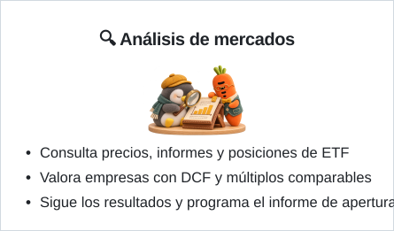
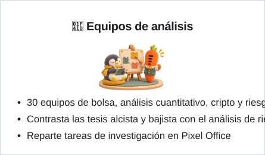
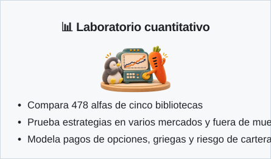
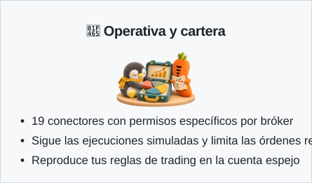

<p align="center">
  <a href="README.md">English</a> | <a href="README_zh.md">中文</a> | <a href="README_ja.md">日本語</a> | <a href="README_ko.md">한국어</a> | <a href="README_ar.md">العربية</a> | <b>Español</b> | <a href="README_id.md">Bahasa Indonesia</a>
</p>

<p align="center">
  
</p>

<h1 align="center">Vibe-Trading: Tu Agente de Trading Personal</h1>

<p align="center">
  <b>Un Solo Comando para Dotar a tu Agente de Capacidades Integrales de Trading</b>
</p>

<p align="center">
  <a href="https://www.star-history.com/HKUDS/Vibe-Trading"></a>
  <a href="https://trendshift.io/repositories/25527"></a>
  <a href="https://www.star-history.com/HKUDS/Vibe-Trading"></a>
</p>

<p align="center">
  <b>Clasificación por estrellas en los temas de GitHub</b> · 4 de noviembre de 2026<br>
  <a href="https://github.com/search?q=topic%3Abacktesting&amp;type=repositories&amp;s=stars&amp;o=desc">#1 Backtesting</a> &nbsp;·&nbsp;
  <a href="https://github.com/search?q=topic%3Aalgorithmic-trading&amp;type=repositories&amp;s=stars&amp;o=desc">#3 Trading algorítmico</a> &nbsp;·&nbsp;
  <a href="https://github.com/search?q=topic%3Aquantitative-finance&amp;type=repositories&amp;s=stars&amp;o=desc">#4 Finanzas cuantitativas</a>
</p>

<p align="center">
  
  
  
  <a href="https://pypi.org/project/vibe-trading-ai/"></a>
  <a href="LICENSE"></a>
  <br>
  <a href="https://github.com/HKUDS/.github/blob/main/profile/README.md"></a>
  <a href="https://github.com/HKUDS/.github/blob/main/profile/README.md"></a>
  <a href="https://discord.gg/6TdQnT5xcF"></a>
</p>

<p align="center">
  <a href="https://vibetrading.wiki/">Sitio web</a> &nbsp;&middot;&nbsp;
  <a href="https://vibetrading.wiki/docs/">Documentación</a> &nbsp;&middot;&nbsp;
  <a href="#-noticias">Noticias</a> &nbsp;&middot;&nbsp;
  <a href="#-funciones">Funciones</a> &nbsp;&middot;&nbsp;
  <a href="#cuentas-y-operativa">Cuenta espejo</a> &nbsp;&middot;&nbsp;
  <a href="#-demostraciones">Demostraciones</a> &nbsp;&middot;&nbsp;
  <a href="#-inicio-rápido">Inicio rápido</a> &nbsp;&middot;&nbsp;
  <a href="#-ejemplos">Ejemplos</a> &nbsp;&middot;&nbsp;
  <a href="#-servidor-api">API / MCP</a> &nbsp;&middot;&nbsp;
  <a href="#-hoja-de-ruta">Hoja de ruta</a> &nbsp;&middot;&nbsp;
  <a href="#colaboradores">Colaboradores</a>
</p>

<p align="center">
  <a href="#-inicio-rápido"></a>
</p>

## 📰 Noticias

- **2026-11-13** 🛠️ **Entrega de análisis y herramientas de cálculo** — Las respuestas se transmiten sin borrar cifras automáticamente, forzar reescrituras ni decidir la finalización por el formato. Las ejecuciones interrumpidas del comité conservan resultados parciales y permiten reanudar los roles pendientes reutilizando el trabajo completado.
  Las referencias a datos de mercado completos alimentan cálculos con QuantLib sin shell, y los roles comparten la evidencia original. Options Lab y `options_payoff` calculan estrategias de acciones y opciones y comparan varias alternativas en una sola llamada, devolviendo costes, límites de pérdidas y ganancias y la dirección de las comparaciones. Se mantienen explícitos los costes efectivos del backtest y los estados de truncamiento o error, así como los límites de autorización para operar en real. **Aún no publicado.**

- **2026-11-12** 🛠️ **Correcciones en tiempos de ejecución, cifras e investigación** — La cuenta sombra usa el capital inicial solicitado; las respuestas de los workers truncadas por el límite de tokens ya no se consideran completas. El PM del comité puede sintetizar informes previos válidos sin volver a consultar los datos. El adaptador nativo de Anthropic usa por defecto 16.384 tokens de salida, configurables.
  Las estrategias generadas rechazan los desplazamientos adicionales detectados en las señales de salida salvo que se declaren intencionales; se conservan los períodos retrospectivos de los indicadores. Grounding admite distintas notaciones de magnitud y declaraciones de valores observados precisos sin relajar la verificación de evidencia. Los backtests de SPY/GLD coinciden con una contabilidad independiente en las 206/140 ejecuciones y en la rentabilidad total. **Aún no publicado.**

- **2026-11-11** 🧾 **Ejecuciones parciales en trading simulado y conciliación independiente** — Activa límites de volumen por orden, ejecuciones parciales y estados de las órdenes en las simulaciones de acciones A de China con velas de cinco minutos ([#2128](https://github.com/HKUDS/Vibe-Trading/pull/2128)). La nueva herramienta Agent/MCP `paper_trade_reconcile` permite conciliar de forma independiente las comisiones, el efectivo, las posiciones y los cálculos del valor neto de los activos a partir de las ejecuciones devueltas ([#2197](https://github.com/HKUDS/Vibe-Trading/pull/2197)).
  Se procesan correctamente los formatos admitidos de encabezados porcentuales repartidos en varias líneas y las citas explícitas de enteros de documentos, conservando sus etiquetas originales ([#2185](https://github.com/HKUDS/Vibe-Trading/pull/2185), [#2192](https://github.com/HKUDS/Vibe-Trading/pull/2192)). También se corrigen las entradas del benchmark estricto de factores ([#2195](https://github.com/HKUDS/Vibe-Trading/pull/2195)) y se evita devolver una respuesta anterior cuando un turno de conversación por un canal agota su tiempo de espera ([#2194](https://github.com/HKUDS/Vibe-Trading/pull/2194)).
  ¡Gracias a [@shadowinlife](https://github.com/shadowinlife), [@he-yufeng](https://github.com/he-yufeng), [@Jackzigen](https://github.com/Jackzigen) y [@divya0795](https://github.com/divya0795)! **Disponible en `main`, para la próxima versión de pip.**

<details>
<summary>Noticias anteriores</summary>

- **2026-11-10** 📊 **Superficies de volatilidad implícita interactivas y correcciones del análisis de opciones** — Edita la cuadrícula por precio de ejercicio y vencimiento en Options Lab, con valores observados e interpolados diferenciados y sin extrapolación ([#2186](https://github.com/HKUDS/Vibe-Trading/pull/2186)).
  Se corrigen las estrategias predefinidas para precios bajos, cantidades, fechas de vencimiento, reintentos, carga bloqueada al cambiar de idioma y límite de 20 patas. Los contratos de Zhengzhou con vencimiento de tres dígitos, como `CF501`, ya usan las reglas de futuros chinos en el backtest ([#2193](https://github.com/HKUDS/Vibe-Trading/pull/2193)).
  ¡Gracias a [@he-yufeng](https://github.com/he-yufeng) y [@GPT-AGI](https://github.com/GPT-AGI)! **Disponible en `main`, para la próxima versión de pip.**

- **2026-11-09** 🧭 **Exportación de una comparación de revisiones seleccionada; los backtests rechazan códigos que no reconocen** — Descarga el par exacto de revisiones de investigación que estás comparando en JSON o Markdown desde la Web, la API o la CLI ([#2189](https://github.com/HKUDS/Vibe-Trading/pull/2189)). Un código de backtest que ninguna regla de mercado reconoce (como `local:BHP.AX` o `7203.T`) ahora se rechaza antes de obtener datos, en lugar de ejecutarse con las reglas de acciones A de China; los códigos de seis dígitos y la grafía `.SS` de Shanghái siguen funcionando. Las respuestas de OpenRouter ya no muestran el nombre del modelo dos veces ([#2191](https://github.com/HKUDS/Vibe-Trading/pull/2191)), y un id de revisión vacío en `research-artifact export` ahora es un error. ¡Gracias a [@he-yufeng](https://github.com/he-yufeng) y [@Gloubiboulgator](https://github.com/Gloubiboulgator)! **Disponible en `main`, para la próxima versión de pip.**

- **2026-11-08** 📝 **Comparación de revisiones y exportación del historial completo de investigación** — Compara el contenido, las evidencias y los metadatos de dos revisiones cualesquiera ([#2168](https://github.com/HKUDS/Vibe-Trading/pull/2168)) y exporta todo el historial en JSON o Markdown ([#2170](https://github.com/HKUDS/Vibe-Trading/pull/2170)). Al cambiar de registro se ignoran las respuestas obsoletas; la exportación Markdown conserva el contenido original en bloques de código aislados. También se corrigen los pesos de factores ausentes, la atribución con rentabilidades incompletas, las muestras insuficientes para IC, los datos de valoración no finitos y el cálculo del margen con precios de entrada negativos. **Disponible en `main`, para la próxima versión de pip.**

- **2026-11-07** 🧪 **Research Lab: costes de negociación y validación fuera de muestra** — Repite los backtests con precios guardados y distintas comisiones y deslizamientos. Los parámetros se eligen solo con los resultados de entrenamiento y se fijan antes de las pruebas fuera de muestra y de una muestra final reservada independiente. [Research Lab](guides/research-lab.md) comparte el mismo flujo en Web, CLI, API y Agent/MCP, con los once idiomas de la interfaz. También se corrigen los rendimientos omitidos entre ventanas y los cálculos de inicialización y ventanas largas de los factores; se añaden 20 casos de verificación de tareas guardadas sin conexión, indicando la falta de evidencias. Los registros de investigación versionados admiten datos financieros estructurados ([#2164](https://github.com/HKUDS/Vibe-Trading/pull/2164)) y se corrige el reconocimiento de contratos de futuros chinos sin sufijo de bolsa ([#2177](https://github.com/HKUDS/Vibe-Trading/pull/2177)). **Disponible en `main` para la próxima versión de pip.**

- **2026-11-06** 📈 **Cuadrículas de volatilidad implícita y correcciones de negociación simulada** — Crea cuadrículas de IV por precio de ejercicio y vencimiento a partir de observaciones de opciones, distingue puntos observados e interpolados y rechaza la extrapolación ([#2172](https://github.com/HKUDS/Vibe-Trading/pull/2172)). Las entradas numéricas extremas producen resultados finitos o errores explícitos. En la simulación de acciones A con barras de cinco minutos, las órdenes de mercado bloqueadas por los límites de precio se cancelan de inmediato ([#2176](https://github.com/HKUDS/Vibe-Trading/pull/2176)); el motor también procesa los símbolos en orden cronológico para impedir que una venta posterior financie una compra anterior. **Disponible en `main`, para la próxima versión de pip; las solicitudes públicas de cinco minutos siguen limitadas a un símbolo por paso.**

- **2026-11-05** 🚀 **Publicada la v0.1.19** ([Notas de la versión](https://github.com/HKUDS/Vibe-Trading/releases/tag/v0.1.19), `pip install -U vibe-trading-ai`): investigación que sobrevive al chat: guarda investigaciones versionadas con su evidencia y revísalas, reutiliza backtests de turnos y sesiones anteriores y edita un objetivo de investigación sin empezar de cero. Nuevas funciones opcionales: una simulación de acciones A en pasos de cinco minutos y las consultas financieras, la selección de acciones y el diagnóstico de cartera Shannon de Gildata (se retira QVeris; un `GILDATA_TOKEN` existente ya no activa nada por sí solo). Además: backtests de Argentina (BYMA), búsqueda web con Parallel, descubrimiento de modelos con OAuth de Codex y corrección de las dos regresiones de la 0.1.18. 116 pull requests fusionados más 21 incorporados mediante commits de los mantenedores, de 26 contribuidores ([CHANGELOG](CHANGELOG.md)).
  **Corregido hoy:** el backtest informa del índice de referencia que realmente evaluó, las carteras largo/corto tienen radiografía de riesgo, el alfa 17 de GTJA queda vacío mientras sus datos de entrada completan el periodo de calentamiento, el panel Shannon está disponible en los once idiomas de la interfaz y entran dos correcciones revisadas de colaboradores que no se habían incorporado ([#2042](https://github.com/HKUDS/Vibe-Trading/pull/2042) sumas TTM que abarcaban un trimestre ausente, [#1985](https://github.com/HKUDS/Vibe-Trading/pull/1985) detección de desdoblamientos 3:2). ¡Gracias a [@rudycelekli](https://github.com/rudycelekli), [@he-yufeng](https://github.com/he-yufeng), [@Jackzigen](https://github.com/Jackzigen), [@Shizoqua](https://github.com/Shizoqua), [@cgycorey](https://github.com/cgycorey), [@dajiaohuang](https://github.com/dajiaohuang), [@zeus229](https://github.com/zeus229), [@alexwan02](https://github.com/alexwan02), [@BHhhh-123](https://github.com/BHhhh-123), [@remote-controlled-man](https://github.com/remote-controlled-man), [@shadowinlife](https://github.com/shadowinlife), [@TWJxi](https://github.com/TWJxi), [@lishuanghong1989-netizen](https://github.com/lishuanghong1989-netizen), [@TerryF7](https://github.com/TerryF7), [@davidalmeida90](https://github.com/davidalmeida90), [@DrDLyuan](https://github.com/DrDLyuan), [@goatyyc](https://github.com/goatyyc), [@hnq-ai](https://github.com/hnq-ai), [@kadyrbekovhamit-cyber](https://github.com/kadyrbekovhamit-cyber), [@MetaAviator](https://github.com/MetaAviator), [@octo-patch](https://github.com/octo-patch), [@RowanAldean](https://github.com/RowanAldean), [@VectorPeak](https://github.com/VectorPeak), [@wavebyrd](https://github.com/wavebyrd) y [@yufengsika](https://github.com/yufengsika)!
  **Corregido en main tras el lanzamiento (llegará en la próxima versión de pip):** el benchmark del backtest ahora se compra a la apertura de la primera barra evaluada, como la estrategia, en lugar de partir del último cierre del calentamiento; el exceso de rentabilidad ya no incluye ese movimiento (ejemplo AAPL SMA 20/60: 22,5 % → 18,4 %).

- **2026-11-04** 📊 **Consultas financieras, selección de acciones y diagnóstico de cartera Shannon con Gildata** — Una consulta permite obtener las tres acciones de mayor capitalización y sus ingresos semestrales. Shannon muestra la exposición de la cartera a diez factores y la contribución de cada posición a la volatilidad. Las nueve funciones requieren activación individual, incluso con un token guardado. Si fallan las fuentes gratuitas, el sistema no recurre a Gildata. [#2117](https://github.com/HKUDS/Vibe-Trading/pull/2117) · [#2118](https://github.com/HKUDS/Vibe-Trading/pull/2118) · [#2119](https://github.com/HKUDS/Vibe-Trading/pull/2119)
  También se aclaró la ejecución de señales en la apertura de la siguiente vela, se corrigieron falsos vencimientos de tareas Swarm y se agilizó la detección de investigaciones duplicadas. [#2137](https://github.com/HKUDS/Vibe-Trading/pull/2137) · [#2155](https://github.com/HKUDS/Vibe-Trading/pull/2155) · [#2159](https://github.com/HKUDS/Vibe-Trading/pull/2159)

- **2026-11-03** 🛠️ **Integridad de los registros e idiomas**. Las trazas, el registro de auditoría y la búsqueda conservan U+2028/U+2029 en JSONL sin romper las entradas posteriores. Se normalizan los nombres de modelo con guion bajo y la segunda fase de compactación conserva el resumen de traspaso. Se admiten metadatos con BOM y se corrige la alineación inicial en idiomas de derecha a izquierda. Se añaden pruebas de regresión.

- **2026-11-02** 🛠️ **Metadatos y resultados extensos**. Se interpretan los escalares entre comillas y se muestra un recorte legible si no se puede codificar un resultado demasiado grande. Se ajustan la bienvenida y sus tarjetas y se añaden pruebas de regresión.

- **2026-11-01** 🛠️ **Fechas, contraste y ejemplos**. Las actualizaciones de sesión usan UTC. Mejoran el contraste de los botones en modo oscuro y los ejemplos del panel lateral, que ahora se pueden pulsar y muestran su categoría. Se añaden pruebas de regresión.

- **2026-10-31** 🛠️ **Bienvenida y símbolos bursátiles**. La pantalla inicial adopta tonos cálidos y dos columnas para distinguir ejemplos y acciones. Las letras finales de un símbolo dejan de interpretarse como restricciones de acciones A o A/H.

[Archivo de noticias](guides/news.md) · [Historial de cambios](CHANGELOG.md)

</details>

## ✨ Funciones

<div align="center">
<a href="assets/features/es/feature-market-research-card.svg"></a><a href="assets/features/es/feature-research-teams-card.svg"></a><br/>
<a href="assets/features/es/feature-quant-lab-card.svg"></a><a href="assets/features/es/feature-trading-portfolio-card.svg"></a>
</div>

## 💡 ¿Qué es Vibe-Trading?

Vibe-Trading convierte preguntas financieras en informes, pruebas históricas ejecutables y carteras simuladas. Puedes autorizar a un bróker compatible a operar dentro de los límites que fijes y detener la operativa cuando quieras. Los fondos permanecen en el bróker.

## ✨ Qué se puede hacer

| Tarea | Por dónde empezar |
|---|---|
| Investigar mercados o documentos | Pregunta en el chat web o [adjunta un informe](guides/research.md#upload--analyze-documents). |
| Probar estrategias y alfas | Consulta gráficos y operaciones en Run Detail o compara factores en `/alpha-zoo`. |
| Simular y revisar operaciones | Sigue las ejecuciones diarias y el valor liquidativo en `/paper-trading`. Revisa el diario con `/journal` y `/shadow` en la CLI. |
| Agregar cuentas y comparar pesos | Abre `/portfolio` para ver posiciones y cambios de asignación. [Brókeres compatibles](#compatibilidad-por-bróker) |
| Explorar opciones y correlaciones | Usa `/options` para pagos y griegas de varias patas, o `/correlation` para identificar regímenes de mercado. |
| Coordinar investigaciones | Inicia un [equipo Swarm](guides/research.md#swarm-workflows), reparte tareas en Pixel Office o programa un informe en `/scheduled`. |
| Recuperar la evidencia | Busca [investigaciones con historial](guides/research.md#versioned-research-artifacts) por fecha en `/research-artifacts`, compara dos revisiones y exporta la serie completa o una comparación seleccionada como JSON o Markdown. |

## ⚡ Ejemplo rápido

Tras ejecutar `vibe-trading init`, puedes pedir una prueba histórica en lenguaje natural o evaluar una biblioteca de alfas desde la terminal.

```bash
vibe-trading run -p "Prueba un cruce de medias móviles de 20 y 50 periodos en BTC-USDT durante 2024. Compáralo con comprar y mantener e indica la caída máxima."
vibe-trading alpha bench --zoo gtja191 --universe csi300 --period 2018-2025 --top 20
```

Abre **Run Detail** para comparar ambas estrategias, revisar las operaciones durante la caída y comprobar la fuente de datos de la ejecución.

## 🧪 Flujo de investigación

| Paso | Ejemplo del cruce de medias |
|---|---|
| Planificar | Identifica el par, las fechas, las medias y el índice de referencia. |
| Obtener datos | Descarga las velas históricas de BTC-USDT y verifica su procedencia y sus fechas. |
| Ejecutar | Escribe y prueba la estrategia. El directorio de ejecución guarda la estrategia, las operaciones y la curva de capital. |
| Validar | Compara con comprar y mantener. Revisa rotación, caída máxima y avisos de validación junto con la rentabilidad. |
| Revisar | Reabre la ejecución o cambia los parámetros. También puedes guardar una conclusión fechada y revisarla cuando aparezca nueva evidencia. |

## 📡 Fuentes de datos y alternativas

Hay **28 fuentes de datos de mercado**. Con `source: "auto"` se identifica el mercado por el símbolo y se prueban las fuentes en el orden configurado.

| Mercado | Orden de consulta |
|---|---|
| Acciones A y Hong Kong | Primero Tencent. Si faltan velas, se prueba Eastmoney y después las fuentes restantes. |
| Acciones de EE. UU. | Yahoo, seguido de Stooq y Sina. |
| Criptoactivos | Primero OKX, Binance y CCXT, antes de pasar a otras fuentes. |
| Futuros | Los contratos chinos admiten AKShare o velas locales. Para contratos internacionales, aporta datos locales. |

También puedes elegir una fuente. Instala `vibe-trading-ai[ashare]` para consultar velas diarias de acciones A con BaoStock sin token. La [referencia de datos](guides/capabilities.md#-data-sources--smart-fallback) detalla el orden y las credenciales.

## 🔩 Funciones en detalle

### Análisis de mercados

| Función | Uso |
|---|---|
| Informes y posiciones | Compara las posiciones trimestrales de un gestor en los 13F de la SEC o consulta los activos subyacentes de un ETF. Cada informe indica la fecha de las posiciones. |
| Valoración | `/dcf` muestra cómo influyen la tasa de descuento y el crecimiento terminal. Usa `/comps` para comparar múltiplos o exporta a Excel un modelo que vincule los tres estados financieros. |
| Artículos y documentos | Busca señales en arXiv y OpenAlex, comprueba la definición original y pruébala en tu universo. Sube informes, hojas de cálculo o diapositivas para preguntar por una figura. |
| Selección de acciones | Con Gildata activado, puedes filtrar por capitalización y obtener ingresos semestrales en una consulta. La selección y el diagnóstico factorial de la cartera se activan por separado. |

### Investigación cuantitativa

| Función | Uso |
|---|---|
| Alpha Zoo | Evalúa señales de Qlib, Alpha101, GTJA y las bibliotecas académica y fundamental. Compara coeficientes de información por horizonte y valida en ventanas sucesivas. |
| Motores de backtesting | Modela límites de precio de acciones A, financiación cripto y márgenes de futuros. Comparte capital entre mercados y revisa cada ejecución. |
| Laboratorio de opciones | Construye spreads pata a pata. Compara el pago al vencimiento con las griegas y varía el precio al contado y la volatilidad implícita. |
| Riesgo de cartera | Analiza caídas, VaR y pérdida esperada en la cola. Separa asignación y selección con la atribución de Brinson y observa cambios en la correlación. |
| Seguimiento de estrategias | Registra una estrategia con su evidencia y sigue la evolución del ratio de Sharpe o del coeficiente de información del factor. |

### Cuentas y operativa

| Función | Uso |
|---|---|
| Cartera | Agrupa posiciones de cuentas de solo lectura o importa un archivo de extraETF. Introduce pesos objetivo para ver el cambio de valor por posición. |
| Simulación | Avanza un día bursátil en una cuenta guardada y revisa ejecuciones, efectivo y valor liquidativo. También puedes reproducir aparte una sesión de acciones A en pasos de cinco minutos. La herramienta `paper_trade_reconcile` del agente/MCP verifica de forma independiente comisiones, efectivo, posiciones y la aritmética del NAV sin acceder al mercado ni al bróker. |
| Cuenta espejo | Importa tu diario del bróker, analiza comisiones y hábitos y compara las operaciones reales con una reproducción basada en reglas. |
| Conexión al bróker | Configura la conexión en la CLI o la web y prueba una lectura. Define símbolos y límites de orden y exposición antes de activar la operativa real. El interruptor de emergencia la detiene. |

### Equipos e informes periódicos

| Función | Uso |
|---|---|
| Swarm y Pixel Office | Convoca un comité alcista y bajista o un equipo cuantitativo y lee sus informes. Asigna tareas en Pixel Office y anota los resultados en el tablero compartido. |
| Informes programados | Elige un informe de apertura, un seguimiento de resultados o una revisión de cartera. Programa el envío a Slack, Telegram o correo configurados. |
| Historial de análisis | Busca sesiones y reabre ejecuciones. También puedes guardar conclusiones fechadas con evidencia y comparar revisiones de una tesis. |
| Registro de ejecución | Consulta los datos, el modelo, el registro y las referencias de las métricas. Reabre operaciones y curva de capital para comprobar una cifra. |

### Compatibilidad por bróker

<details>
<summary>Comparar lectura, simulación y operativa real</summary>

Lectura indica un perfil de solo lectura. Simulación usa el entorno de pruebas del bróker o uno local. Las órdenes reales requieren un mandato. ✓ indica soporte declarado y — la ausencia de un perfil compatible.

<!-- BEGIN GENERATED broker-overview -->

| Bróker | Leer | Sim | Real |
| --- | :---: | :---: | :---: |
| alpaca | ✓ | ✓ | ✓ |
| binance | ✓ | ✓ | ✓ |
| dhan | ✓ | ✓ | — |
| etoro | ✓ | ✓ | ✓ |
| futu | ✓ | ✓ | ✓ |
| ibkr | ✓ | — | — |
| kis | ✓ | ✓ | — |
| longbridge | ✓ | ✓ | — |
| mstock | ✓ | — | — |
| mt5 | ✓ | ✓ | ✓ |
| okx | ✓ | ✓ | ✓ |
| robinhood | ✓ | — | ✓ |
| scalable | ✓ | — | — |
| shoonya | ✓ | ✓ | — |
| tiger | ✓ | ✓ | ✓ |
| toss | ✓ | — | — |
| trading212 | ✓ | — | — |
| upbit | ✓ | ✓ | — |
| zerodha | ✓ | ✓ | — |

<!-- END GENERATED broker-overview -->

</details>

[Permisos completos por perfil](guides/portfolio-and-brokers.md#full-broker-permissions)

## 🎬 Demostraciones

<table>
<tr><th width="50%">Web · De la pregunta al backtest</th><th width="50%">CLI · Terminal interactiva</th></tr>
<tr>
<td width="50%" valign="top">

https://github.com/user-attachments/assets/2c595ee1-c577-481a-9460-34ea12bcf41c

</td>
<td width="50%" valign="top">

https://github.com/user-attachments/assets/ac79426e-f3f7-4349-b0d5-d997a2725784

</td>
</tr>
<tr><td>Introduce la estrategia, sigue el trabajo del agente y revisa el resultado.</td><td>Explora las plantillas de investigación y abre el informe de preapertura en la terminal.</td></tr>
</table>

## 🚀 Inicio rápido

Instala el paquete con Python 3.11 o posterior, elige el proveedor del modelo en el asistente y abre la CLI.

```bash
pip install vibe-trading-ai
vibe-trading init
vibe-trading
```

Docker sirve la web y la API en `http://localhost:8899`. Tras clonar el repositorio, configura el proveedor antes de iniciar el contenedor.

```bash
git clone https://github.com/HKUDS/Vibe-Trading.git
cd Vibe-Trading
cp agent/.env.example agent/.env
# Configura el proveedor y la clave API en agent/.env.
docker compose up --build
```

El paquete de PyPI incluye la CLI, la API y el servidor MCP. Consulta la [guía de instalación](guides/installation.md) para desarrollo web o modelos locales.

## 🖥 Referencia de la CLI

Abre la terminal con `vibe-trading` y escribe `/help` para ver los comandos.

| Comando | Uso |
|---|---|
| `/model` | Cambiar de proveedor o modelo en la sesión. |
| `/history` | Reanudar una conversación anterior. |
| `/show <run-id>` | Ver una ejecución guardada. |
| `/pine` | Exportar la estrategia como indicador de Pine Script. |

Desde el shell, `vibe-trading alpha list` enumera las bibliotecas de factores y `vibe-trading playbook list` las plantillas de investigación periódica.

## 💡 Ejemplos

- Compara AAPL y MSFT en 2024. ¿En qué mes se produjo la mayor diferencia de rentabilidad? Retoma el chat con `/history`.
- Analiza el historial exportado con `/journal` y contrástalo con una alternativa basada en reglas con `/shadow`.
- Elige una acción y sigue los argumentos alcistas y bajistas hasta el informe final.

```bash
vibe-trading --swarm-run investment_committee '{"target":"TSLA","market":"US"}'
```

## 🌐 Servidor API

Inicia `vibe-trading serve --port 8899`. En otra terminal, lista las ejecuciones con `curl http://localhost:8899/runs` y consulta una con su ID mediante `GET /runs/{run_id}`.

| Investigación por HTTP | Endpoint |
|---|---|
| Crear conversación | `POST /sessions` |
| Enviar pregunta | `POST /sessions/{id}/messages` |
| Seguir el progreso | `GET /sessions/{id}/events` |

Prueba la API en `http://localhost:8899/docs`. Los [clientes autenticados](guides/cli-and-api.md#security-defaults) envían la clave en la cabecera `Authorization: Bearer`.

## 🔌 Complemento MCP

Los clientes MCP pueden iniciar el paquete por stdio. Añade esta entrada a `claude_desktop_config.json` de Claude Desktop, reinicia el cliente y llama a `list_skills`.

```json
{
  "mcpServers": {
    "vibe-trading": { "command": "vibe-trading-mcp" }
  }
}
```

Para otros clientes o directorios de salida, consulta la [configuración MCP](guides/mcp.md).

## 🏛 Ecosistema

Vibe-Trading forma parte del ecosistema de agentes de **[HKUDS](https://github.com/HKUDS)**:

<table>
  <tr>
    <td align="center" width="20%">
      <a href="https://github.com/HKUDS/nanobot"><b>NanoBot</b></a><br>
      <sub>Ultra-Lightweight Personal AI Assistant</sub>
    </td>
    <td align="center" width="20%">
      <a href="https://github.com/HKUDS/AI-Trader"><b>AI-Trader</b></a><br>
      <sub>Agent-Native Signal &amp; Copy Trading Platform</sub>
    </td>
    <td align="center" width="20%">
      <a href="https://github.com/HKUDS/CLI-Anything"><b>CLI-Anything</b></a><br>
      <sub>Making All Software Agent-Native</sub>
    </td>
    <td align="center" width="20%">
      <a href="https://github.com/HKUDS/OpenSpace"><b>OpenSpace</b></a><br>
      <sub>Self-Evolving AI Agent Skills</sub>
    </td>
    <td align="center" width="20%">
      <a href="https://github.com/HKUDS/ClawTeam"><b>ClawTeam</b></a><br>
      <sub>Agent Swarm Intelligence</sub>
    </td>
  </tr></table>

---

## 🗺 Hoja de ruta

| Área | Disponible | Próximo |
|---|---|---|
| Simulación | Las cuentas diarias conservan efectivo, ejecuciones y valor liquidativo entre sesiones. Una simulación aparte reproduce una sesión de acciones A en pasos de cinco minutos. | Ejecución opcional limitada por la cuota del volumen negociado ([#2128](https://github.com/HKUDS/Vibe-Trading/pull/2128), borrador). |
| Investigación | Las fichas guardan métricas y evidencia del backtest. Las investigaciones fechadas conservan su historial de revisiones y se pueden buscar. | Datos financieros estructurados en las investigaciones guardadas ([#2164](https://github.com/HKUDS/Vibe-Trading/pull/2164), en revisión). |
| Opciones | Pagos multipata, griegas y escenarios de precio al contado × IV. | Cuadrícula interactiva de volatilidad implícita en `/options`. |

## Cómo contribuir

Elige una [incidencia para empezar](https://github.com/HKUDS/Vibe-Trading/issues?q=is%3Aissue+is%3Aopen+label%3A%22good+first+issue%22) o abre una para discutir cambios mayores. La [guía de contribución](CONTRIBUTING.md) cubre el entorno y las comprobaciones antes de abrir una PR.

## Colaboradores

¡Gracias a todos los que han contribuido a Vibe-Trading!

### v0.1.19 · Colaboradores

- @rudycelekli — 58 PRs (12 landed as maintainer ports): GTJA alpha formulas restored to the report (#2036/#2037/#2038/#2039/#2040/#2051), loaders that ask each vendor for the ticker form it serves and page at its own cap (Alpha Vantage #1997, AKShare #1998, CCXT #1999, Tushare minute lots #2001, Tiingo/Stooq class shares #2010/#2012, Nobitex Tehran days #1989, push2 decimals #1988), futures and market fees (micro index price limits #1992, the 30-year treasury fee #1994, India stamp duty on short covers #1995), quant-library and governance fixes (#1950/#1959/#1960/#1962/#1963/#2000/#2017), sub-penny prices kept in trades and charts (#1987/#1990), TTM sums that stop at a missing quarter (#2042), 3:2 splits and ST board limits in paper trading (#1985/#1984), a live halt key that cannot alias the global halt (#2003), session, memory, CLI and API fixes (#1969/#1970/#1982/#2002/#2006), and a string-"false" sweep across ten tools (#1976/#1977/#2008/#2009/#2011/#2013/#2014/#2015/#2016/#2018)
- @he-yufeng — 18 PRs (5 landed as ports): versioned research artifacts (#2079/#2159), background tasks scoped to their owner, reaped on cancel and reconciled after a restart (#2092/#2098/#2100/#2157), silent provider streams interrupted (#2099), cache and reasoning tokens kept in `llm_usage` (#2109), one tool policy across providers (#2087), Claude CLI tool-attempt recovery and structured finals (#2048/#2064/#2120), Qlib BETA/RESI/ROC/CORD semantics (#2062/#2069), magnitude suffixes in derived formulas (#2134), long/short risk x-ray and validation that refuses non-positive equity (#2162/#2161), and Unicode-safe swarm heartbeats (#2155)
- @Jackzigen — the bar-agnostic paper order lifecycle (#2066), swarm runs that stop when cancelled from the chat (#2059/#2060), document figures and percentage points in grounding (#2058/#2108), Robinhood portfolio reads with account selection (#2054), Moonshot reasoning effort for kimi-k3.1-pro (#2043), and Eastmoney JSONP, AKShare 1.20 forex and bare US ETF symbol fixes (#2082/#2083/#2086)
- @Shizoqua — research goals edited in place (#2093), Feishu, Teams, WeChat, WhatsApp and Discord channel fixes (#1957/#1958/#1967/#2078/#2114), heredoc commands in the bash tool (#2077), path-escape tests (#2094), and a run-directory fallback that no longer depends on the process cwd (#2116, landed as a port)
- @cgycorey — global futures priced on real contract multipliers and micro rates, with generic defaults reported (#1965/#1966/#1968/#1972), and a shadow account that honours every entry condition and currency (#2073/#2075)
- @dajiaohuang — transfer flow signs (#2023), aligned attribution benchmarks (#2044), overflow-free weight normalisation (#2046), and boolean payoff quantities refused (#2049)
- @zeus229 — the BYMA engine for Argentine shares and CEDEARs (#2071), backtests reused across turns and sessions (#2074), Codex OAuth model discovery (#2080), and financial units kept in grounding evidence (#2072)
- @alexwan02 — Longbridge per-currency cash (#1940), `.env` read by the MCP server (#1974), and Futu US symbol mapping (#2076)
- @BHhhh-123 — cross-sectional factor combination with walk-forward weights (#1953), field-level data availability in alpha bench (#2057), and factor research provenance (#2067)
- @remote-controlled-man — comma-grouped document integers (#2135), one bounded retry for a withheld final answer (#2136), and A-share source setup docs (#2138)
- @shadowinlife — the opt-in five-minute A-share paper step and its bar-by-bar matching (#2110/#2111), and JoinQuant limit fills (#2127, landed as a port)
- @TWJxi and @lishuanghong1989-netizen — Gildata stock discovery and financial queries (#2117), stock screening with report-period indicators (#2118), and Shannon portfolio style and risk analysis (#2119)
- @TerryF7 — IBKR and Futu gateway endpoints per connection (#1983), and connection deletion without a credential vault (#2153, landed as a port)
- @davidalmeida90 — the next-bar signal delay documented in the strategy skill (#2137)
- @DrDLyuan — STAR Market and Beijing buys sized on their own order grid (#2105)
- @goatyyc — Binance HTTP 451 read failures explained (#1937)
- @hnq-ai — a crawlable documentation wiki (#2165, landed as a port)
- @kadyrbekovhamit-cyber — Heston prices for short expiries (#2140)
- @MetaAviator — invalid journal quantities refused (#2052)
- @octo-patch — MiniMax M3.1 Flash as the default MiniMax model (#1936)
- @RowanAldean — optional Parallel search in `web_search` (#2113)
- @VectorPeak — voice notes forwarded in four IM adapters (#2106)
- @wavebyrd — Yahoo three-letter `=X` forex symbols read as USD pairs (#1980)
- @yufengsika — non-finite and boolean inputs refused by financial rigor checks (#2053)

<details>
<summary>Contribuidores de los ciclos v0.1.17 y v0.1.18</summary>

**v0.1.18** · @warren618 (Haozhe Wu) incorporó los esquemas de herramientas bajo demanda, guardó resultados extensos en los archivos de ejecución y corrigió el cómputo de uso de llamadas interrumpidas al modelo.

- @rudycelekli — a 92-PR correctness sweep (13 of them landed as maintainer ports): quant-library guards and edge cases (implied-vol price tolerance #1657, gaps in VaR breach transitions #1658, Heston inputs #1719, scheduled CDS coupons #1716, Carino coincidence #1943, undefined probabilistic-Sharpe and bond-accrual inputs #1821/#1822), missing prices kept out of risk x-ray return pairs and OU lag pairs (#1717/#1713), an undefined three-scenario upside and unbounded journal ratios reported as such (#1921/#1884), document reading that keeps PDF text, Word order, PowerPoint groups and Excel missing-value markers (#1838/#1839/#1840/#1841), session search limits, locking and snippets (#1827/#1828/#1832/#1834), more secret formats redacted (#1874/#1880), A-share board limits and Beijing codes (#1913/#1914), standalone revalidation and attribution on the run's own annualisation (#1915/#1948), and settings the selected engine ignores now warned about (#1947)
- @Shizoqua — 25 PRs (2 landed as ports): memory and cross-session search that read back clean and match non-English text (#1682/#1686/#1697/#1771/#1772), skill headings and saved skill names resolved consistently (#1797/#1858), Telegram and Matrix replies no longer dropped when the stream preview never sent and one WeCom stream id per reply (#1860/#1903/#1929), SSE events no longer double-delivered on reconnect (#1798), parallel CLI tool results paired with their own call (#1859), goal evidence confined to the claimed run (#1895), Carhart momentum no longer leaking today's price (#1578), Wilder RSI in the shadow account (#1457), direct-SDK positions priced from `current_price`/`ltp`/`market_val` (#1581), the email SPF/DKIM spoofing check (#1508), and swarm artifacts cleared before each fresh task (#1455)
- @he-yufeng — 24 PRs (2 landed as ports): the declared grounding-check registry and the fired checks recorded in the validation artifact (#1628/#1691/#1661), corrections that keep the figures already passed (#1702), percent-named evidence read as points in derived checks (#1823), additive A-share qfq converted to multiplicative when the offsets validate (#1551), mootdx retired from the default A-share chain and the health canary (#1730), the channel-authoring contract (#1630), the compaction-helper split out of `loop.py` (#1631), the first bar's result counted against initial capital in the options engine and per-bar returns (#1750/#1844), config keys nothing reads warned about (#1935), the US early-bell close on half-days (#1706), and the ReportLab fallback for Shadow Account PDFs (#1683)
- @shadowinlife — 19 PRs (5 landed as ports): daily paper trading with saved accounts across CLI, API and Web (#1939), the shared scheduler kernel adopted by the research, back-office and live loops (#1893/#1899), token usage in Run Detail, chat and swarm (#1890), `read_run_artifact` and a structured backtest tool summary (#1647/#1646), `get_southbound_flow` and a northbound flow that no longer serves a silent empty envelope (#1486/#1484), guided Web UI setup for Feishu, Slack and Discord with runtime errors surfaced in channel status (#1572/#1764/#1777/#1738/#1737), and thirteen fundamental and valuation factors, industry-neutral A-share value alphas and a monthly-horizon IC bench (#1787/#1788/#1802/#1801)
- @zeus229 — 18 PRs (4 landed as ports): grounding that fails closed on unresolved derived refs and suggests exact refs (#1835/#1837/#1638), parses complete derived formulas after labels (#1728), keeps identity in ticker-keyed metrics and blank-corner matrices (#1851/#1850) and leaves execution metadata out of numeric evidence (#1767); rich Email scheduled reports with optional PDF password protection (#1680/#1709), channel-aware scheduled-run editing (#1649), reproducible indicator reads and pinned portfolio snapshots (#1768/#1769), redundant MCP payload copies removed before agent context (#1634), and goal tool-call provenance (#1688)
- @alexwan02 — 16 PRs (4 landed as ports): the `claude-cli` provider backed by a local `claude -p` (#1804), Hong Kong orders sized on each symbol's own board lot (#1813), the Longbridge SDK config built through `from_apikey` (#1805), Futu multi-currency balances with average-cost basis (#1814), SDM registration that keeps its trading rules and records bench history for decay monitoring (#1848/#1849), a lightweight run preview built off the event loop (#1853), run trades listed newest first from the full trades.csv (#1865), trades.csv entry rows, offline benchmarks and Brinson weights fixed (#1780/#1781/#1782), and runtime connectors ordered by status (#1845)
- @Jackzigen — 13 PRs (2 landed as ports): the first `loop.py` extractions for tool-result helpers, run outcome and tuning (#1636/#1641/#1678), a byte-stable system prompt for prefix caching (#1708), after-close SEC filings kept out of the IC until the next bar (#1794), a free BaoStock fallback for `val:*` panels (#1799), undefined correlation pairs published as null instead of 0.0 (#1933), journal PnL pooled per settlement currency (#1811), `BASE-USDT-PERP` routed to the crypto market (#1864), the mStock read-only profile (#1675), and the shared OHLCV contract assertion in per-loader suites (#1725)
- @cgycorey — 12 PRs (3 landed as ports): only the engine's own output grounds a backtest report (#1685), adjusted and raw prices never mixed in one series (#1684), a stooq challenge latch that stops probing and sees every refusal (#1637/#1640), a loader health lane that says why a source is empty and keeps labelled credentials out (#1643/#1698), `get_macro_series` reporting when it caps a series (#1676), env-style credential names, URL userinfo and Basic auth redacted (#1765/#1742/#1744/#1846), and suffixed HK codes normalized for the duplicate-asset guard (#1746)
- @MetaAviator — 12 PRs (2 landed as ports): full-sample downside deviation for Sortino in the metrics and options engines (#1693/#1727), initial capital in Monte Carlo path metrics (#1664), missing equity kept out of adjacent validation returns (#1754), standalone revalidation that honours saved settings and entry dates (#1815/#1842), break-even exits and zero-bar trades kept in trade artifacts and holding periods (#1779/#1876), and trade-journal fixes for reversal fees, split date/time columns, equal timestamps and invalid dates (#1891/#1900/#1941/#1942)
- @lorenzozanee — unsupported Robinhood option orders gated before the broker (#1585), run cards that flag backtests possibly inside the model's training data (#1618), and option evidence in the broker bring-up checklist (#1770)
- @Mikesad — LLM usage accounting extracted from `loop.py` (#1662), swarm presets that take their variables from the prompt (#1674, landed as a port), and the factor registry suite running without symlink privileges (#1696)
- @remote-controlled-man — options legs priced on the run's bar cadence (#1753), the Futu journal format claimed only when its value columns exist (#1766), and three-statement balance tolerance threaded into projected periods (#1786, landed as a port)
- @Romzhou — a kill-switch sweep that fails closed on its own bookkeeping and input (#1703), and a runner driver kept alive for the scheduler's lifetime (#1704)
- @sambazhu — three Gildata research tools with off-exchange fund NAV (#1485), and an env-configurable ReAct iteration cap (#1833)
- @wavebyrd — spread and swap rates for Yahoo `=X` forex pairs (#1930), and per-cent multipliers for ICE coffee, sugar and cotton (#1944)
- @BHhhh-123 — factor neutralisation and PCA in the quant library (#1817, landed as a port)
- @Bortlesboat — Calmar kept finite on explosive equity paths (#1901)
- @bygordon130-hub — Pixel Office, a shared manual research-task board, and the Turkish locale (#1616)
- @davidalmeida90 — profit factor reported as undefined when no trade lost (#1602)
- @DrDLyuan — the equity.csv drawdown peak seeded with initial capital (#1818)
- @Emad211 — per-channel configuration, custom providers and the Persian locale (#1264)
- @Frank-zhu2000 — Futu profiles no longer pinning the HK trade market (#1812)
- @goatyyc — Binance balances that survive clock skew, with unpriced assets marking the snapshot incomplete (#1505)
- @hunters1011-ctrl — symlink tests skipped where symlinks are unavailable (#1803)
- @incorpore — Brazil (B3) market data and an opt-in ZimaOS template (#1783, landed as a port)
- @mdb1230 — five example options strategies and a candidate study of which to paper-trade (#1774)
- @mminkus — the interactive message cap raised to match the scheduled-run path (#1701)
- @passionbull — KIS reads that see SOR fills and recover from a server-invalidated token (#1726)
- @rwxyx518-prog — the Portfolio page's holdings table and history chart following the display currency (#1810)
- @ThreeTima — currency identity checked in financial figure grounding (#1905)
- @tomaszkubiak-courses — strategy provenance model fields set on the loop, so writing a strategy file no longer raises `AttributeError` (#1673)
- @xaritoku — dotenv loaded in the `alpha bench` / `alpha compare` CLI handlers (#1806)

</details>

<details>
<summary>Contribuidores del ciclo v0.1.16</summary>

- @Shizoqua — a 55-PR correctness sweep (one landed as a port) across nearly every layer: quant-library fixes and input guards (Patell z degrees of freedom #1449, copula ties #1453, Kyle's lambda intercept #1477, HRP labels #1555, non-finite impact and yield-curve inputs #1557/#1558), Alpha Zoo NaN propagation and formula fixes (gtja191_038 #1523, alpha101_074 #1534, qlib158 WVMA #1594, GTJA HIGHDAY/LOWDAY #1604), backtest sizing for negative futures prices and shorts (#1547/#1548), venue bars per year in Monte Carlo validation (#1546), options annual return over elapsed bars (#1458), memory, swarm-store and session robustness (#1450/#1525/#1545/#1536/#1579), DingTalk, Signal, Slack and Discord channel fixes (#1506/#1478/#1524/#1537), Argentina listing identity in grounding (#1575), and a mandate narrowed to zero exposure stored as zero (#1593)
- @zeus229 — grounding that reads locale decimals and grouped numbers with precision-aware rounding (#1517/#1588), resolves explicit symbols and exact field refs from observed evidence (#1584/#1586), preserves `latest_date` timestamps (#1590) and keeps corrections text-only (#1600); Argentina (`.BA`) market data through Yahoo (#1543), ISO-4217 portfolio currencies with isolated FX failures (#1510), explicit header names compared case-insensitively (#1568), technical-indicator volume statistics and their replay after compaction (#1571/#1601), and bounded read-only replay after compaction (#1488)
- @cgycorey — a read-only extraETF export reader (#1406) and the read-only Scalable Capital MCP connector (#1417), run cards that keep non-scalar metrics (#1424), the backtest tool naming the directory it looked in (#1429), a tool-declared swarm `run_dir` confined to the workspace and worker message logs persisted on every terminal path (#1430/#1439), qlib158 CNTP/CNTN/CNTD NaN propagation (#1459), custom zoo roots that no longer replace the bundled module (#1468), `get_shareholder_count` answering again (#1490), Tencent's A-share and HK calibers stamped correctly (#1497)
- @shadowinlife — IM channels configured from the Web UI, with QQ, Email and WebSocket guided setups (#1520/#1529/#1544), stdlib logging placeholders across 12 channel adapters (#1533), Tencent history paginated backward from the end of the window (#1411), `state.json` written by the backtest tool so tool-driven runs are ingestible (#1413), per-worker swarm skill allowlists (#1414), the `1M` interval no longer folding to one minute (#1487), and welcome quick actions with a real selected state (#1500)
- @he-yufeng — tail-risk measure and confidence kept through the grounding gate (#1444), full history in the risk x-ray instead of sampled rows (#1462), shareholder-count history from the per-period report (#1518), backtests attaching to a running MT5 terminal without credentials (#1598), a per-read BaoStock socket deadline (#1615), the weekly live-source health canary (#1627), the broker capability matrix generated into the README (#1629), and the channel `stop_all` and WebSocket logger fixes carried over from #1521
- @lorenzozanee — dragon-tiger seat reports and lockup expiry data restored (#1512/#1513), malformed Robinhood buying power rejected (#1526), broker-only MT5 symbols resolved in `search_symbol` (#1597), hash-only traces and citations on run cards (#1612), expired Copilot CLI tokens refreshed (#1619), and Telegram polling ownership documented (#1583)
- @chiww — the Stooq warning naming the override variable the config layer reads (#1402), A-shares routed by market for sources without a dedicated branch (#1431), the declared interval checked against the served bars before annualising (#1432), and `_NO_NETWORK_FALLBACK_SOURCES` honoured for per-symbol gaps (#1441)
- @as950118 — three Korean broker connectors: KIS with separate paper and live hosts (#1407), Upbit capped at paper plus read-only (#1408), and read-only Toss Securities (#1409)
- @0xouzm — SDM decay metrics that treat NaN and infinite bench results as missing (#1447)
- @alanwilhelm — synchronized cold loader-registry initialization, so concurrent first lookups no longer see an empty registry (#1405)
- @modelpath-dev — the description-driven strategy-store adaptation substrate (#1391)
- @sambazhu — the Gildata A-share OHLCV loader over its raw-api MCP endpoint (#1474)
- @tingkk — broker-neutral SDK diagnostics across all locales (#1436)
- @tonydo — OpenCode as a built-in provider, sending the `x-opencode-session` header OpenCode Go requires (#1416)
- @woshi77777stars — the `Trigger.market` default restored on non-market triggers (#1599)
- @Yoruxyv — the Bahasa Indonesia UI locale and `README_id.md` (#1482)

</details>

<details>
<summary>Contribuidores del ciclo v0.1.15</summary>

- @Shizoqua — 28 PRs: NaN propagated through 16 GTJA and Alpha101 alphas instead of fabricated values (#1371/#1372/#1373/#1374/#1379/#1380/#1381/#1382/#1383) and Alpha Zoo returns no longer forward-filling gaps (#1172), missing-price gaps preserved in the SDM template and cross-market volatility weights (#1397/#1398), multi-factor and social-media factor evaluation fixes (#1399/#1400), walk-forward ML training without future-label leakage (#1392), China futures product codes parsed for digit-prefixed, month-code-colliding and lower-case symbols (#1369/#1389), composite sub-engines synced before every dispatch (#1370), per-regime position sizing in strategy discovery (#1368), MCP goal sessions isolated per connection with current-goal defaults (#1173/#1331), Codex token usage and model metadata (#1334/#1348), and swarm cancellation reaching the in-flight worker (#1175)
- @he-yufeng — 26 PRs, mostly fail-closed live trading and backtest semantics: broker API errors and error envelopes fail closed in position reads and the halt sweep (#1212/#1232), the flatten latch persists across restarts (#1233), market-triggered ticks skip closed markets (#1253) and buy-limit orders are sized at the worse of quote and limit (#1312); the price-adjustment caliber stamped on served frames (#1317) with adjusted Yahoo prices (#1287), unresolved symbols retried down the fallback chain (#1288) and the stooq anti-bot challenge flagged (#1342); short option legs holding margin (#1306), perpetual funding settled by bar span (#1307), A-share and India rules enforced through composite state (#1309) and halted positions marked at the last traded close (#1332); Shadow Account PnL, attribution, FIFO short lots and cache keys (#1217/#1310/#1311/#1314); and each monitor's latest verdict rendered on the list (#1156)
- @cgycorey — 23 PRs: UK (LSE `.L`) equity support (#1206), swarm replay/resume of failed runs keeping completed artifacts (#1158), market-data validation of codes, dates and sources with aligned FX/index search and fetch (#1185/#1316), dotted US class shares routed as US equity (#1351), backtest execution fixes — requested targets separated from executed fills, 1x shorts liquidated, option signals filled on the next bar, default IV for HV warm-up and over-committed baskets scaled (#1281/#1298/#1299/#1305/#1344); live halt-sweep envelopes, per-episode latches and MCP buy-limit sizing (#1244/#1254/#1361); grounding clause and metric-table gates (#1326/#1338/#1375/#1378); the registry NaN contract on declared dependencies (#1377); compaction sized by tool-call arguments (#1352); and report audits that fail closed when nothing was verified (#1362)
- @santhreal — 16 PRs extending the quant library: factor risk decomposition, event-study rank and sign tests, OU calibration, drawdown analytics, barrier options, single-name CDS, key-rate duration, IC time series, Vasicek credit loss and group-purged CV (#1159–#1168), Heston pricing, HRP allocation, copulas and market microstructure (#1195–#1198), finite-difference barrier Greeks (#1203), and multi-segment test sets in cross-validation (#1204)
- @AirHua-byte — multi-file drag-and-drop and paste uploads (#1179), interrupted replies recovered after a service restart (#1180), shared HTTP clients preserved during cleanup (#1182), agent-confirmed scheduled research tasks (#1187), persisted Feishu QR login credentials (#1188), explicit market context kept in grounding (#1269), and the offline harness artifact verifier (#1271)
- @lorenzozanee — silent order-plan rejections surfaced through an `_on_plan_rejected` hook (#1245), the temperature self-heal on the OpenAI-compatible path (#1246), escalating stream retry delays that honour Retry-After (#1247), USD-M tolerance calibration (#1248), FMP's Stable endpoint with no silent fallback for an explicit source (#1276), adjusted prices on the FMP and Tiingo paths (#1320), and EPERM handled in desktop updater shutdown checks (#1284)
- @goatyyc — the read-only multi-broker portfolio dashboard and connection framework (#1072) with connector onboarding contracts (#1250), IBKR official MCP OAuth with verified read tools (#1190), and an isolated portfolio OAuth reconnect lifecycle with classified failures (#1211/#1251)
- @saju01 — the agent loop keeping tool results the model still needs (#1341), compacted results reconciled by exact call identity (#1358), and grounding that no longer reads percentage-point deltas as quoted prices (#1346/#1357)
- @aminak58 — symbol identity for bare joined crypto pairs (#1265), FX, metals and futures (#1280), and spot-gold aliases (#1282)
- @averatec0773 — the Anthropic static prefix cached with cache usage recorded (#1366), relocated `extra_body.temperature` stripped in the Anthropic self-heal (#1330), and an attempt start persisted so the elapsed clock survives navigation and reload (#1340)
- @Elfsa-Miranda — Alpaca submissions owned before broker writes, then recovered by exact client id and exact fills across restarts (#1213/#1221/#1222)
- @ethanstoner — skill-relative reference links resolved in `read_file` and on GitHub (#1252/#1328), and strategy-store history that is really newest first (#1347)
- @iagop03 — Web UI fixes: a stale `streamingSessionId` cleared on reopen, a scrollable main region with collapsed long prompts, and non-backtest runs pointed to Studio (#1257/#1258/#1259)
- @Robin1987China — non-finite inputs refused across valuation and credit-risk functions (#1184/#1215), and Archimedean copula CDFs stabilized under large parameters (#1386)
- @Emad211 — cross-platform locks and path handling for Windows (#1261), and read-only Nobitex and Wallex market-data sources (#1263)
- @honginp — read-only Binance USD-M account snapshots (#1229) and USD-M drift evidence artifacts (#1230)
- @pengpengyi92 — bounded backoff on swarm worker retries (#1210), and crypto pairs resolved through an active Binance connector (#1242)
- @ashutoshsinghpr7 — the Zerodha Kite Connect broker for Indian equities (#1193)
- @be-student — the no-progress stop for repeated discovery without new evidence (#1363)
- @BigFishEmily — paginated Tencent finance history requests (#1154)
- @birdxs — Docker CI actions upgraded to Node.js 24 compatible versions (#1359)
- @bonyohana — the survivorship-bias disclosure rendered in the HTML bench report (#1289)
- @c020627 — the IBKR official read-only MCP seed pointed at `/mcp-public` (#1178)
- @guestccc — `/api` routes proxied in the Vite dev server (#1319)
- @Jackzigen — mandate adjustments that enforce narrowing for non-numeric and list fields (#1285)
- @JaxonHu1024 — Futu HKD valuations preserved in the portfolio (#1228)
- @laiyierjiangsu — HK-prefixed symbols (`HK.06693` → `06693.HK`) locked in grounding (#1384)
- @nandofmike — the Brazilian Portuguese (pt-BR) locale (#1327)
- @P1Piyush — metals treated as metals in the forex backtest: pip size, lot size and spreads (#1226)
- @sambazhu — per-market data-source priority in Settings and `MARKET_DATA_ORDER_*` (#1231)
- @SiMinus — `vibe-trading swarm retry` with a resume option (#1194)
- @sykuang — the IBKR public MCP OAuth flow (#1186)
- @thisisjun786 — calendar-triggered partial rebalancing (#1277)
- @wiliao — a run-stall watchdog, a bash tree-kill timeout and a compaction verification ledger (#1169)
- @youngjincho02-arch — the historical VaR quantile formula fixed in the risk-analysis skill (#1189)

</details>

<details>
<summary>Contribuidores del ciclo v0.1.14</summary>

- @Shizoqua — a 13-PR correctness sweep across nearly every subsystem: grounding auto-recovers identity and price evidence within a bounded budget (#1092), swarm isolates worker artifacts between retries (#1053), rejects raw `ok`/`success` tool-result envelopes (#1052) and truncates oversized results with the shared notice (#1110), MCP gains offset paging for SEC filings and statements (#1138), routes `load_skill` through the registry so oversized skills page (#1137) and carries market-data provenance on `get_market_data` (#1131), plus `excess_return` consistency (#1058), Wilder-EWM RSI (#1056), the FTS5 tokenizer floor (#1071), non-finite prediction-market fields (#1136), in-flight delivery protection (#1140) and preserved backtest validation evidence (#1139)
- @shadowinlife — the run-analysis surface, four pages in one cycle: Options Lab (#1096), the Factor Research panel with its new IC correlation matrix (#1099), positions structure visualization (#1097) and the tearsheet tab (#1091); plus evidence-gated Strategy Discovery Phase 1 (#978) and Phase 2 decay monitoring (#1007), per-market volume units in market-data provenance (#1065) and baostock volume normalized to board lots (#1067)
- @pengpengyi92 — five quantlib numerics fixes: `xirr` and money-weighted return survive long-horizon discount underflow (#1119), zero-volatility options discount their forward value (#1066), the fixed-income curve keeps decay inside the requested bounds (#1076), event studies anchor to the prior session (#1078) and cross-validation aligns label ends to the prior observation (#1079)
- @cgycorey — reasoning effort honoured in chat completions (#1025), the per-task swarm `ChatLLM` closed to stop a pooled-connection leak (#1145) and the same for one-shot clients (#1153), `gross_profit` derived from revenue minus COGS when the SEC tag is absent (#1111), and `vibe-trading show <run_id>` dispatching its run id instead of the flag (#1147)
- @lorenzozanee — the test suite stopped escaping into the real config root and its live audit ledger (#1118, closes #1116), recovery steering delivered as user messages with inline system tags (#1112), and unsupported ticker-plus-name symbol queries marked skipped rather than failed (#1114)
- @AndyLongest — the interactive backtest research dashboard (#1084), the engine reporting actual post-fill positions (#1082), and grounding ignoring identity constants in rate formulas (#1083)
- @ofeksh-tr — eToro runtime UI parity for SDK connector status (#1051) and its crypto browse and flat market-data quotes (#1070), plus an empty `Response` for the `scheduled-runs` DELETE 204 (#1068)
- @wiliao — the agent-run reliability pass: grounding false-rejections, the final-answer gate and LLM timeouts (#1105), with prompt wording and support/resistance masking (#1060)
- @jay79-boop — a selectable IBKR market-data tier with starved quotes reported as `no_data` (#1075), and strict alpha t-stats surfaced in the bench JSON and HTML report (#1085)
- @Robin1987China — DCF refusing non-finite inputs instead of a silent negative share price (#1121), and grounding masking ISO dates that run into CJK text (#1132)
- @zzz607 — grounding masking line-leading ordered-list markers before number extraction (#1063), and the East Money research-report endpoint given the time parameters it now requires (#1077)
- @Echoandelementwebsites — worker prompts ordered for prompt-cache-friendly prefixes (#1057), and tool-less agents no longer instructed to call `write_file` (#1144)
- @549236606-oss — seven extended read-only Futu connector endpoints, each fail-closed through the existing gateway envelope (#1135)
- @QCYTSN — the desktop update safety boundary: PID-scoped shutdown, dormant candidate verification, interrupted-attempt recovery, and a tested tampered/unsigned/wrong-publisher/downgrade rejection matrix (#1101)
- @honginp — offline USD-M account reconciliation with immutable snapshot contracts and deterministic drift reporting (#1106)
- @he-yufeng — each monitor's latest verdict parsed server-side and persisted on the job for the Market Watch list (#1152)
- @sykuang — GitHub Copilot as a provider through the official SDK, with no borrowed client ID and no editor-impersonation headers (#990)
- @miguelangelo78 — the hosted TickerAll MetaTrader 5 data source, so forex and metals backtests need no local MT5 terminal (#968)
- @ngoanpv — Vietnam equity (HOSE) support: `.VN` no longer executes under China A-share rules (#1033)
- @jax-novita — Novita AI registered as a built-in OpenAI-compatible provider (#1059)
- @daviddaco1 — the Spanish locale and `README_es.md`, the sixth README (#1087)
- @1psconstructor — German (Deutsch) UI support (#1117)
- @x-lambda — the tencent loader building its SSL context from the certifi CA bundle, unblocking HK quotes (#1113)
- @er-s-an — `build_registry()` reporting partial construction instead of silently returning a short tool list (#1129)
- @straun-repo — reasoning effort passed through to the Anthropic adapter (#1115)
- @nstavros — `connector orders` rendering broker_sdk rows, with SDK enum reprs stripped and class-B tickers left intact (#1150)
- @lukiod — `.env.partial` created with owner-only permissions (#1086)
- @fixXxerTech — inferred strategy labels marked as inferred in the run dashboard (#1134)
- @birdxs — Docker images carrying the Feishu and Telegram channel dependencies, with a GHCR/Docker Hub build workflow (#1088)
- @zhiwuyazhe-fjr — a Docker Codex OAuth EOF that explains itself (#1054)

</details>

<details>
<summary>Contribuidores del ciclo v0.1.13</summary>

- @santhreal — a 21-PR correctness sweep: trade-journal date and format parsing for Excel serials, UTF-16 BOM CSVs and BTCUSDT-style symbols (#778/#794/#811/#862/#868), loader interval mapping (#812/#838), skill frontmatter closed at EOF (#861), exact memory anchors and result bounds (#956/#957), negative-equity drawdown, insolvent empty cross accounts and `inf` from zero equity (#958/#959/#1041), NaN/inf in the grounding block (#1043), null and non-finite tool arguments (#911/#913), and resource-leak and robustness fixes in the rate limiter, HTTP throttle, event bus, store and Shoonya connector (#1039/#1047/#1046/#1045/#1038)
- @Robin1987China — read-only `technical_indicators` and `sentiment` tools (#921/#939), the final report aggregator stage for `quant_strategy_desk` (#1048), annualisation entries for 15 more data sources (#891), `factor_analysis` realigned on MCP to the registered tool's contract (#715), blank symbol rows skipped in the Futu and generic journal parsers (#749), loader payloads handled without sampling indicator inputs (#1005), and a real account label in CLI balances (#843)
- @he-yufeng — the options payoff and scenario explorer (#883, rebuilt by the maintainer as #946), the strict alpha bench gate via `alpha bench --strict` (#796), composable optimizer weight constraints (#818), rebalance notes and risk x-ray artifacts for portfolio runs (#795/#900), yfinance crypto routed to the crypto engine (#970), and memory entries written with their `.md` suffix (#984)
- @shadowinlife — memory Phase 1 lifecycle management and Tier 2 structural organization (#733/#815), JSON-string list/dict arguments accepted from MCP clients (#993), HK fallback routing repaired with a Tencent HK source (#1000), and MT5 `trading_history` numpy scalars made JSON-safe (#776)
- @honginp — USD-M perpetual realism: margin state contracts, isolated and cross liquidation risk, the funding and liquidation lifecycle and persisted fidelity evidence (#798/#889/#903/#936), plus opt-in atomic rebalancing integrated with strict USD-M positions (#951/#1019)
- @Shizoqua — swarm detection of `ok:false` / `success:false` tool failures (#1028), importance decay in FTS5 memory ranking (#1032), remote server identity in the MCP specs cache key (#1049), and lowercase `4h` requests resampled in the yfinance loader (#1013)
- @tyj147454413-cmd — three fixes split from #543 that landed with their authorship: one run per session with honest terminal states (#676), redaction of free-text tool results (#675), and durable trace records and sidecars (#662)
- @cgycorey — Alpha Zoo tools exposed on MCP with a bounded `alpha_bench` (#979), and mapping-shaped Responses stream events accepted (#1034)
- @darkknight4563 — opt-in non-positive prices in the daily-bar validator (#816, closes #571), and `bar_returns` keeping the real move across a long trading halt (#895)
- @MuggleJinx — sessions, runs and uploads stored under the user runtime root instead of the code tree (#925), and the `connector` CLI loading `~/.vibe-trading/.env` (#902)
- @00EVA — a model dropdown that resizes so full provider/model slugs are readable (#1006)
- @AmirF194 — universe metadata forwarded into the `alpha bench` JSON and HTML output (#841)
- @CRui5in — Web UI LLM settings saved on Windows without an HTTP 500 (#561)
- @ddy4633 — the correlation matrix no longer forward-filling missing closes (#873)
- @Echoandelementwebsites — dataclass tool results serialized without a false circular-reference crash (#849)
- @g0rdonL — historical USD-M funding consumed, with settlement jitter rounded (#819)
- @JungHoonGhae — Korea equity (KRX: KOSPI/KOSDAQ) as a backtest engine (#693, landed as a port)
- @klmtseng — restated PIT fundamentals deduplicated without regressing to an older fiscal period (#772)
- @ngoanpv — timezone-aware local schedules for scheduled research (#954)
- @QCYTSN — live model discovery and runtime identity in Settings (#924)
- @sambazhu — `temperature=1` forced for the whole Kimi K-series (#701)
- @shugaoye — the OpenBB Workspace bridge (#817, landed as a port)
- @TSENGCHIENFENG — the read-only Taiwan stock snapshot tool (#848, landed as a port)
- @wiliao — TSX/TSXV symbols end to end, with bash-written run-dir OHLC CSVs counted as observed evidence (#1037)
- @x-lambda — a config option to disable the agent proxy (#995)
- @xkam7ar — partial market-data results completed through the fallback chain instead of shrinking the universe (#689, landed as a port)
- @y85998607 — the vn.py export skill updated for the vn.py 4.x layout (#869)
- @yagnikpipaliya — the Anthropic adapter self-healing models that deprecate `temperature` (#890)
- @yrk111222 — ModelScope as an OpenAI-compatible provider (#1011)

</details>

<details>
<summary>Contribuidores del ciclo v0.1.12</summary>

- @santhreal — una limpieza de corrección de 30 PR: endurecimiento de strict-JSON / números finitos en metrics, factors, pattern y options (#764/#765/#766/#767/#739/#740/#744), corrección de loaders (#761 yahoo 1m bars), y robustez de session / journal (#762/#763/#768/#769/#770)
- @xkam7ar — mejoras de fiabilidad amplias en packaging, web, scheduler, swarm y CLI (#584), cancelación antes de la primera iteración de AgentLoop (#641, cierra #638), puertas de CI / OOS (#630/#632), y correcciones del filtro por mes / parseo de side en journal (#626/#628)
- @shadowinlife — la skill Strategy Development Manager (#457, cierra #455), extracción enchufable con OCR + LLM-vision (#548), credenciales de proveedor centralizadas (#563), la vectorización 80× de alineación de señales (#698), y el cacheo de MCP-discovery en swarm (#704)
- @ebujinovch — el endpoint + UI de la línea temporal de correlation regime (#756, cierra #719) y su skill `correlation-regime` (#557), además del factor `academic_corr_rewire` (#705)
- @honginp — enrutamiento USD-M de Binance con separación execution/mark (#470/#716) y el desacoplamiento del maintenance-bracket que mantiene los backtests `-PERP` sin necesidad de credenciales (#757)
- @StaniellG — el connector de broker MetaTrader 5 (Exness) + la fuente de datos `mt5` (#481)
- @tyj147454413-cmd — el loader de fallback de Binance (#643), historial acotado de OKX con manejo de rate-limit (#644), y clasificación de fallos de stream de codex (#663)
- @Marnie0415 — fallback de sub-motor composite para símbolos desconocidos (#734) y la corrección de la race condition de DOM en `insertBefore` durante el streaming en el frontend (#717)
- @YZY0108 — la corrección de look-ahead-bias en los cinco optimizadores de portfolio (#487)
- @UNHNQ — los proveedores SiliconFlow CN + Global (#565)
- @FenjuFu — el proveedor iFlytek Spark (#537)
- @jelech — el adaptador nativo de la API de Messages de Anthropic (#695)
- @octo-patch — endpoints regionales de la API de MiniMax (#731)
- @Thibaultjaigu — el proveedor de gateway Requesty compatible con OpenAI (#474)
- @Robin1987China — métricas de turnover realizado del portfolio para cada optimizador (#478)
- @YogeshModi24 — el factor académico betting-against-beta de Frazzini-Pedersen (#480)
- @0xZKnw — modo TAP opcional para Alpaca (#377)
- @sambazhu — la whitelist `_VALID_ZOOS` del zoo fundamental (#707)
- @nareshkps — conexión de `account_number` en el connector de Robinhood (#726)
- @darkknight4563 — descubrimiento del directorio de swarm-presets del usuario (#570)
- @MikeCer — pool de conexiones thread-local de IBKR + cotizaciones snapshot (#636)
- @Shizoqua — resampling de intervalos en el loader `local` (#467)
- @roberttidball — compatibilidad de importación del transporte de FastMCP (#469)
- @yxhuang — resolución de tickers sin prefijo en la matriz de correlación (#472, cierra #471)
- @Bortlesboat — corrección de `OPENAI_BASE_URL` desactualizado al cambiar de proveedor (#484, cierra #482)
- @ananaymital — corrección de caché desactualizada de `EnvConfig` en preflight (#479, cierra #477)
- @GabbaTauchi — reportó el bug de streaming / base-URL nativo de zai (#758)
- @warren618 / Haozhe Wu — la integración de backend de correlation regime, la corrección de streaming + resolución de base-URL del proveedor zai (#758), integración de releases, y triage de PRs/issues abiertos

</details>

<details>
<summary>Contribuidores del ciclo v0.1.11</summary>

- @shadowinlife — la culminación de la modularización de `api_server` (1103 → 371 líneas, #424 cerrando #331), configuración de entorno centralizada con la puerta de CI basada en AST (#440), conformidad del protocolo `fetch()` de los loaders (#437), y el RFC de Strategy Development Manager en revisión (#455/#457) — 12 PR fusionados en este ciclo
- @Robin1987China — cierre del bucle de la Fase 3 de Research Autopilot (#267), 4 alphas académicas canónicas (#277), condiciones de entrada PIT-safe de Shadow Account (#302/#314/#316), el optimizador de portfolio con reducción de turnover (#466), tests de la ruta de scheduled-research (#452), y lotes de cobertura de tests para las capas de trade-journal / pattern / loader (#268/#269/#276)
- @muku314115 — soporte de primera clase para renta variable india (NSE/BSE): `IndiaEquityEngine`, el stack de costes, el enrutamiento `.NS`/`.BO`, y el puente `india_broker` (#305)
- @mvanhorn — el ejecutor de extremo a extremo de scheduled-research (#278), el connector de solo lectura de Trading 212 (#321), la resolución del modelo por defecto de OpenAI (#319), y la validación de configuración de Robinhood (#320)
- @fei-moss — la herramienta de visión `analyze_image` (#464), el emparejamiento DM de NapCat (#463), y el informe de allowed-roots de medios en IM (#465)
- @sambazhu — el toolkit de value-investing: herramientas de financial-rigor + report-audit, 4 skills, y el preset `value_investing_committee` (#407/#408)
- @Elfsa-Miranda — la exploración del pipeline de investigación de alpha vinculado a evidencia (#405/#416, posteriormente reencauzado en #442)
- @Hinotoi-agent — rechazo de CSRF en loopback (#293) y solicitudes remotas autenticadas de la UI del mismo origen (#304)
- @dpersek — timeout configurable de respuesta en IM (#413) y la corrección de redirect en el preflight del proveedor (#404)
- @digger-yu — comandos `setup`/`dev` multiplataforma (#292) y comprobaciones previas de dependencias de desarrollo (#349)
- @skloxo — expansión de tilde + fallback de seguridad de file-roots (#299) y localización reactiva zh-CN (#301)
- @kadaliao — el tutorial para principiantes (#393) y las tarjetas sociales de Alpha Library (#396)
- @morluto — preservación del primer mensaje en el resume de CLI (#448) y el modelo por defecto de Codex OAuth (#446)
- @yxhuang — el proveedor Kimi for Coding (#435) y el diagnóstico preciso de #433 detrás de la reversión del governance-stack
- @isaveall — la corrección del directorio de artifacts de `validation.json` (#429) y errores más claros en `--swarm-run` (#428)
- @mustafakamal88 — timestamps UTC con conciencia de zona horaria (#397)
- @irfanallana-oss — la protección contra órdenes de tamaño cero en `trading_place_order` (#417)
- @Shizoqua — la protección central de invariante OHLC en el loader (#274)
- @hobostay — endurecimiento de la protección SSRF para rangos CGNAT/mesh + la corrección del redirect de medios de QQ (#389)
- @aeonframework — elevación de las versiones mínimas de Pillow / langchain por CVE (#390)
- @hannibal-lee — la corrección de la restricción de versión de pandas (#329)
- @MarkfuGod — conteos dinámicos de fuentes de datos + microcompaction controlada por tokens (#296)
- @gyx09212214-prog — salidas con validación estricta de JSON (#306)
- @LemonCANDY42 — la librería de informes de backtest (#224)
- @fanfpy — serialización Decimal→float de Longbridge (#459)
- @asahikiko — sincronización del conteo de capacidades en el SKILL.md empaquetado + el test de protección del manifest (#461)
- @wison1717-maker — el diálogo de segunda confirmación del mandato + toasts de error unificados (#453)
- @imsankz — mapeos de proveedor de opencode (#444)
- @flash1234pku — la corrección del code-fence de referencia de tushare (#449)
- @Penn-Live — el reporte del crash de iteración de rutas al iniciar Docker (#450)
- @warren618 / Haozhe Wu — la capa de factores fundamentales (paneles SEC PIT-safe), el runtime del canal IM, la revisión de la integración de renta variable india, los fallbacks de búsqueda en CN, e integración de releases

</details>

<details>
<summary>Contribuidores del ciclo v0.1.10</summary>

- @Hinotoi-agent — una ola de endurecimiento de seguridad: autenticación para el shutdown local (#241), rechazo de rebinding del host loopback (#242), opt-in de la herramienta de shell del agente (#243), autenticación en la escritura de settings (#245), contención del proposal-id del mandato (#256), validación de tipos en la memoria persistente (#257), y contención del run-id de swarm en MCP (#258)
- @mvanhorn — la caché local de datos opcional (#177), el round-trip del thoughtSignature de Gemini sobre tool calls compatibles con OpenAI (#176), la guía de loaders de datos personalizados (#194), y el alias de proveedor glm/zhipu + inferencia del nombre de modelo (#247)
- @gyx09212214-prog — robustez del loader ante variables de entorno de timeout malformadas de crypto/RSSHub (#227, #240), inclusión de la fecha final solicitada en yfinance (#226), JSON estricto de run-card para métricas no finitas (#238), y cobertura de retry-fallback en ddgs (#239)
- @BillDin — estado de los agentes swarm en la UI de chat (#188), manejo explícito del nombre del preset (#189), la herramienta de datos de mercado respaldada por loader para los workers de swarm (#199), y continuaciones de contexto de preset (#200)
- @Robin1987China — el puente goal-hypothesis de Research Autopilot (#260), el loader de datos local CSV/Parquet/DuckDB (#252), y una corrección de assistant-prefill + User-Agent configurable de Kimi (#248)
- @LemonCANDY42 — el panel de estado del runtime de solo lectura (#210), artefactos persistidos de uso de AgentLoop (#223), y payloads de gráficos de Run Detail opcionales (#225)
- @zwrong — la revisión de trace.jsonl con truncamiento cero + offload (#206) y el session-id al salir + `resume <session-id>` (#218)
- @forge-builder — la guía de contribución para IA (#173) y la documentación de smoke-tests solo de investigación de OpenClaw MCP (#165)
- @skloxo — localización del frontend al chino (zh-CN) (adoptada de #217)
- @LeeCQiang — docstrings en chino para los 452 factores de Alpha Zoo (#180)
- @KaiLuettmann — publicación de imágenes preconstruidas en GHCR con cada release (#187)
- @ngoanpv — preservación del thought_signature de Gemini a través de la ruta dict de AgentLoop (#184)
- @ShahNewazKhan — alcanzabilidad de Ollama en el host desde Docker vía host.docker.internal (#196)
- @sambazhu — sincronización en el frontend de los intentos de chat completados (#236)
- @bhlt — soporte del formato de código nativo de baostock (#230)
- @octo-patch — actualización del modelo por defecto a MiniMax M3 (#162)
- @warren618 / Haozhe Wu — la capa de datos global (8 fuentes + 18 herramientas de datos de solo lectura), los 10 connectors de SDK de broker, el stack completo de alpha-compare, la revisión de fiabilidad de proveedores, el fallback de web_search multi-motor, el Stop responsivo + reconexión SSE, e integración de releases

</details>

<a href="https://github.com/HKUDS/Vibe-Trading/graphs/contributors">
  
</a>

## Aviso legal

Vibe-Trading es software de investigación y trading. No constituye asesoría de inversión, no custodia fondos y no opera ningún centro de ejecución. El trading a través de un canal de broker que tú autorizas explícitamente (por ejemplo, Robinhood Agentic Trading) ocurre únicamente dentro de los límites que tú estableces y que puedes detener en cualquier momento. Esta capacidad de trading a través de broker es experimental y no ha sido verificada por nosotros frente a una cuenta de broker real — utilízala bajo tu propio riesgo. El rendimiento pasado no garantiza resultados futuros.

## Licencia

Consulta la [licencia MIT](LICENSE).
