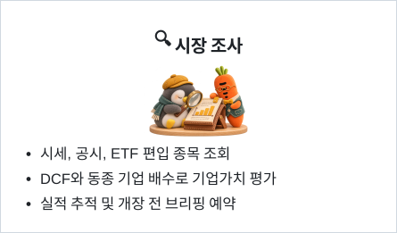
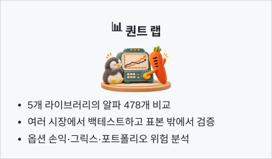

<p align="center">
  <a href="README.md">English</a> | <a href="README_zh.md">中文</a> | <a href="README_ja.md">日本語</a> | <b>한국어</b> | <a href="README_ar.md">العربية</a> | <a href="README_es.md">Español</a> | <a href="README_id.md">Bahasa Indonesia</a>
</p>

<p align="center">
  
</p>

<h1 align="center">Vibe-Trading: 당신의 개인 트레이딩 에이전트</h1>

<p align="center">
  <b>한 번의 명령으로 에이전트에 종합적인 트레이딩 역량을 더하세요</b>
</p>

<p align="center">
  <a href="https://www.star-history.com/HKUDS/Vibe-Trading"></a>
  <a href="https://trendshift.io/repositories/25527"></a>
  <a href="https://www.star-history.com/HKUDS/Vibe-Trading"></a>
</p>

<p align="center">
  <b>GitHub 주제별 스타 순위</b> · 2026년 11월 4일<br>
  <a href="https://github.com/search?q=topic%3Abacktesting&amp;type=repositories&amp;s=stars&amp;o=desc">#1 백테스트</a> &nbsp;·&nbsp;
  <a href="https://github.com/search?q=topic%3Aalgorithmic-trading&amp;type=repositories&amp;s=stars&amp;o=desc">#3 알고리즘 거래</a> &nbsp;·&nbsp;
  <a href="https://github.com/search?q=topic%3Aquantitative-finance&amp;type=repositories&amp;s=stars&amp;o=desc">#4 계량금융</a>
</p>

<p align="center">
  
  
  
  <a href="https://pypi.org/project/vibe-trading-ai/"></a>
  <a href="LICENSE"></a>
  <br>
  <a href="https://github.com/HKUDS/.github/blob/main/profile/README.md"></a>
  <a href="https://github.com/HKUDS/.github/blob/main/profile/README.md"></a>
  <a href="https://discord.gg/6TdQnT5xcF"></a>
</p>

<p align="center">
  <a href="https://vibetrading.wiki/">홈페이지</a> &nbsp;&middot;&nbsp;
  <a href="https://vibetrading.wiki/docs/">문서</a> &nbsp;&middot;&nbsp;
  <a href="#-뉴스">뉴스</a> &nbsp;&middot;&nbsp;
  <a href="#-주요-기능">주요 기능</a> &nbsp;&middot;&nbsp;
  <a href="#계좌와-거래">섀도 계좌</a> &nbsp;&middot;&nbsp;
  <a href="#-데모">데모</a> &nbsp;&middot;&nbsp;
  <a href="#-빠른-시작">빠른 시작</a> &nbsp;&middot;&nbsp;
  <a href="#-예제">예제</a> &nbsp;&middot;&nbsp;
  <a href="#-api-서버">API / MCP</a> &nbsp;&middot;&nbsp;
  <a href="#-로드맵">로드맵</a> &nbsp;&middot;&nbsp;
  <a href="#기여자">기여자</a>
</p>

<p align="center">
  <a href="#-빠른-시작"></a>
</p>

## 📰 뉴스

- **2026-11-12** 🛠️ **백테스트 시점, 보고서 수치와 연구 완료 판정 수정** — 섀도 계좌가 지정한 초기 자본을 사용하고, 출력 토큰 한도로 잘린 워커 응답을 완료로 처리하지 않습니다. 위원회 PM은 유효한 상위 보고서를 바탕으로 데이터를 다시 가져오지 않고 종합할 수 있습니다. 네이티브 Anthropic 어댑터의 기본 출력 예산은 변경 가능한 16,384 토큰입니다.
  생성 전략의 출력 목표에서 추가 시프트가 감지되면 의도한 지연이라고 명시해야 실행할 수 있으며, 지표의 lookback은 계속 허용됩니다. Grounding은 증거 검증을 유지하면서 금액 단위의 여러 표기와 정확한 관측값 선언을 지원합니다. 실제 SPY／GLD 백테스트의 206／140건 체결과 총수익률이 독립 장부 계산과 일치했습니다. **아직 출시되지 않았습니다.**

- **2026-11-11** 🧾 **모의거래 부분 체결과 독립적인 원장 대사** — 중국 A주 5분봉 모의거래에서 주문별 거래량 한도, 부분 체결, 주문 상태 출력을 선택적으로 활성화할 수 있습니다([#2128](https://github.com/HKUDS/Vibe-Trading/pull/2128)). 새로운 `paper_trade_reconcile` Agent/MCP 도구는 반환된 체결 기록을 바탕으로 수수료, 현금, 보유 포지션, 순자산가치(NAV) 계산을 독립적으로 대사합니다([#2197](https://github.com/HKUDS/Vibe-Trading/pull/2197)).
  지원되는 여러 줄 백분율 헤더와 원문의 레이블을 유지하는 문서 내 정수의 명시적 인용을 올바르게 처리합니다([#2185](https://github.com/HKUDS/Vibe-Trading/pull/2185), [#2192](https://github.com/HKUDS/Vibe-Trading/pull/2192)). 엄격한 팩터 벤치마크의 입력도 수정하고([#2195](https://github.com/HKUDS/Vibe-Trading/pull/2195)), 채널 대화에서 응답 대기 시간이 초과되었을 때 이전 답변을 반환하지 않도록 했습니다([#2194](https://github.com/HKUDS/Vibe-Trading/pull/2194)).
  [@shadowinlife](https://github.com/shadowinlife), [@he-yufeng](https://github.com/he-yufeng), [@Jackzigen](https://github.com/Jackzigen), [@divya0795](https://github.com/divya0795) 님께 감사드립니다! **`main`에 반영되었으며 다음 pip 릴리스에 포함됩니다.**

- **2026-11-10** 📊 **편집 가능한 IV 곡면과 옵션 분석 수정** — Options Lab에서 행사가·만기별 IV 그리드를 편집하고 관측값과 보간값을 구분할 수 있습니다. 외삽은 거부합니다([#2186](https://github.com/HKUDS/Vibe-Trading/pull/2186)).
  저가 종목 프리셋, 수량 입력, 만기일 표시, 재시도, 언어 변경 시 로딩 멈춤, 20개 레그 제한을 수정했습니다. `CF501`처럼 만기 부분이 세 자리인 정저우 상품거래소 코드는 이제 중국 선물 규칙으로 백테스트됩니다([#2193](https://github.com/HKUDS/Vibe-Trading/pull/2193)).
  [@he-yufeng](https://github.com/he-yufeng) 및 [@GPT-AGI](https://github.com/GPT-AGI)에게 감사드립니다! **`main`에 반영되었으며 다음 pip 릴리스에 포함됩니다.**

- **2026-11-09** 🧭 **선택한 리비전 비교 내보내기와 인식할 수 없는 코드를 거부하는 백테스트** — 비교 중인 두 연구 리비전을 Web, API, CLI에서 JSON 또는 Markdown으로 내려받을 수 있습니다([#2189](https://github.com/HKUDS/Vibe-Trading/pull/2189)). 어떤 시장 규칙에도 해당하지 않는 백테스트 코드(`local:BHP.AX`, `7203.T` 등)는 이제 중국 A주 규칙으로 실행되지 않고 데이터를 가져오기 전에 거부됩니다. 6자리 숫자만 있는 코드와 상하이 `.SS` 표기는 계속 사용할 수 있습니다. OpenRouter 응답에 모델 이름이 두 번 표시되지 않으며([#2191](https://github.com/HKUDS/Vibe-Trading/pull/2191)), `research-artifact export`에 빈 리비전 ID를 넘기면 오류가 납니다. [@he-yufeng](https://github.com/he-yufeng) 및 [@Gloubiboulgator](https://github.com/Gloubiboulgator)에게 감사드립니다! **`main`에 반영되었으며 다음 pip 릴리스에 포함됩니다.**

<details>
<summary>이전 뉴스</summary>

- **2026-11-08** 📝 **연구 버전 비교와 전체 이력 내보내기** — 두 리비전의 본문, 근거, 메타데이터를 비교하고([#2168](https://github.com/HKUDS/Vibe-Trading/pull/2168)), 전체 연구 이력을 JSON 또는 Markdown으로 내보낼 수 있습니다([#2170](https://github.com/HKUDS/Vibe-Trading/pull/2170)). 연구 기록을 전환할 때 오래된 응답을 무시하며, Markdown 내보내기는 원문을 독립된 코드 블록에 보존합니다. 팩터 가중치 누락, 일부 수익률 누락 시의 성과 귀속, IC 표본 부족, 유한하지 않은 가치평가 입력값, 음수 진입 가격의 증거금 계산도 수정했습니다. **`main`에 반영되었으며 다음 pip 릴리스에 포함됩니다.**

- **2026-11-07** 🧪 **Research Lab: 거래 비용과 표본 외 검증** — 저장된 가격 데이터로 수수료와 슬리피지를 바꿔 백테스트를 다시 실행합니다. 학습 결과만으로 매개변수를 선택한 뒤 고정해 표본 외 테스트와 별도의 최종 홀드아웃 검증을 수행합니다. [Research Lab](guides/research-lab.md)은 Web, CLI, API, Agent/MCP에서 같은 절차를 사용하며 UI는 11개 언어를 모두 지원합니다. 구간 경계의 수익률 누락, 팩터 초기화와 장기 구간 계산도 수정하고, 근거 부족을 명시하는 오프라인 작업 재검증 사례 20개를 추가했습니다. 버전별 연구 기록에 구조화된 재무 데이터를 저장할 수 있으며([#2164](https://github.com/HKUDS/Vibe-Trading/pull/2164)), 거래소 접미사가 없는 중국 선물 계약 코드의 인식도 수정했습니다([#2177](https://github.com/HKUDS/Vibe-Trading/pull/2177)). **`main`에 반영되었으며 다음 pip 릴리스에 포함됩니다.**

- **2026-11-06** 📈 **내재변동성 격자와 모의 거래 수정** — 제공된 옵션 관측값으로 행사가 × 만기의 IV 격자를 만들고 관측점과 보간점을 구분하며, 데이터 범위 밖으로 외삽하지 않습니다([#2172](https://github.com/HKUDS/Vibe-Trading/pull/2172)). 극단적인 수치 입력에는 유한한 결과 또는 명시적인 오류를 반환합니다. A주 5분봉 모의 거래에서 가격 제한으로 체결할 수 없는 시장가 주문은 즉시 취소합니다([#2176](https://github.com/HKUDS/Vibe-Trading/pull/2176)). 여러 종목의 체결 처리도 시간순으로 진행해 나중의 매도 대금으로 앞선 매수 주문을 충당하지 못하게 했습니다. **`main`에 반영되었으며 다음 pip 릴리스에 포함됩니다. 공개 5분봉 요청은 여전히 단계당 한 종목만 지원합니다.**

- **2026-11-05** 🚀 **v0.1.19 출시**([릴리스 노트](https://github.com/HKUDS/Vibe-Trading/releases/tag/v0.1.19), `pip install -U vibe-trading-ai`): 대화가 끝나도 남는 리서치 — 근거를 담은 연구 기록을 버전별로 저장하고 수정하며, 이전 턴과 세션의 백테스트를 재사용하고, 연구 목표를 그 자리에서 편집할 수 있습니다. 새 옵트인 기능: A주 5분 단위 모의 거래 시뮬레이션, Gildata 재무 조회·종목 선별 및 Shannon 포트폴리오 진단(QVeris는 제거되었고, 기존 `GILDATA_TOKEN`만으로는 아무 기능도 켜지지 않습니다). 또한 아르헨티나(BYMA) 백테스트, Parallel 웹 검색, Codex OAuth 모델 탐색을 추가하고 0.1.18의 회귀 두 건을 모두 수정했습니다. 병합된 풀 리퀘스트 116개와 메인테이너 커밋으로 반영된 21개이며 기여자는 26명입니다([CHANGELOG](CHANGELOG.md)).
  **오늘의 수정:** 백테스트가 실제로 평가한 벤치마크를 보고하고, 롱숏 포트폴리오에도 위험 분석(risk x-ray)을 제공합니다. GTJA alpha 17은 입력이 워밍업되는 동안 결측으로 유지되고, Shannon 패널은 11개 UI 언어를 모두 지원합니다. 검토를 마쳤지만 반영되지 않았던 기여자 수정 두 건도 반영했습니다([#2042](https://github.com/HKUDS/Vibe-Trading/pull/2042) 결측 분기를 건너뛰는 TTM 합계 수정, [#1985](https://github.com/HKUDS/Vibe-Trading/pull/1985) 3:2 주식 분할 감지). [@rudycelekli](https://github.com/rudycelekli), [@he-yufeng](https://github.com/he-yufeng), [@Jackzigen](https://github.com/Jackzigen), [@Shizoqua](https://github.com/Shizoqua), [@cgycorey](https://github.com/cgycorey), [@dajiaohuang](https://github.com/dajiaohuang), [@zeus229](https://github.com/zeus229), [@alexwan02](https://github.com/alexwan02), [@BHhhh-123](https://github.com/BHhhh-123), [@remote-controlled-man](https://github.com/remote-controlled-man), [@shadowinlife](https://github.com/shadowinlife), [@TWJxi](https://github.com/TWJxi), [@lishuanghong1989-netizen](https://github.com/lishuanghong1989-netizen), [@TerryF7](https://github.com/TerryF7), [@davidalmeida90](https://github.com/davidalmeida90), [@DrDLyuan](https://github.com/DrDLyuan), [@goatyyc](https://github.com/goatyyc), [@hnq-ai](https://github.com/hnq-ai), [@kadyrbekovhamit-cyber](https://github.com/kadyrbekovhamit-cyber), [@MetaAviator](https://github.com/MetaAviator), [@octo-patch](https://github.com/octo-patch), [@RowanAldean](https://github.com/RowanAldean), [@VectorPeak](https://github.com/VectorPeak), [@wavebyrd](https://github.com/wavebyrd), [@yufengsika](https://github.com/yufengsika)에게 감사드립니다!
  **릴리스 후 main에서 수정(다음 pip 릴리스에 포함):** 백테스트 벤치마크는 전략과 같이 평가 구간 첫 봉의 시가에 매수하며, 더 이상 워밍업 마지막 종가에서 계산하지 않습니다. 초과 수익에 그 움직임이 더 이상 포함되지 않습니다(AAPL 20/60 SMA 예: 22.5% → 18.4%).

- **2026-11-04** 📊 **Gildata 재무 조회·종목 선별 및 Shannon 포트폴리오 진단** — 시가총액 상위 세 종목과 반기 매출을 한 번에 조회할 수 있습니다. Shannon은 포트폴리오의 10개 요인 노출도와 각 보유 종목의 변동성 기여도를 보여 줍니다. 저장된 토큰이 있어도 아홉 기능을 각각 켜야 합니다. 무료 소스 조회가 실패해도 Gildata로 자동 전환하지 않습니다. [#2117](https://github.com/HKUDS/Vibe-Trading/pull/2117) · [#2118](https://github.com/HKUDS/Vibe-Trading/pull/2118) · [#2119](https://github.com/HKUDS/Vibe-Trading/pull/2119)
  백테스트 신호가 다음 봉의 시가에 체결된다는 점을 명시하고 Swarm의 시간 초과 오판을 수정했으며 연구 자료 중복 검사 속도를 높였습니다. [#2137](https://github.com/HKUDS/Vibe-Trading/pull/2137) · [#2155](https://github.com/HKUDS/Vibe-Trading/pull/2155) · [#2159](https://github.com/HKUDS/Vibe-Trading/pull/2159)

- **2026-11-03** 🛠️ **기록 무결성과 다국어 처리**. 추적·감사·세션 검색 JSONL에서 U+2028/U+2029를 보존하고 이후 기록도 정상적으로 추가합니다. 밑줄이 든 모델 이름을 정규화하고 2단계 압축에서 인계 요약을 보존합니다. BOM이 있는 메타데이터와 오른쪽에서 왼쪽으로 읽는 시작 화면을 지원하며 회귀 검사를 추가했습니다.

- **2026-11-02** 🛠️ **메타데이터와 결과 표시**. 따옴표로 감싼 스칼라 값을 올바르게 읽고 인코딩할 수 없는 대형 결과는 읽을 수 있는 길이로 줄입니다. 시작 화면과 추천 카드도 다듬고 회귀 검사를 추가했습니다.

- **2026-11-01** 🛠️ **세션 시간과 시작 화면**. 갱신 시각을 UTC로 기록하고 다크 모드의 주요 버튼 대비를 높였습니다. 사이드 패널 예제는 분류를 표시하고 클릭할 수 있으며 회귀 검사를 추가했습니다.

- **2026-10-31** 🛠️ **시작 화면과 종목 코드**. 따뜻한 종이색의 두 열 배치로 예제와 동작을 구분했습니다. 종목 끝의 문자를 A주 또는 A/H 조건으로 해석하던 문제를 수정했습니다.

[이전 뉴스 전체](guides/news.md) · [변경 내역](CHANGELOG.md)

</details>

## ✨ 주요 기능

<div align="center">
<a href="assets/features/ko/feature-market-research-card.svg"></a><a href="assets/features/ko/feature-research-teams-card.svg"></a><br/>
<a href="assets/features/ko/feature-quant-lab-card.svg"></a><a href="assets/features/ko/feature-trading-portfolio-card.svg"></a>
</div>

## 💡 Vibe-Trading 소개

금융 질문으로 리서치 보고서와 실행 가능한 백테스트, 모의 포트폴리오를 만듭니다. 지원되는 브로커에는 한도를 정해 실거래를 허용하고 언제든 중단할 수 있습니다. 자금은 브로커 계좌에 보관됩니다.

## ✨ 무엇을 할 수 있나요?

| 작업 | 시작 위치 |
|---|---|
| 시장과 공시 조사 | 웹 채팅에서 질문하거나 [보고서를 첨부](guides/research.md#upload--analyze-documents)합니다. |
| 전략과 알파 검증 | Run Detail에서 차트와 체결을 보고 `/alpha-zoo`에서 팩터를 비교합니다. |
| 모의 거래와 복기 | `/paper-trading`에서 일별 체결과 순자산을 보고 CLI의 `/journal`, `/shadow`로 복기합니다. |
| 계좌 합산과 배분 비교 | `/portfolio`에서 보유 종목과 배분 변경안을 확인합니다. [브로커 지원](#브로커-지원-현황) |
| 옵션과 상관관계 | `/options`에서 다중 레그 손익과 그릭스를, `/correlation`에서 시장 국면을 확인합니다. |
| 팀 운영과 정기 조사 | [Swarm 팀](guides/research.md#swarm-workflows)을 실행하거나 Pixel Office에서 업무를 배정하고 `/scheduled`에서 브리핑을 예약합니다. |
| 연구 근거 재검토 | `/research-artifacts`에서 날짜가 있는 [연구 기록](guides/research.md#versioned-research-artifacts)을 검색하고 두 리비전을 비교하며 전체 시리즈 또는 선택한 비교를 JSON 또는 Markdown으로 저장합니다. |

## ⚡ 실행 예제

`vibe-trading init` 실행 후 자연어로 백테스트를 요청하거나 터미널에서 팩터 라이브러리를 평가할 수 있습니다.

```bash
vibe-trading run -p "2024년 BTC-USDT의 20/50 이동평균 교차 전략을 백테스트하고 매수 후 보유와 비교해 최대 낙폭을 알려줘."
vibe-trading alpha bench --zoo gtja191 --universe csi300 --period 2018-2025 --top 20
```

**Run Detail**에서 매수 후 보유와 비교하고 낙폭 구간의 체결과 실행 카드의 데이터 소스를 확인하세요.

## 🧪 리서치 절차

| 단계 | 이동평균 교차 예시 |
|---|---|
| 계획 | 거래 쌍, 기간, 이동평균, 벤치마크를 정합니다. |
| 데이터 확인 | BTC-USDT 과거 봉의 출처와 날짜를 확인합니다. |
| 실행 | 전략을 작성해 백테스트합니다. 실행 폴더에 전략, 체결, 자산 곡선이 남습니다. |
| 검증 | 매수 후 보유와 비교하고 수익률, 회전율, 낙폭 및 검증 경고를 확인합니다. |
| 재검토 | 저장한 실행을 열거나 매개변수를 바꿔 질문합니다. 날짜별 결론을 저장하고 새 근거에 따라 수정할 수도 있습니다. |

## 📡 데이터 소스와 자동 전환

**시장 데이터 소스 28개**를 지원합니다. `source: "auto"`는 종목 코드로 시장을 판별해 설정 순서대로 조회합니다.

| 시장 | 조회 순서 |
|---|---|
| 중국 A주 및 홍콩 | Tencent에서 봉을 구하지 못하면 Eastmoney와 해당 시장의 다음 소스를 사용합니다. |
| 미국 주식 | Yahoo, Stooq, Sina 순으로 조회합니다. |
| 가상자산 | OKX, Binance, CCXT를 먼저 사용합니다. |
| 선물 | 중국 계약은 AKShare 또는 로컬 봉을 사용합니다. 해외 계약은 로컬 봉을 제공합니다. |

소스를 직접 지정할 수도 있습니다. `vibe-trading-ai[ashare]`를 설치하면 토큰 없이 BaoStock의 A주 일봉을 조회합니다. 전체 순서와 인증 요건은 [데이터 소스 문서](guides/capabilities.md#-data-sources--smart-fallback)에 있습니다.

## 🔩 세부 기능

### 시장 조사

| 기능 | 사용 방법 |
|---|---|
| 공시와 보유 종목 | SEC 13F로 운용사 보유 종목을 분기별로 비교하거나 ETF 편입 종목을 확인합니다. 각 보고서에 기준일을 표시합니다. |
| 기업가치 평가 | `/dcf`로 할인율과 영구성장률의 영향을, `/comps`로 동종 기업 배수를 봅니다. 재무제표 연계 모델을 Excel로 내보낼 수 있습니다. |
| 논문과 문서 | arXiv와 OpenAlex에서 신호의 정의를 찾아 내 종목군에서 검증합니다. 공시, 표, 슬라이드를 올려 특정 도표를 질문할 수 있습니다. |
| 종목 선별 | Gildata를 켜면 시가총액으로 선별하며 반기 매출도 조회합니다. 선별과 포트폴리오 팩터 진단은 각각 활성화합니다. |

### 퀀트 리서치

| 기능 | 사용 방법 |
|---|---|
| Alpha Zoo | Qlib, Alpha101, GTJA, 학술 및 펀더멘털 신호의 기간별 정보계수를 비교하고 워크포워드 검증을 수행합니다. |
| 백테스트 엔진 | A주 가격제한, 가상자산 펀딩비, 선물 증거금을 반영합니다. 여러 시장이 자금을 공유하며 개별 체결을 확인할 수 있습니다. |
| 옵션 랩 | 레그별로 스프레드를 구성해 만기 손익, 그릭스, 현물 가격과 내재변동성 변화의 영향을 비교합니다. |
| 포트폴리오 위험 | 낙폭, VaR, 기대손실을 살펴보고 Brinson 분석으로 자산 배분과 종목 선택 효과를 나눕니다. 상관관계 변화도 확인합니다. |
| 전략 추적 | 근거와 함께 전략을 등록하고 새 결과에 따른 샤프 비율이나 팩터 정보계수를 추적합니다. |

### 계좌와 거래

| 기능 | 사용 방법 |
|---|---|
| 포트폴리오 | 읽기 전용 계좌의 보유 종목을 합산하거나 extraETF 파일을 가져옵니다. 목표 비중으로 종목별 금액 변화를 미리 봅니다. |
| 모의 거래 | 저장 계좌를 하루씩 진행해 체결, 현금, 순자산을 봅니다. 별도의 모의 환경에서 A주를 5분 단위로 재생할 수도 있습니다. `paper_trade_reconcile` agent/MCP 도구는 시장이나 브로커에 접근하지 않고 수수료, 현금, 포지션과 NAV 산식을 독립적으로 검증합니다. |
| 섀도 계좌 | 브로커 거래 내역을 가져와 수수료와 매매 습관을 확인하고 규칙에 따른 재현 결과와 비교합니다. |
| 브로커 연결 | CLI나 웹에서 연결한 뒤 읽기로 확인합니다. 실거래를 켜기 전 종목·주문·노출 한도를 정하며 긴급 중단도 가능합니다. |

### 팀과 정기 리서치

| 기능 | 사용 방법 |
|---|---|
| Swarm과 Pixel Office | 강세·약세 투자위원회나 퀀트 팀의 보고서를 확인하고, Pixel Office에서 업무를 배정해 결과를 공동 보드에 기록합니다. |
| 정기 브리핑 | 개장 전 브리핑, 실적 추적, 포트폴리오 점검을 예약해 설정된 Slack, Telegram, 이메일로 보냅니다. |
| 조사 기록 | 이전 대화와 저장 실행을 다시 엽니다. 날짜와 근거를 붙여 결론을 저장하고 투자 가설이 바뀌면 버전을 비교합니다. |
| 실행 기록 | 백테스트의 데이터 소스, 모델, 실행 기록, 지표 근거를 확인하고 체결과 자산 곡선으로 수치를 검토합니다. |

### 브로커 지원 현황

<details>
<summary>브로커별 조회·모의·실거래 비교</summary>

조회는 읽기 전용 프로필, 모의는 샌드박스 또는 로컬 모의 주문, 실거래는 위임 한도 내 주문입니다. ✓는 선언된 지원, —는 해당 프로필 없음을 뜻합니다.

<!-- BEGIN GENERATED broker-overview -->

| 브로커 | 조회 | 모의 | 실거래 |
| --- | :---: | :---: | :---: |
| alpaca | ✓ | ✓ | ✓ |
| binance | ✓ | ✓ | ✓ |
| dhan | ✓ | ✓ | — |
| etoro | ✓ | ✓ | ✓ |
| futu | ✓ | ✓ | ✓ |
| ibkr | ✓ | — | — |
| kis | ✓ | ✓ | — |
| longbridge | ✓ | ✓ | — |
| mstock | ✓ | — | — |
| mt5 | ✓ | ✓ | ✓ |
| okx | ✓ | ✓ | ✓ |
| robinhood | ✓ | — | ✓ |
| scalable | ✓ | — | — |
| shoonya | ✓ | ✓ | — |
| tiger | ✓ | ✓ | ✓ |
| toss | ✓ | — | — |
| trading212 | ✓ | — | — |
| upbit | ✓ | ✓ | — |
| zerodha | ✓ | ✓ | — |

<!-- END GENERATED broker-overview -->

</details>

[프로필별 전체 권한](guides/portfolio-and-brokers.md#full-broker-permissions)

## 🎬 데모

<table>
<tr><th width="50%">웹 · 질문부터 백테스트까지</th><th width="50%">CLI · 대화형 터미널</th></tr>
<tr>
<td width="50%" valign="top">

https://github.com/user-attachments/assets/2c595ee1-c577-481a-9460-34ea12bcf41c

</td>
<td width="50%" valign="top">

https://github.com/user-attachments/assets/ac79426e-f3f7-4349-b0d5-d997a2725784

</td>
</tr>
<tr><td>전략 요청을 입력하고 작업 진행과 결과를 확인합니다.</td><td>터미널에서 리서치 템플릿 목록을 살펴보고 개장 전 브리핑을 엽니다.</td></tr>
</table>

## 🚀 빠른 시작

Python 3.11 이상에서 설치한 뒤 설정 마법사에서 모델 제공자를 선택하고 CLI를 엽니다.

```bash
pip install vibe-trading-ai
vibe-trading init
vibe-trading
```

Docker로 웹과 API를 `http://localhost:8899`에서 함께 실행합니다. 처음 복제한 뒤 컨테이너 시작 전에 제공자를 설정하세요.

```bash
git clone https://github.com/HKUDS/Vibe-Trading.git
cd Vibe-Trading
cp agent/.env.example agent/.env
# agent/.env에 제공자와 API 키를 설정하세요.
docker compose up --build
```

PyPI 패키지에는 CLI, API, MCP 서버가 포함됩니다. 프런트엔드 개발 및 로컬 모델은 [설치 안내](guides/installation.md)를 참조하세요.

## 🖥 CLI 명령

`vibe-trading`을 실행하고 `/help`로 명령을 확인하세요.

| 명령 | 용도 |
|---|---|
| `/model` | 대화의 제공자나 모델을 전환합니다. |
| `/history` | 이전 대화를 찾아 이어갑니다. |
| `/show <run-id>` | 저장된 실행 결과를 엽니다. |
| `/pine` | 현재 전략을 Pine Script 지표로 내보냅니다. |

셸에서 `vibe-trading alpha list`로 팩터 라이브러리를, `vibe-trading playbook list`로 정기 조사 템플릿을 봅니다.

## 💡 예제

- 2024년 AAPL과 MSFT의 수익률 차이가 가장 컸던 달을 물은 뒤 `/history`로 대화를 이어가세요.
- `/journal`로 거래 내역을 분석하고 `/shadow`로 규칙 기반 결과와 비교하세요.
- 종목을 골라 투자위원회의 강세·약세 의견과 최종 보고서를 확인하세요.

```bash
vibe-trading --swarm-run investment_committee '{"target":"TSLA","market":"US"}'
```

## 🌐 API 서버

`vibe-trading serve --port 8899`를 실행하세요. 다른 터미널에서 `curl http://localhost:8899/runs`로 목록을 조회한 뒤 ID를 넣어 `GET /runs/{run_id}`로 결과를 봅니다.

| HTTP 조사 작업 | 엔드포인트 |
|---|---|
| 대화 생성 | `POST /sessions` |
| 질문 전송 | `POST /sessions/{id}/messages` |
| 진행 상황 구독 | `GET /sessions/{id}/events` |

`http://localhost:8899/docs`에서 시험할 수 있습니다. [인증 클라이언트](guides/cli-and-api.md#security-defaults)는 `Authorization: Bearer` 헤더에 API 키를 보냅니다.

## 🔌 MCP 플러그인

MCP 클라이언트는 같은 패키지를 stdio로 실행합니다. Claude Desktop의 `claude_desktop_config.json`에 다음 항목을 추가한 뒤 재시작하고 `list_skills`를 호출하세요.

```json
{
  "mcpServers": {
    "vibe-trading": { "command": "vibe-trading-mcp" }
  }
}
```

다른 클라이언트와 출력 폴더 설정은 [MCP 구성](guides/mcp.md)을 참조하세요.

## 🏛 생태계

Vibe-Trading은 **[HKUDS](https://github.com/HKUDS)** agent ecosystem의 일부입니다:

<table>
  <tr>
    <td align="center" width="20%">
      <a href="https://github.com/HKUDS/nanobot"><b>NanoBot</b></a><br>
      <sub>초경량 개인 AI 어시스턴트</sub>
    </td>
    <td align="center" width="20%">
      <a href="https://github.com/HKUDS/AI-Trader"><b>AI-Trader</b></a><br>
      <sub>Agent-Native Signal &amp; Copy Trading Platform</sub>
    </td>
    <td align="center" width="20%">
      <a href="https://github.com/HKUDS/CLI-Anything"><b>CLI-Anything</b></a><br>
      <sub>모든 소프트웨어를 agent-native로</sub>
    </td>
    <td align="center" width="20%">
      <a href="https://github.com/HKUDS/OpenSpace"><b>OpenSpace</b></a><br>
      <sub>자가 진화 AI agent skills</sub>
    </td>
    <td align="center" width="20%">
      <a href="https://github.com/HKUDS/ClawTeam"><b>ClawTeam</b></a><br>
      <sub>Agent Swarm Intelligence</sub>
    </td>
  </tr></table>

---

## 🗺 로드맵

| 영역 | 현재 제공 | 예정 |
|---|---|---|
| 모의 거래 | 일별 현금, 체결, 순자산을 세션 간 보존합니다. 별도의 모의 환경에서 A주 거래일을 5분 단위로 재생합니다. | 선택형 거래량 비율 체결([#2128](https://github.com/HKUDS/Vibe-Trading/pull/2128), 초안). |
| 리서치 | 실행 카드에 백테스트 지표와 근거를 기록합니다. 날짜별 연구 기록은 개정 이력을 보존하며 검색할 수 있습니다. | 연구 기록의 구조화된 재무 데이터([#2164](https://github.com/HKUDS/Vibe-Trading/pull/2164), 검토 중). |
| 옵션 랩 | 다중 레그 손익과 그릭스, 현물 × IV 시나리오를 봅니다. | `/options`에서 대화형 변동성 곡면 그리드를 제공합니다. |

## 기여하기

[첫 기여용 이슈](https://github.com/HKUDS/Vibe-Trading/issues?q=is%3Aissue+is%3Aopen+label%3A%22good+first+issue%22)를 선택하거나 큰 변경은 먼저 이슈에서 논의하세요. 환경 설정과 PR 전 검사는 [기여 안내](CONTRIBUTING.md)에 있습니다.

## 기여자

Vibe-Trading에 기여해 주신 모든 분께 감사드립니다!

### v0.1.19 · 기여자

- @rudycelekli — 58 PRs (12 landed as maintainer ports): GTJA alpha formulas restored to the report (#2036/#2037/#2038/#2039/#2040/#2051), loaders that ask each vendor for the ticker form it serves and page at its own cap (Alpha Vantage #1997, AKShare #1998, CCXT #1999, Tushare minute lots #2001, Tiingo/Stooq class shares #2010/#2012, Nobitex Tehran days #1989, push2 decimals #1988), futures and market fees (micro index price limits #1992, the 30-year treasury fee #1994, India stamp duty on short covers #1995), quant-library and governance fixes (#1950/#1959/#1960/#1962/#1963/#2000/#2017), sub-penny prices kept in trades and charts (#1987/#1990), TTM sums that stop at a missing quarter (#2042), 3:2 splits and ST board limits in paper trading (#1985/#1984), a live halt key that cannot alias the global halt (#2003), session, memory, CLI and API fixes (#1969/#1970/#1982/#2002/#2006), and a string-"false" sweep across ten tools (#1976/#1977/#2008/#2009/#2011/#2013/#2014/#2015/#2016/#2018)
- @he-yufeng — 18 PRs (5 landed as ports): versioned research artifacts (#2079/#2159), background tasks scoped to their owner, reaped on cancel and reconciled after a restart (#2092/#2098/#2100/#2157), silent provider streams interrupted (#2099), cache and reasoning tokens kept in `llm_usage` (#2109), one tool policy across providers (#2087), Claude CLI tool-attempt recovery and structured finals (#2048/#2064/#2120), Qlib BETA/RESI/ROC/CORD semantics (#2062/#2069), magnitude suffixes in derived formulas (#2134), long/short risk x-ray and validation that refuses non-positive equity (#2162/#2161), and Unicode-safe swarm heartbeats (#2155)
- @Jackzigen — the bar-agnostic paper order lifecycle (#2066), swarm runs that stop when cancelled from the chat (#2059/#2060), document figures and percentage points in grounding (#2058/#2108), Robinhood portfolio reads with account selection (#2054), Moonshot reasoning effort for kimi-k3.1-pro (#2043), and Eastmoney JSONP, AKShare 1.20 forex and bare US ETF symbol fixes (#2082/#2083/#2086)
- @Shizoqua — research goals edited in place (#2093), Feishu, Teams, WeChat, WhatsApp and Discord channel fixes (#1957/#1958/#1967/#2078/#2114), heredoc commands in the bash tool (#2077), path-escape tests (#2094), and a run-directory fallback that no longer depends on the process cwd (#2116, landed as a port)
- @cgycorey — global futures priced on real contract multipliers and micro rates, with generic defaults reported (#1965/#1966/#1968/#1972), and a shadow account that honours every entry condition and currency (#2073/#2075)
- @dajiaohuang — transfer flow signs (#2023), aligned attribution benchmarks (#2044), overflow-free weight normalisation (#2046), and boolean payoff quantities refused (#2049)
- @zeus229 — the BYMA engine for Argentine shares and CEDEARs (#2071), backtests reused across turns and sessions (#2074), Codex OAuth model discovery (#2080), and financial units kept in grounding evidence (#2072)
- @alexwan02 — Longbridge per-currency cash (#1940), `.env` read by the MCP server (#1974), and Futu US symbol mapping (#2076)
- @BHhhh-123 — cross-sectional factor combination with walk-forward weights (#1953), field-level data availability in alpha bench (#2057), and factor research provenance (#2067)
- @remote-controlled-man — comma-grouped document integers (#2135), one bounded retry for a withheld final answer (#2136), and A-share source setup docs (#2138)
- @shadowinlife — the opt-in five-minute A-share paper step and its bar-by-bar matching (#2110/#2111), and JoinQuant limit fills (#2127, landed as a port)
- @TWJxi and @lishuanghong1989-netizen — Gildata stock discovery and financial queries (#2117), stock screening with report-period indicators (#2118), and Shannon portfolio style and risk analysis (#2119)
- @TerryF7 — IBKR and Futu gateway endpoints per connection (#1983), and connection deletion without a credential vault (#2153, landed as a port)
- @davidalmeida90 — the next-bar signal delay documented in the strategy skill (#2137)
- @DrDLyuan — STAR Market and Beijing buys sized on their own order grid (#2105)
- @goatyyc — Binance HTTP 451 read failures explained (#1937)
- @hnq-ai — a crawlable documentation wiki (#2165, landed as a port)
- @kadyrbekovhamit-cyber — Heston prices for short expiries (#2140)
- @MetaAviator — invalid journal quantities refused (#2052)
- @octo-patch — MiniMax M3.1 Flash as the default MiniMax model (#1936)
- @RowanAldean — optional Parallel search in `web_search` (#2113)
- @VectorPeak — voice notes forwarded in four IM adapters (#2106)
- @wavebyrd — Yahoo three-letter `=X` forex symbols read as USD pairs (#1980)
- @yufengsika — non-finite and boolean inputs refused by financial rigor checks (#2053)

<details>
<summary>v0.1.17 및 v0.1.18 사이클 기여자</summary>

**v0.1.18** · @warren618 (Haozhe Wu) 도구 스키마를 필요할 때 불러오도록 했고, 큰 조사 결과를 실행 산출물에 보존하며 중단된 모델 호출의 사용량 집계를 수정했습니다.

- @rudycelekli — a 92-PR correctness sweep (13 of them landed as maintainer ports): quant-library guards and edge cases (implied-vol price tolerance #1657, gaps in VaR breach transitions #1658, Heston inputs #1719, scheduled CDS coupons #1716, Carino coincidence #1943, undefined probabilistic-Sharpe and bond-accrual inputs #1821/#1822), missing prices kept out of risk x-ray return pairs and OU lag pairs (#1717/#1713), an undefined three-scenario upside and unbounded journal ratios reported as such (#1921/#1884), document reading that keeps PDF text, Word order, PowerPoint groups and Excel missing-value markers (#1838/#1839/#1840/#1841), session search limits, locking and snippets (#1827/#1828/#1832/#1834), more secret formats redacted (#1874/#1880), A-share board limits and Beijing codes (#1913/#1914), standalone revalidation and attribution on the run's own annualisation (#1915/#1948), and settings the selected engine ignores now warned about (#1947)
- @Shizoqua — 25 PRs (2 landed as ports): memory and cross-session search that read back clean and match non-English text (#1682/#1686/#1697/#1771/#1772), skill headings and saved skill names resolved consistently (#1797/#1858), Telegram and Matrix replies no longer dropped when the stream preview never sent and one WeCom stream id per reply (#1860/#1903/#1929), SSE events no longer double-delivered on reconnect (#1798), parallel CLI tool results paired with their own call (#1859), goal evidence confined to the claimed run (#1895), Carhart momentum no longer leaking today's price (#1578), Wilder RSI in the shadow account (#1457), direct-SDK positions priced from `current_price`/`ltp`/`market_val` (#1581), the email SPF/DKIM spoofing check (#1508), and swarm artifacts cleared before each fresh task (#1455)
- @he-yufeng — 24 PRs (2 landed as ports): the declared grounding-check registry and the fired checks recorded in the validation artifact (#1628/#1691/#1661), corrections that keep the figures already passed (#1702), percent-named evidence read as points in derived checks (#1823), additive A-share qfq converted to multiplicative when the offsets validate (#1551), mootdx retired from the default A-share chain and the health canary (#1730), the channel-authoring contract (#1630), the compaction-helper split out of `loop.py` (#1631), the first bar's result counted against initial capital in the options engine and per-bar returns (#1750/#1844), config keys nothing reads warned about (#1935), the US early-bell close on half-days (#1706), and the ReportLab fallback for Shadow Account PDFs (#1683)
- @shadowinlife — 19 PRs (5 landed as ports): daily paper trading with saved accounts across CLI, API and Web (#1939), the shared scheduler kernel adopted by the research, back-office and live loops (#1893/#1899), token usage in Run Detail, chat and swarm (#1890), `read_run_artifact` and a structured backtest tool summary (#1647/#1646), `get_southbound_flow` and a northbound flow that no longer serves a silent empty envelope (#1486/#1484), guided Web UI setup for Feishu, Slack and Discord with runtime errors surfaced in channel status (#1572/#1764/#1777/#1738/#1737), and thirteen fundamental and valuation factors, industry-neutral A-share value alphas and a monthly-horizon IC bench (#1787/#1788/#1802/#1801)
- @zeus229 — 18 PRs (4 landed as ports): grounding that fails closed on unresolved derived refs and suggests exact refs (#1835/#1837/#1638), parses complete derived formulas after labels (#1728), keeps identity in ticker-keyed metrics and blank-corner matrices (#1851/#1850) and leaves execution metadata out of numeric evidence (#1767); rich Email scheduled reports with optional PDF password protection (#1680/#1709), channel-aware scheduled-run editing (#1649), reproducible indicator reads and pinned portfolio snapshots (#1768/#1769), redundant MCP payload copies removed before agent context (#1634), and goal tool-call provenance (#1688)
- @alexwan02 — 16 PRs (4 landed as ports): the `claude-cli` provider backed by a local `claude -p` (#1804), Hong Kong orders sized on each symbol's own board lot (#1813), the Longbridge SDK config built through `from_apikey` (#1805), Futu multi-currency balances with average-cost basis (#1814), SDM registration that keeps its trading rules and records bench history for decay monitoring (#1848/#1849), a lightweight run preview built off the event loop (#1853), run trades listed newest first from the full trades.csv (#1865), trades.csv entry rows, offline benchmarks and Brinson weights fixed (#1780/#1781/#1782), and runtime connectors ordered by status (#1845)
- @Jackzigen — 13 PRs (2 landed as ports): the first `loop.py` extractions for tool-result helpers, run outcome and tuning (#1636/#1641/#1678), a byte-stable system prompt for prefix caching (#1708), after-close SEC filings kept out of the IC until the next bar (#1794), a free BaoStock fallback for `val:*` panels (#1799), undefined correlation pairs published as null instead of 0.0 (#1933), journal PnL pooled per settlement currency (#1811), `BASE-USDT-PERP` routed to the crypto market (#1864), the mStock read-only profile (#1675), and the shared OHLCV contract assertion in per-loader suites (#1725)
- @cgycorey — 12 PRs (3 landed as ports): only the engine's own output grounds a backtest report (#1685), adjusted and raw prices never mixed in one series (#1684), a stooq challenge latch that stops probing and sees every refusal (#1637/#1640), a loader health lane that says why a source is empty and keeps labelled credentials out (#1643/#1698), `get_macro_series` reporting when it caps a series (#1676), env-style credential names, URL userinfo and Basic auth redacted (#1765/#1742/#1744/#1846), and suffixed HK codes normalized for the duplicate-asset guard (#1746)
- @MetaAviator — 12 PRs (2 landed as ports): full-sample downside deviation for Sortino in the metrics and options engines (#1693/#1727), initial capital in Monte Carlo path metrics (#1664), missing equity kept out of adjacent validation returns (#1754), standalone revalidation that honours saved settings and entry dates (#1815/#1842), break-even exits and zero-bar trades kept in trade artifacts and holding periods (#1779/#1876), and trade-journal fixes for reversal fees, split date/time columns, equal timestamps and invalid dates (#1891/#1900/#1941/#1942)
- @lorenzozanee — unsupported Robinhood option orders gated before the broker (#1585), run cards that flag backtests possibly inside the model's training data (#1618), and option evidence in the broker bring-up checklist (#1770)
- @Mikesad — LLM usage accounting extracted from `loop.py` (#1662), swarm presets that take their variables from the prompt (#1674, landed as a port), and the factor registry suite running without symlink privileges (#1696)
- @remote-controlled-man — options legs priced on the run's bar cadence (#1753), the Futu journal format claimed only when its value columns exist (#1766), and three-statement balance tolerance threaded into projected periods (#1786, landed as a port)
- @Romzhou — a kill-switch sweep that fails closed on its own bookkeeping and input (#1703), and a runner driver kept alive for the scheduler's lifetime (#1704)
- @sambazhu — three Gildata research tools with off-exchange fund NAV (#1485), and an env-configurable ReAct iteration cap (#1833)
- @wavebyrd — spread and swap rates for Yahoo `=X` forex pairs (#1930), and per-cent multipliers for ICE coffee, sugar and cotton (#1944)
- @BHhhh-123 — factor neutralisation and PCA in the quant library (#1817, landed as a port)
- @Bortlesboat — Calmar kept finite on explosive equity paths (#1901)
- @bygordon130-hub — Pixel Office, a shared manual research-task board, and the Turkish locale (#1616)
- @davidalmeida90 — profit factor reported as undefined when no trade lost (#1602)
- @DrDLyuan — the equity.csv drawdown peak seeded with initial capital (#1818)
- @Emad211 — per-channel configuration, custom providers and the Persian locale (#1264)
- @Frank-zhu2000 — Futu profiles no longer pinning the HK trade market (#1812)
- @goatyyc — Binance balances that survive clock skew, with unpriced assets marking the snapshot incomplete (#1505)
- @hunters1011-ctrl — symlink tests skipped where symlinks are unavailable (#1803)
- @incorpore — Brazil (B3) market data and an opt-in ZimaOS template (#1783, landed as a port)
- @mdb1230 — five example options strategies and a candidate study of which to paper-trade (#1774)
- @mminkus — the interactive message cap raised to match the scheduled-run path (#1701)
- @passionbull — KIS reads that see SOR fills and recover from a server-invalidated token (#1726)
- @rwxyx518-prog — the Portfolio page's holdings table and history chart following the display currency (#1810)
- @ThreeTima — currency identity checked in financial figure grounding (#1905)
- @tomaszkubiak-courses — strategy provenance model fields set on the loop, so writing a strategy file no longer raises `AttributeError` (#1673)
- @xaritoku — dotenv loaded in the `alpha bench` / `alpha compare` CLI handlers (#1806)

</details>

<details>
<summary>v0.1.16 사이클 기여자</summary>

- @Shizoqua — a 55-PR correctness sweep (one landed as a port) across nearly every layer: quant-library fixes and input guards (Patell z degrees of freedom #1449, copula ties #1453, Kyle's lambda intercept #1477, HRP labels #1555, non-finite impact and yield-curve inputs #1557/#1558), Alpha Zoo NaN propagation and formula fixes (gtja191_038 #1523, alpha101_074 #1534, qlib158 WVMA #1594, GTJA HIGHDAY/LOWDAY #1604), backtest sizing for negative futures prices and shorts (#1547/#1548), venue bars per year in Monte Carlo validation (#1546), options annual return over elapsed bars (#1458), memory, swarm-store and session robustness (#1450/#1525/#1545/#1536/#1579), DingTalk, Signal, Slack and Discord channel fixes (#1506/#1478/#1524/#1537), Argentina listing identity in grounding (#1575), and a mandate narrowed to zero exposure stored as zero (#1593)
- @zeus229 — grounding that reads locale decimals and grouped numbers with precision-aware rounding (#1517/#1588), resolves explicit symbols and exact field refs from observed evidence (#1584/#1586), preserves `latest_date` timestamps (#1590) and keeps corrections text-only (#1600); Argentina (`.BA`) market data through Yahoo (#1543), ISO-4217 portfolio currencies with isolated FX failures (#1510), explicit header names compared case-insensitively (#1568), technical-indicator volume statistics and their replay after compaction (#1571/#1601), and bounded read-only replay after compaction (#1488)
- @cgycorey — a read-only extraETF export reader (#1406) and the read-only Scalable Capital MCP connector (#1417), run cards that keep non-scalar metrics (#1424), the backtest tool naming the directory it looked in (#1429), a tool-declared swarm `run_dir` confined to the workspace and worker message logs persisted on every terminal path (#1430/#1439), qlib158 CNTP/CNTN/CNTD NaN propagation (#1459), custom zoo roots that no longer replace the bundled module (#1468), `get_shareholder_count` answering again (#1490), Tencent's A-share and HK calibers stamped correctly (#1497)
- @shadowinlife — IM channels configured from the Web UI, with QQ, Email and WebSocket guided setups (#1520/#1529/#1544), stdlib logging placeholders across 12 channel adapters (#1533), Tencent history paginated backward from the end of the window (#1411), `state.json` written by the backtest tool so tool-driven runs are ingestible (#1413), per-worker swarm skill allowlists (#1414), the `1M` interval no longer folding to one minute (#1487), and welcome quick actions with a real selected state (#1500)
- @he-yufeng — tail-risk measure and confidence kept through the grounding gate (#1444), full history in the risk x-ray instead of sampled rows (#1462), shareholder-count history from the per-period report (#1518), backtests attaching to a running MT5 terminal without credentials (#1598), a per-read BaoStock socket deadline (#1615), the weekly live-source health canary (#1627), the broker capability matrix generated into the README (#1629), and the channel `stop_all` and WebSocket logger fixes carried over from #1521
- @lorenzozanee — dragon-tiger seat reports and lockup expiry data restored (#1512/#1513), malformed Robinhood buying power rejected (#1526), broker-only MT5 symbols resolved in `search_symbol` (#1597), hash-only traces and citations on run cards (#1612), expired Copilot CLI tokens refreshed (#1619), and Telegram polling ownership documented (#1583)
- @chiww — the Stooq warning naming the override variable the config layer reads (#1402), A-shares routed by market for sources without a dedicated branch (#1431), the declared interval checked against the served bars before annualising (#1432), and `_NO_NETWORK_FALLBACK_SOURCES` honoured for per-symbol gaps (#1441)
- @as950118 — three Korean broker connectors: KIS with separate paper and live hosts (#1407), Upbit capped at paper plus read-only (#1408), and read-only Toss Securities (#1409)
- @0xouzm — SDM decay metrics that treat NaN and infinite bench results as missing (#1447)
- @alanwilhelm — synchronized cold loader-registry initialization, so concurrent first lookups no longer see an empty registry (#1405)
- @modelpath-dev — the description-driven strategy-store adaptation substrate (#1391)
- @sambazhu — the Gildata A-share OHLCV loader over its raw-api MCP endpoint (#1474)
- @tingkk — broker-neutral SDK diagnostics across all locales (#1436)
- @tonydo — OpenCode as a built-in provider, sending the `x-opencode-session` header OpenCode Go requires (#1416)
- @woshi77777stars — the `Trigger.market` default restored on non-market triggers (#1599)
- @Yoruxyv — the Bahasa Indonesia UI locale and `README_id.md` (#1482)

</details>

<details>
<summary>v0.1.15 사이클 기여자</summary>

- @Shizoqua — 28 PRs: NaN propagated through 16 GTJA and Alpha101 alphas instead of fabricated values (#1371/#1372/#1373/#1374/#1379/#1380/#1381/#1382/#1383) and Alpha Zoo returns no longer forward-filling gaps (#1172), missing-price gaps preserved in the SDM template and cross-market volatility weights (#1397/#1398), multi-factor and social-media factor evaluation fixes (#1399/#1400), walk-forward ML training without future-label leakage (#1392), China futures product codes parsed for digit-prefixed, month-code-colliding and lower-case symbols (#1369/#1389), composite sub-engines synced before every dispatch (#1370), per-regime position sizing in strategy discovery (#1368), MCP goal sessions isolated per connection with current-goal defaults (#1173/#1331), Codex token usage and model metadata (#1334/#1348), and swarm cancellation reaching the in-flight worker (#1175)
- @he-yufeng — 26 PRs, mostly fail-closed live trading and backtest semantics: broker API errors and error envelopes fail closed in position reads and the halt sweep (#1212/#1232), the flatten latch persists across restarts (#1233), market-triggered ticks skip closed markets (#1253) and buy-limit orders are sized at the worse of quote and limit (#1312); the price-adjustment caliber stamped on served frames (#1317) with adjusted Yahoo prices (#1287), unresolved symbols retried down the fallback chain (#1288) and the stooq anti-bot challenge flagged (#1342); short option legs holding margin (#1306), perpetual funding settled by bar span (#1307), A-share and India rules enforced through composite state (#1309) and halted positions marked at the last traded close (#1332); Shadow Account PnL, attribution, FIFO short lots and cache keys (#1217/#1310/#1311/#1314); and each monitor's latest verdict rendered on the list (#1156)
- @cgycorey — 23 PRs: UK (LSE `.L`) equity support (#1206), swarm replay/resume of failed runs keeping completed artifacts (#1158), market-data validation of codes, dates and sources with aligned FX/index search and fetch (#1185/#1316), dotted US class shares routed as US equity (#1351), backtest execution fixes — requested targets separated from executed fills, 1x shorts liquidated, option signals filled on the next bar, default IV for HV warm-up and over-committed baskets scaled (#1281/#1298/#1299/#1305/#1344); live halt-sweep envelopes, per-episode latches and MCP buy-limit sizing (#1244/#1254/#1361); grounding clause and metric-table gates (#1326/#1338/#1375/#1378); the registry NaN contract on declared dependencies (#1377); compaction sized by tool-call arguments (#1352); and report audits that fail closed when nothing was verified (#1362)
- @santhreal — 16 PRs extending the quant library: factor risk decomposition, event-study rank and sign tests, OU calibration, drawdown analytics, barrier options, single-name CDS, key-rate duration, IC time series, Vasicek credit loss and group-purged CV (#1159–#1168), Heston pricing, HRP allocation, copulas and market microstructure (#1195–#1198), finite-difference barrier Greeks (#1203), and multi-segment test sets in cross-validation (#1204)
- @AirHua-byte — multi-file drag-and-drop and paste uploads (#1179), interrupted replies recovered after a service restart (#1180), shared HTTP clients preserved during cleanup (#1182), agent-confirmed scheduled research tasks (#1187), persisted Feishu QR login credentials (#1188), explicit market context kept in grounding (#1269), and the offline harness artifact verifier (#1271)
- @lorenzozanee — silent order-plan rejections surfaced through an `_on_plan_rejected` hook (#1245), the temperature self-heal on the OpenAI-compatible path (#1246), escalating stream retry delays that honour Retry-After (#1247), USD-M tolerance calibration (#1248), FMP's Stable endpoint with no silent fallback for an explicit source (#1276), adjusted prices on the FMP and Tiingo paths (#1320), and EPERM handled in desktop updater shutdown checks (#1284)
- @goatyyc — the read-only multi-broker portfolio dashboard and connection framework (#1072) with connector onboarding contracts (#1250), IBKR official MCP OAuth with verified read tools (#1190), and an isolated portfolio OAuth reconnect lifecycle with classified failures (#1211/#1251)
- @saju01 — the agent loop keeping tool results the model still needs (#1341), compacted results reconciled by exact call identity (#1358), and grounding that no longer reads percentage-point deltas as quoted prices (#1346/#1357)
- @aminak58 — symbol identity for bare joined crypto pairs (#1265), FX, metals and futures (#1280), and spot-gold aliases (#1282)
- @averatec0773 — the Anthropic static prefix cached with cache usage recorded (#1366), relocated `extra_body.temperature` stripped in the Anthropic self-heal (#1330), and an attempt start persisted so the elapsed clock survives navigation and reload (#1340)
- @Elfsa-Miranda — Alpaca submissions owned before broker writes, then recovered by exact client id and exact fills across restarts (#1213/#1221/#1222)
- @ethanstoner — skill-relative reference links resolved in `read_file` and on GitHub (#1252/#1328), and strategy-store history that is really newest first (#1347)
- @iagop03 — Web UI fixes: a stale `streamingSessionId` cleared on reopen, a scrollable main region with collapsed long prompts, and non-backtest runs pointed to Studio (#1257/#1258/#1259)
- @Robin1987China — non-finite inputs refused across valuation and credit-risk functions (#1184/#1215), and Archimedean copula CDFs stabilized under large parameters (#1386)
- @Emad211 — cross-platform locks and path handling for Windows (#1261), and read-only Nobitex and Wallex market-data sources (#1263)
- @honginp — read-only Binance USD-M account snapshots (#1229) and USD-M drift evidence artifacts (#1230)
- @pengpengyi92 — bounded backoff on swarm worker retries (#1210), and crypto pairs resolved through an active Binance connector (#1242)
- @ashutoshsinghpr7 — the Zerodha Kite Connect broker for Indian equities (#1193)
- @be-student — the no-progress stop for repeated discovery without new evidence (#1363)
- @BigFishEmily — paginated Tencent finance history requests (#1154)
- @birdxs — Docker CI actions upgraded to Node.js 24 compatible versions (#1359)
- @bonyohana — the survivorship-bias disclosure rendered in the HTML bench report (#1289)
- @c020627 — the IBKR official read-only MCP seed pointed at `/mcp-public` (#1178)
- @guestccc — `/api` routes proxied in the Vite dev server (#1319)
- @Jackzigen — mandate adjustments that enforce narrowing for non-numeric and list fields (#1285)
- @JaxonHu1024 — Futu HKD valuations preserved in the portfolio (#1228)
- @laiyierjiangsu — HK-prefixed symbols (`HK.06693` → `06693.HK`) locked in grounding (#1384)
- @nandofmike — the Brazilian Portuguese (pt-BR) locale (#1327)
- @P1Piyush — metals treated as metals in the forex backtest: pip size, lot size and spreads (#1226)
- @sambazhu — per-market data-source priority in Settings and `MARKET_DATA_ORDER_*` (#1231)
- @SiMinus — `vibe-trading swarm retry` with a resume option (#1194)
- @sykuang — the IBKR public MCP OAuth flow (#1186)
- @thisisjun786 — calendar-triggered partial rebalancing (#1277)
- @wiliao — a run-stall watchdog, a bash tree-kill timeout and a compaction verification ledger (#1169)
- @youngjincho02-arch — the historical VaR quantile formula fixed in the risk-analysis skill (#1189)

</details>

<details>
<summary>v0.1.14 사이클 기여자</summary>

- @Shizoqua — a 13-PR correctness sweep across nearly every subsystem: grounding auto-recovers identity and price evidence within a bounded budget (#1092), swarm isolates worker artifacts between retries (#1053), rejects raw `ok`/`success` tool-result envelopes (#1052) and truncates oversized results with the shared notice (#1110), MCP gains offset paging for SEC filings and statements (#1138), routes `load_skill` through the registry so oversized skills page (#1137) and carries market-data provenance on `get_market_data` (#1131), plus `excess_return` consistency (#1058), Wilder-EWM RSI (#1056), the FTS5 tokenizer floor (#1071), non-finite prediction-market fields (#1136), in-flight delivery protection (#1140) and preserved backtest validation evidence (#1139)
- @shadowinlife — the run-analysis surface, four pages in one cycle: Options Lab (#1096), the Factor Research panel with its new IC correlation matrix (#1099), positions structure visualization (#1097) and the tearsheet tab (#1091); plus evidence-gated Strategy Discovery Phase 1 (#978) and Phase 2 decay monitoring (#1007), per-market volume units in market-data provenance (#1065) and baostock volume normalized to board lots (#1067)
- @pengpengyi92 — five quantlib numerics fixes: `xirr` and money-weighted return survive long-horizon discount underflow (#1119), zero-volatility options discount their forward value (#1066), the fixed-income curve keeps decay inside the requested bounds (#1076), event studies anchor to the prior session (#1078) and cross-validation aligns label ends to the prior observation (#1079)
- @cgycorey — reasoning effort honoured in chat completions (#1025), the per-task swarm `ChatLLM` closed to stop a pooled-connection leak (#1145) and the same for one-shot clients (#1153), `gross_profit` derived from revenue minus COGS when the SEC tag is absent (#1111), and `vibe-trading show <run_id>` dispatching its run id instead of the flag (#1147)
- @lorenzozanee — the test suite stopped escaping into the real config root and its live audit ledger (#1118, closes #1116), recovery steering delivered as user messages with inline system tags (#1112), and unsupported ticker-plus-name symbol queries marked skipped rather than failed (#1114)
- @AndyLongest — the interactive backtest research dashboard (#1084), the engine reporting actual post-fill positions (#1082), and grounding ignoring identity constants in rate formulas (#1083)
- @ofeksh-tr — eToro runtime UI parity for SDK connector status (#1051) and its crypto browse and flat market-data quotes (#1070), plus an empty `Response` for the `scheduled-runs` DELETE 204 (#1068)
- @wiliao — the agent-run reliability pass: grounding false-rejections, the final-answer gate and LLM timeouts (#1105), with prompt wording and support/resistance masking (#1060)
- @jay79-boop — a selectable IBKR market-data tier with starved quotes reported as `no_data` (#1075), and strict alpha t-stats surfaced in the bench JSON and HTML report (#1085)
- @Robin1987China — DCF refusing non-finite inputs instead of a silent negative share price (#1121), and grounding masking ISO dates that run into CJK text (#1132)
- @zzz607 — grounding masking line-leading ordered-list markers before number extraction (#1063), and the East Money research-report endpoint given the time parameters it now requires (#1077)
- @Echoandelementwebsites — worker prompts ordered for prompt-cache-friendly prefixes (#1057), and tool-less agents no longer instructed to call `write_file` (#1144)
- @549236606-oss — seven extended read-only Futu connector endpoints, each fail-closed through the existing gateway envelope (#1135)
- @QCYTSN — the desktop update safety boundary: PID-scoped shutdown, dormant candidate verification, interrupted-attempt recovery, and a tested tampered/unsigned/wrong-publisher/downgrade rejection matrix (#1101)
- @honginp — offline USD-M account reconciliation with immutable snapshot contracts and deterministic drift reporting (#1106)
- @he-yufeng — each monitor's latest verdict parsed server-side and persisted on the job for the Market Watch list (#1152)
- @sykuang — GitHub Copilot as a provider through the official SDK, with no borrowed client ID and no editor-impersonation headers (#990)
- @miguelangelo78 — the hosted TickerAll MetaTrader 5 data source, so forex and metals backtests need no local MT5 terminal (#968)
- @ngoanpv — Vietnam equity (HOSE) support: `.VN` no longer executes under China A-share rules (#1033)
- @jax-novita — Novita AI registered as a built-in OpenAI-compatible provider (#1059)
- @daviddaco1 — the Spanish locale and `README_es.md`, the sixth README (#1087)
- @1psconstructor — German (Deutsch) UI support (#1117)
- @x-lambda — the tencent loader building its SSL context from the certifi CA bundle, unblocking HK quotes (#1113)
- @er-s-an — `build_registry()` reporting partial construction instead of silently returning a short tool list (#1129)
- @straun-repo — reasoning effort passed through to the Anthropic adapter (#1115)
- @nstavros — `connector orders` rendering broker_sdk rows, with SDK enum reprs stripped and class-B tickers left intact (#1150)
- @lukiod — `.env.partial` created with owner-only permissions (#1086)
- @fixXxerTech — inferred strategy labels marked as inferred in the run dashboard (#1134)
- @birdxs — Docker images carrying the Feishu and Telegram channel dependencies, with a GHCR/Docker Hub build workflow (#1088)
- @zhiwuyazhe-fjr — a Docker Codex OAuth EOF that explains itself (#1054)

</details>

<details>
<summary>v0.1.13 사이클 기여자</summary>

- @santhreal — a 21-PR correctness sweep: trade-journal date and format parsing for Excel serials, UTF-16 BOM CSVs and BTCUSDT-style symbols (#778/#794/#811/#862/#868), loader interval mapping (#812/#838), skill frontmatter closed at EOF (#861), exact memory anchors and result bounds (#956/#957), negative-equity drawdown, insolvent empty cross accounts and `inf` from zero equity (#958/#959/#1041), NaN/inf in the grounding block (#1043), null and non-finite tool arguments (#911/#913), and resource-leak and robustness fixes in the rate limiter, HTTP throttle, event bus, store and Shoonya connector (#1039/#1047/#1046/#1045/#1038)
- @Robin1987China — read-only `technical_indicators` and `sentiment` tools (#921/#939), the final report aggregator stage for `quant_strategy_desk` (#1048), annualisation entries for 15 more data sources (#891), `factor_analysis` realigned on MCP to the registered tool's contract (#715), blank symbol rows skipped in the Futu and generic journal parsers (#749), loader payloads handled without sampling indicator inputs (#1005), and a real account label in CLI balances (#843)
- @he-yufeng — the options payoff and scenario explorer (#883, rebuilt by the maintainer as #946), the strict alpha bench gate via `alpha bench --strict` (#796), composable optimizer weight constraints (#818), rebalance notes and risk x-ray artifacts for portfolio runs (#795/#900), yfinance crypto routed to the crypto engine (#970), and memory entries written with their `.md` suffix (#984)
- @shadowinlife — memory Phase 1 lifecycle management and Tier 2 structural organization (#733/#815), JSON-string list/dict arguments accepted from MCP clients (#993), HK fallback routing repaired with a Tencent HK source (#1000), and MT5 `trading_history` numpy scalars made JSON-safe (#776)
- @honginp — USD-M perpetual realism: margin state contracts, isolated and cross liquidation risk, the funding and liquidation lifecycle and persisted fidelity evidence (#798/#889/#903/#936), plus opt-in atomic rebalancing integrated with strict USD-M positions (#951/#1019)
- @Shizoqua — swarm detection of `ok:false` / `success:false` tool failures (#1028), importance decay in FTS5 memory ranking (#1032), remote server identity in the MCP specs cache key (#1049), and lowercase `4h` requests resampled in the yfinance loader (#1013)
- @tyj147454413-cmd — three fixes split from #543 that landed with their authorship: one run per session with honest terminal states (#676), redaction of free-text tool results (#675), and durable trace records and sidecars (#662)
- @cgycorey — Alpha Zoo tools exposed on MCP with a bounded `alpha_bench` (#979), and mapping-shaped Responses stream events accepted (#1034)
- @darkknight4563 — opt-in non-positive prices in the daily-bar validator (#816, closes #571), and `bar_returns` keeping the real move across a long trading halt (#895)
- @MuggleJinx — sessions, runs and uploads stored under the user runtime root instead of the code tree (#925), and the `connector` CLI loading `~/.vibe-trading/.env` (#902)
- @00EVA — a model dropdown that resizes so full provider/model slugs are readable (#1006)
- @AmirF194 — universe metadata forwarded into the `alpha bench` JSON and HTML output (#841)
- @CRui5in — Web UI LLM settings saved on Windows without an HTTP 500 (#561)
- @ddy4633 — the correlation matrix no longer forward-filling missing closes (#873)
- @Echoandelementwebsites — dataclass tool results serialized without a false circular-reference crash (#849)
- @g0rdonL — historical USD-M funding consumed, with settlement jitter rounded (#819)
- @JungHoonGhae — Korea equity (KRX: KOSPI/KOSDAQ) as a backtest engine (#693, landed as a port)
- @klmtseng — restated PIT fundamentals deduplicated without regressing to an older fiscal period (#772)
- @ngoanpv — timezone-aware local schedules for scheduled research (#954)
- @QCYTSN — live model discovery and runtime identity in Settings (#924)
- @sambazhu — `temperature=1` forced for the whole Kimi K-series (#701)
- @shugaoye — the OpenBB Workspace bridge (#817, landed as a port)
- @TSENGCHIENFENG — the read-only Taiwan stock snapshot tool (#848, landed as a port)
- @wiliao — TSX/TSXV symbols end to end, with bash-written run-dir OHLC CSVs counted as observed evidence (#1037)
- @x-lambda — a config option to disable the agent proxy (#995)
- @xkam7ar — partial market-data results completed through the fallback chain instead of shrinking the universe (#689, landed as a port)
- @y85998607 — the vn.py export skill updated for the vn.py 4.x layout (#869)
- @yagnikpipaliya — the Anthropic adapter self-healing models that deprecate `temperature` (#890)
- @yrk111222 — ModelScope as an OpenAI-compatible provider (#1011)

</details>

<details>
<summary>v0.1.12 사이클 기여자</summary>

- @santhreal — a 30-PR correctness sweep: strict-JSON / finite-number hardening across metrics, factors, pattern, and options (#764/#765/#766/#767/#739/#740/#744), loader correctness (#761 yahoo 1m bars), and session / journal robustness (#762/#763/#768/#769/#770)
- @xkam7ar — broad reliability across packaging, web, scheduler, swarm, and CLI (#584), cancellation before the first AgentLoop iteration (#641, closes #638), CI / OOS gates (#630/#632), and journal month-filter / side-parse fixes (#626/#628)
- @shadowinlife — the Strategy Development Manager skill (#457, closes #455), pluggable OCR + LLM-vision extraction (#548), centralized provider credentials (#563), the 80× signal-alignment vectorization (#698), and swarm MCP-discovery caching (#704)
- @ebujinovch — the correlation regime timeline endpoint + UI (#756, closes #719) and its `correlation-regime` skill (#557), plus the `academic_corr_rewire` factor (#705)
- @honginp — Binance USD-M routing with execution/mark separation (#470/#716) and the maintenance-bracket decouple that keeps `-PERP` backtests zero-credential (#757)
- @StaniellG — the MetaTrader 5 (Exness) broker connector + `mt5` data source (#481)
- @tyj147454413-cmd — the Binance fallback loader (#643), bounded OKX history with rate-limit handling (#644), and codex stream-failure classification (#663)
- @Marnie0415 — composite sub-engine fallback for unknown symbols (#734) and the frontend `insertBefore` streaming DOM-race fix (#717)
- @YZY0108 — the look-ahead-bias fix across all five portfolio optimizers (#487)
- @UNHNQ — the SiliconFlow CN + Global providers (#565)
- @FenjuFu — the iFlytek Spark provider (#537)
- @jelech — the native Anthropic Messages API adapter (#695)
- @octo-patch — MiniMax regional API endpoints (#731)
- @Thibaultjaigu — the Requesty OpenAI-compatible gateway provider (#474)
- @Robin1987China — realized portfolio turnover metrics for every optimizer (#478)
- @YogeshModi24 — the Frazzini-Pedersen betting-against-beta academic factor (#480)
- @0xZKnw — opt-in TAP mode for Alpaca (#377)
- @sambazhu — the fundamental zoo `_VALID_ZOOS` whitelist (#707)
- @nareshkps — Robinhood connector `account_number` wiring (#726)
- @darkknight4563 — user swarm-presets directory discovery (#570)
- @MikeCer — IBKR thread-local connection pool + snapshot quotes (#636)
- @Shizoqua — `local` loader interval resampling (#467)
- @roberttidball — FastMCP transport import compatibility (#469)
- @yxhuang — bare-ticker resolution in the correlation matrix (#472, closes #471)
- @Bortlesboat — stale `OPENAI_BASE_URL` provider-switch fix (#484, closes #482)
- @ananaymital — preflight `EnvConfig` stale-cache fix (#479, closes #477)
- @GabbaTauchi — reported the native zai streaming / base-URL bug (#758)
- @warren618 / Haozhe Wu — the correlation regime backend integration, the zai provider streaming + base-URL resolution fix (#758), release integration, and open-PR/issue triage

</details>

<details>
<summary>v0.1.11 사이클 기여자</summary>

- @shadowinlife — the `api_server` modularization capstone (1,103 → 371 lines, #424 closing #331), centralized env config with the AST CI gate (#440), loader `fetch()` protocol conformance (#437), and the Strategy Development Manager RFC in review (#455/#457) — 12 merged PRs this cycle
- @Robin1987China — Research Autopilot Phase 3 loop closure (#267), 4 canonical academic alphas (#277), Shadow Account PIT-safe entry conditions (#302/#314/#316), the turnover-aware portfolio optimizer (#466), scheduled-research route tests (#452), and test-coverage batches for trade-journal / pattern / loader layers (#268/#269/#276)
- @muku314115 — first-class Indian equity (NSE/BSE) support: the `IndiaEquityEngine`, cost stack, `.NS`/`.BO` routing, and the `india_broker` bridge (#305)
- @mvanhorn — the end-to-end scheduled-research executor (#278), the Trading 212 read-only connector (#321), OpenAI default-model resolution (#319), and Robinhood config validation (#320)
- @fei-moss — the `analyze_image` vision tool (#464), NapCat DM pairing (#463), and the IM-media allowed-roots report (#465)
- @sambazhu — the value-investing toolkit: financial-rigor + report-audit tools, 4 skills, and the `value_investing_committee` preset (#407/#408)
- @Elfsa-Miranda — the evidence-bound alpha research pipeline exploration (#405/#416, since re-scoped into #442)
- @Hinotoi-agent — loopback CSRF rejection (#293) and authenticated remote same-origin UI requests (#304)
- @dpersek — configurable IM reply timeout (#413) and the provider-preflight redirect fix (#404)
- @digger-yu — cross-platform `setup`/`dev` commands (#292) and dev-dependency pre-checks (#349)
- @skloxo — tilde expansion + file-roots safety fallback (#299) and reactive zh-CN localization (#301)
- @kadaliao — the beginner tutorial (#393) and Alpha Library social cards (#396)
- @morluto — CLI resume first-message preservation (#448) and the Codex OAuth default model (#446)
- @yxhuang — the Kimi for Coding provider (#435) and the precise #433 diagnosis behind the governance-stack revert
- @isaveall — the `validation.json` artifacts-dir fix (#429) and clearer `--swarm-run` errors (#428)
- @mustafakamal88 — timezone-aware UTC timestamps (#397)
- @irfanallana-oss — the zero-size order guard in `trading_place_order` (#417)
- @Shizoqua — the central OHLC-invariant loader guard (#274)
- @hobostay — SSRF-guard hardening for CGNAT/mesh ranges + the QQ media redirect fix (#389)
- @aeonframework — Pillow / langchain CVE floor bumps (#390)
- @hannibal-lee — the pandas version-constraint fix (#329)
- @MarkfuGod — dynamic data-source counts + token-gated microcompaction (#296)
- @gyx09212214-prog — strict JSON validation outputs (#306)
- @LemonCANDY42 — the backtest report library (#224)
- @fanfpy — Longbridge Decimal→float serialization (#459)
- @asahikiko — packaged SKILL.md capability-count sync + the manifest guard test (#461)
- @wison1717-maker — the mandate second-confirmation dialog + unified error toasts (#453)
- @imsankz — opencode provider mappings (#444)
- @flash1234pku — the tushare reference code-fence fix (#449)
- @Penn-Live — the Docker startup route-iteration crash report (#450)
- @warren618 / Haozhe Wu — the fundamental factor layer (PIT-safe SEC panels), the IM channel runtime, India-equity integration review, CN search fallbacks, and release integration

</details>

<details>
<summary>v0.1.10 사이클 기여자</summary>

- @Hinotoi-agent — a security-hardening wave: local-shutdown auth (#241), loopback-host rebinding rejection (#242), agent shell-tool opt-in (#243), settings-write auth (#245), mandate proposal-id containment (#256), persistent-memory type validation (#257), and MCP swarm run-id containment (#258)
- @mvanhorn — the opt-in local data cache (#177), Gemini thoughtSignature round-trip over OpenAI-compat tool calls (#176), the custom data loader guide (#194), and the glm/zhipu provider alias + model-name inference (#247)
- @gyx09212214-prog — loader robustness for malformed crypto/RSSHub timeout env vars (#227, #240), requested yfinance end-date inclusion (#226), strict run-card JSON for non-finite metrics (#238), and ddgs retry-fallback coverage (#239)
- @BillDin — swarm agent status in the chat UI (#188), explicit preset-name handling (#189), the loader-backed market-data tool for swarm workers (#199), and preset-context continuations (#200)
- @Robin1987China — the Research Autopilot goal-hypothesis bridge (#260), the local CSV/Parquet/DuckDB data loader (#252), and an assistant-prefill fix + configurable Kimi User-Agent (#248)
- @LemonCANDY42 — the read-only runtime status dashboard (#210), persisted AgentLoop usage artifacts (#223), and opt-in Run Detail chart payloads (#225)
- @zwrong — the trace.jsonl overhaul with zero truncation + offload (#206) and session-id on exit + `resume <session-id>` (#218)
- @forge-builder — the AI contributor guide (#173) and the OpenClaw MCP research-only smoke-test docs (#165)
- @skloxo — Chinese (zh-CN) frontend localization (adopted from #217)
- @LeeCQiang — Chinese docstrings across all 452 Alpha Zoo factors (#180)
- @KaiLuettmann — GHCR pre-built image publishing on release (#187)
- @ngoanpv — Gemini thought_signature preservation through the AgentLoop dict path (#184)
- @ShahNewazKhan — Docker host-Ollama reachability via host.docker.internal (#196)
- @sambazhu — frontend sync of completed chat attempts (#236)
- @bhlt — baostock-native code format support (#230)
- @octo-patch — MiniMax M3 default model upgrade (#162)
- @warren618 / Haozhe Wu — the global data layer (8 sources + 18 read-only data tools), the 10 broker SDK connectors, the alpha-compare full stack, the provider-reliability overhaul, multi-engine web_search fallback, responsive Stop + SSE reconnect, and release integration

</details>

<a href="https://github.com/HKUDS/Vibe-Trading/graphs/contributors">
  
</a>

## 면책 조항

Vibe-Trading은 리서치 및 거래 소프트웨어입니다. 투자 조언이 아니며, 자금을 보유하지 않고, 거래소를 운영하지 않습니다. 거래는 사용자가 명시적으로 인가한 브로커 채널(예: Robinhood Agentic Trading)을 통해서만, 사용자가 설정한 한도 내에서 이루어지며 언제든 중단할 수 있습니다. 이 브로커 거래 기능은 실험적이며 당사가 실제 브로커 계정으로 검증하지 않았습니다 — 사용에 따른 책임은 본인에게 있습니다. 과거 성과가 미래 수익을 보장하지 않습니다.

## 라이선스

MIT License — [LICENSE](LICENSE) 참조
