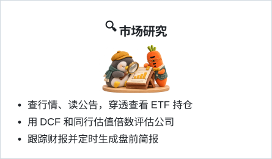
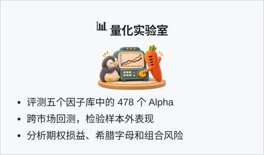

<p align="center">
  <a href="README.md">English</a> | <b>中文</b> | <a href="README_ja.md">日本語</a> | <a href="README_ko.md">한국어</a> | <a href="README_ar.md">العربية</a> | <a href="README_es.md">Español</a> | <a href="README_id.md">Bahasa Indonesia</a>
</p>

<p align="center">
  
</p>

<h1 align="center">Vibe-Trading：你的个人交易智能体</h1>

<p align="center">
  <b>一条命令，让你的智能体具备完整交易研究能力</b>
</p>

<p align="center">
  <a href="https://www.star-history.com/HKUDS/Vibe-Trading"></a>
  <a href="https://trendshift.io/repositories/25527"></a>
  <a href="https://www.star-history.com/HKUDS/Vibe-Trading"></a>
</p>

<p align="center">
  <b>GitHub 主题星标排名</b> · 2026 年 11 月 4 日<br>
  <a href="https://github.com/search?q=topic%3Abacktesting&amp;type=repositories&amp;s=stars&amp;o=desc">#1 回测</a> &nbsp;·&nbsp;
  <a href="https://github.com/search?q=topic%3Aalgorithmic-trading&amp;type=repositories&amp;s=stars&amp;o=desc">#3 算法交易</a> &nbsp;·&nbsp;
  <a href="https://github.com/search?q=topic%3Aquantitative-finance&amp;type=repositories&amp;s=stars&amp;o=desc">#4 量化金融</a>
</p>

<p align="center">
  
  
  
  <a href="https://pypi.org/project/vibe-trading-ai/"></a>
  <a href="LICENSE"></a>
  <br>
  <a href="https://github.com/HKUDS/.github/blob/main/profile/README.md"></a>
  <a href="https://github.com/HKUDS/.github/blob/main/profile/README.md"></a>
  <a href="https://discord.gg/6TdQnT5xcF"></a>
</p>

<p align="center">
  <a href="https://vibetrading.wiki/">官网</a> &nbsp;&middot;&nbsp;
  <a href="https://vibetrading.wiki/docs/">文档</a> &nbsp;&middot;&nbsp;
  <a href="#-新闻">新闻</a> &nbsp;&middot;&nbsp;
  <a href="#-主要功能">主要功能</a> &nbsp;&middot;&nbsp;
  <a href="#账户与交易">影子账户</a> &nbsp;&middot;&nbsp;
  <a href="#-演示">演示</a> &nbsp;&middot;&nbsp;
  <a href="#-快速开始">快速开始</a> &nbsp;&middot;&nbsp;
  <a href="#-示例">示例</a> &nbsp;&middot;&nbsp;
  <a href="#-api-服务">API / MCP</a> &nbsp;&middot;&nbsp;
  <a href="#-路线图">路线图</a> &nbsp;&middot;&nbsp;
  <a href="#贡献者">贡献者</a>
</p>

<p align="center">
  <a href="#-快速开始"></a>
</p>

## 📰 新闻

- **2026-11-12** 🛠️ **回测时序、报告数字与研究完成判定修复** — 影子账户按指定本金运行；因输出 token 上限截断的 worker 回复不再判为完成。委员会 PM 可直接综合有效的上游报告，无须重复取数；原生 Anthropic 适配器默认输出预算设为可配置的 16,384 tokens。
  生成策略若被检测到对输出目标额外移位，须明确声明为有意延迟，否则拒绝运行；正常指标 lookback 保持可用。Grounding 支持金额单位的不同写法及精确观测值声明，同时保留证据校验。SPY／GLD 实际回测的 206／140 笔成交及总收益均与独立账本一致。**尚未发布。**

- **2026-11-11** 🧾 **模拟交易部分成交与独立账本对账** — A 股 5 分钟模拟交易可选择启用逐笔订单的成交量上限、部分成交和订单状态输出（[#2128](https://github.com/HKUDS/Vibe-Trading/pull/2128)）。新增 `paper_trade_reconcile` Agent/MCP 工具，根据返回的成交记录，独立核对费用、现金、持仓和净值计算（[#2197](https://github.com/HKUDS/Vibe-Trading/pull/2197)）。
  正确处理受支持的跨行百分比表头，并允许在保留原文标签的前提下明确引用文档中的整数（[#2185](https://github.com/HKUDS/Vibe-Trading/pull/2185)、[#2192](https://github.com/HKUDS/Vibe-Trading/pull/2192)）。另修复严格因子基准评测的输入（[#2195](https://github.com/HKUDS/Vibe-Trading/pull/2195)），避免渠道会话超时后返回上一轮答案（[#2194](https://github.com/HKUDS/Vibe-Trading/pull/2194)）。
  感谢 [@shadowinlife](https://github.com/shadowinlife)、[@he-yufeng](https://github.com/he-yufeng)、[@Jackzigen](https://github.com/Jackzigen) 和 [@divya0795](https://github.com/divya0795)！**已在 `main`，随下一次 pip 版本发布。**

- **2026-11-10** 📊 **可编辑波动率曲面与期权分析修复** — 在 Options Lab 编辑行权价与到期日的隐含波动率网格，区分观测值与插值，并拒绝外推（[#2186](https://github.com/HKUDS/Vibe-Trading/pull/2186)）。
  修复低价策略预设、数量输入、到期日显示、失败重试、切换语言卡加载及 20 腿上限；`CF501` 等郑商所三位交割年月合约代码现在按中国期货规则回测（[#2193](https://github.com/HKUDS/Vibe-Trading/pull/2193)）。
  感谢 [@he-yufeng](https://github.com/he-yufeng) 和 [@GPT-AGI](https://github.com/GPT-AGI)！**已在 `main`，随下一次 pip 版本发布。**

- **2026-11-09** 🧭 **导出选中的版本对比；回测拒绝无法识别的代码** — 可在 Web、API 或 CLI 中把正在比较的两个研究修订导出为 JSON 或 Markdown（[#2189](https://github.com/HKUDS/Vibe-Trading/pull/2189)）。任何市场规则都无法识别的回测代码（如 `local:BHP.AX`、`7203.T`）现在会在拉取数据前被拒绝，不再按 A 股规则运行；裸六位代码和上交所 `.SS` 写法仍可使用。OpenRouter 回复不再重复显示模型名（[#2191](https://github.com/HKUDS/Vibe-Trading/pull/2191)），`research-artifact export` 传入空修订号现在会报错。感谢 [@he-yufeng](https://github.com/he-yufeng) 和 [@Gloubiboulgator](https://github.com/Gloubiboulgator)！**已在 `main`，随下一次 pip 版本发布。**

<details>
<summary>更早的新闻</summary>

- **2026-11-08** 📝 **研究版本比较与完整历史导出** — 可比较任意两个修订的正文、证据和元数据（[#2168](https://github.com/HKUDS/Vibe-Trading/pull/2168)），并将完整研究历史导出为 JSON 或 Markdown（[#2170](https://github.com/HKUDS/Vibe-Trading/pull/2170)）。切换研究记录时会忽略过期响应，Markdown 导出以隔离的代码块保留原始正文。另修复因子权重缺失、部分收益缺失时的归因、IC 样本不足、估值输入非有限值，以及负入场价格下的保证金计算。**已在 `main`，随下一次 pip 版本发布。**

- **2026-11-07** 🧪 **研究实验室：交易成本与样本外验证** — 用已保存的行情输入，按不同费用和滑点重新回测；仅依据训练结果选参，再锁定参数执行样本外测试与独立的最终留出验证。[研究实验室](guides/research-lab.md) 的 Web、CLI、API 和 Agent/MCP 共用一套流程，界面支持全部 11 种语言。另修复跨窗口收益统计、因子预热与长窗口计算，新增 20 个离线任务回放用例，缺少证据会明确显示。版本化研究资料也可保存结构化财务事实（[#2164](https://github.com/HKUDS/Vibe-Trading/pull/2164)），并修正中国期货裸合约代码识别（[#2177](https://github.com/HKUDS/Vibe-Trading/pull/2177)）。**已在 `main`，随下一次 pip 版本发布。**

- **2026-11-06** 📈 **隐含波动率曲面与模拟交易修复** — 可根据提供的期权观测值构建行权价 × 到期时间的 IV 网格，标注原始观测与插值点，不向数据覆盖范围之外外推（[#2172](https://github.com/HKUDS/Vibe-Trading/pull/2172)）。极端数值输入现在返回有限结果或明确错误。A 股五分钟模拟交易中，受涨跌停限制的市价单会立即撤销（[#2176](https://github.com/HKUDS/Vibe-Trading/pull/2176)）；撮合引擎也改为按跨标的时间顺序处理，防止用未来卖出款支付早先买单。**已在 `main`，随下一次 pip 版本发布；公开的五分钟入口仍限每步一个标的。**

- **2026-11-05** 🚀 **v0.1.19 发布**（[发布说明](https://github.com/HKUDS/Vibe-Trading/releases/tag/v0.1.19)，`pip install -U vibe-trading-ai`）：研究不再随对话结束而消失——带证据的研究记录可按版本保存并修订，之前轮次和会话中的回测可直接复用，研究目标可原地编辑。新增可选功能：A 股五分钟模拟交易，以及聚源综合问数、智能选股与香农持仓诊断（QVeris 已移除；仅有 `GILDATA_TOKEN` 不再开启任何功能）。另有阿根廷（BYMA）回测、Parallel 网页搜索、Codex OAuth 模型发现，并修复了 0.1.18 的两个回归问题。共 116 个合并的 PR，另有 21 个经维护者提交合入，来自 26 位贡献者（[CHANGELOG](CHANGELOG.md)）。
  **今日修复：** 回测报告其实际评估的基准；多空组合也能生成风险透视（risk x-ray）；GTJA alpha 17 在输入预热期间保持缺失；香农面板支持全部 11 种界面语言；另合入两项已审阅但尚未落地的贡献者修复（[#2042](https://github.com/HKUDS/Vibe-Trading/pull/2042) TTM 求和不再跨越缺失季度，[#1985](https://github.com/HKUDS/Vibe-Trading/pull/1985) 3:2 拆股识别）。感谢 [@rudycelekli](https://github.com/rudycelekli), [@he-yufeng](https://github.com/he-yufeng), [@Jackzigen](https://github.com/Jackzigen), [@Shizoqua](https://github.com/Shizoqua), [@cgycorey](https://github.com/cgycorey), [@dajiaohuang](https://github.com/dajiaohuang), [@zeus229](https://github.com/zeus229), [@alexwan02](https://github.com/alexwan02), [@BHhhh-123](https://github.com/BHhhh-123), [@remote-controlled-man](https://github.com/remote-controlled-man), [@shadowinlife](https://github.com/shadowinlife), [@TWJxi](https://github.com/TWJxi), [@lishuanghong1989-netizen](https://github.com/lishuanghong1989-netizen), [@TerryF7](https://github.com/TerryF7), [@davidalmeida90](https://github.com/davidalmeida90), [@DrDLyuan](https://github.com/DrDLyuan), [@goatyyc](https://github.com/goatyyc), [@hnq-ai](https://github.com/hnq-ai), [@kadyrbekovhamit-cyber](https://github.com/kadyrbekovhamit-cyber), [@MetaAviator](https://github.com/MetaAviator), [@octo-patch](https://github.com/octo-patch), [@RowanAldean](https://github.com/RowanAldean), [@VectorPeak](https://github.com/VectorPeak), [@wavebyrd](https://github.com/wavebyrd) 和 [@yufengsika](https://github.com/yufengsika)！
  **发版后已在 main 上修复（随下个 pip 版本发布）：** 回测基准改为在评估期第一根 K 线的开盘价买入，与策略的成交方式一致，不再从热身期最后一根收盘价起算；超额收益不再包含这段涨跌（AAPL 20/60 均线例子：22.5% → 18.4%）。

- **2026-11-04** 📊 **聚源综合问数、智能选股与香农持仓诊断** — 可以一次查出市值前三的股票及其半年营收，也可以查看组合的十因子风格暴露和各持仓对波动的贡献。聚源九项功能默认全关，已有 Token 也需逐项开启。免费数据源查不到时不会自动转用聚源。 [#2117](https://github.com/HKUDS/Vibe-Trading/pull/2117) · [#2118](https://github.com/HKUDS/Vibe-Trading/pull/2118) · [#2119](https://github.com/HKUDS/Vibe-Trading/pull/2119)
  同日明确了回测信号在下一根 K 线开盘成交的约定，修复了特殊换行符导致 Swarm 任务被误判为超时的问题，并加快了研究资料查重。 [#2137](https://github.com/HKUDS/Vibe-Trading/pull/2137) · [#2155](https://github.com/HKUDS/Vibe-Trading/pull/2155) · [#2159](https://github.com/HKUDS/Vibe-Trading/pull/2159)

- **2026-11-03** 🛠️ **运行完整性与本地化后续修复**：trace、审计账本和会话搜索的 JSONL 保留 U+2028/U+2029，含这些字符的账本记录仍可继续追加；模型名称统一下划线写法；上下文第 2 层压缩保留 handoff 摘要。另支持带 BOM 的 frontmatter，并让欢迎页在 RTL 语言中保持阅读方向。补充回归测试。

- **2026-11-02** 🛠️ **frontmatter、结果安全与欢迎页润色**：去除带引号的标量元数据外壳；超大结果无法编码时回退到可读截断；调整欢迎页布局和精选示例，并补充回归测试。

- **2026-11-01** 🛠️ **会话时间、主题对比度与欢迎页交互**：会话更新统一记录 UTC 时间；深色模式主按钮保持可读；侧栏示例可点击并显示清晰的分类标签。补充回归测试。

- **2026-10-31** 🛠️ **欢迎页与代码解析润色**：欢迎页改用暖色纸感和双栏布局，精选示例与侧栏操作更清晰；避免把 ticker 末尾字母误读成 A 股或 A/H 约束。

[新闻归档](guides/news.md) · [更新日志](CHANGELOG.md)

</details>

## ✨ 主要功能

<div align="center">
<a href="assets/features/zh/feature-market-research-card.svg"></a><a href="assets/features/zh/feature-research-teams-card.svg"></a><br/>
<a href="assets/features/zh/feature-quant-lab-card.svg"></a><a href="assets/features/zh/feature-trading-portfolio-card.svg"></a>
</div>

## 💡 Vibe-Trading 是什么？

把金融问题变成研究报告、可运行的回测或模拟投资组合。你也可以授权支持的券商在指定限额内执行实盘交易，并随时叫停。资金始终留在券商账户。

## ✨ 你能做什么

| 任务 | 从哪里开始 |
|---|---|
| 研究市场和文件 | 在 Web 对话中提问，或[上传报告](guides/research.md#upload--analyze-documents)。 |
| 回测策略或比较因子 | 在 Run Detail 查看图表与成交，或在 `/alpha-zoo` 比较因子。 |
| 模拟交易或复盘 | 在 `/paper-trading` 跟踪每日成交与净值，用 CLI 的 `/journal` 和 `/shadow` 复盘。 |
| 汇总账户或比较配置 | 在 `/portfolio` 查看持仓和调整建议。[券商支持](#券商支持一览) |
| 分析期权或相关性 | 在 `/options` 查看多腿损益和希腊字母，在 `/correlation` 观察市场状态。 |
| 组织或定时运行研究 | 运行 [Swarm 团队](guides/research.md#swarm-workflows)，在 Pixel Office 分工，或在 `/scheduled` 安排简报。 |
| 回看研究证据 | 在 `/research-artifacts` 搜索带日期的[研究版本](guides/research.md#versioned-research-artifacts)，比较任意两个修订，并将完整系列或选定比较导出为 JSON 或 Markdown。 |

## ⚡ 快速示例

运行 `vibe-trading init` 后，可以用自然语言发起回测，也可以从终端评测已有因子库。

```bash
vibe-trading run -p "回测 BTC-USDT 在 2024 年的 20/50 均线交叉策略，与买入持有比较，并报告最大回撤。"
vibe-trading alpha bench --zoo gtja191 --universe csi300 --period 2018-2025 --top 20
```

打开 **Run Detail** 对比策略与买入持有，查看回撤期间的成交和运行卡片上的数据源。

## 🧪 研究流程

| 步骤 | 以上述均线策略为例 |
|---|---|
| 规划 | 从问题中确定交易对、日期、均线周期和基准。 |
| 取数 | 获取 BTC-USDT 历史 K 线，核对来源与日期。 |
| 执行 | 编写策略并回测，在运行目录查看策略、成交和净值曲线。 |
| 验证 | 对比买入持有，同时核对收益、换手、回撤和验证提示。 |
| 复查 | 打开已保存的运行或调整参数继续提问。还可保存带日期的结论，获得新证据后修订。 |

## 📡 数据源与自动切换

支持 **28 个行情数据源**。`source: "auto"` 会根据代码识别市场，按配置顺序尝试数据源。

| 市场 | 取数顺序 |
|---|---|
| A 股与港股 | 先试腾讯，缺少 K 线时尝试东方财富及该市场的后续来源。 |
| 美股 | 依次尝试 Yahoo、Stooq、Sina。 |
| 加密资产 | 先试 OKX、Binance、CCXT，再使用其他来源。 |
| 期货 | 国内合约可用 AKShare 或本地 K 线，海外合约需提供本地数据。 |

也可指定来源。安装 `vibe-trading-ai[ashare]` 后可通过 BaoStock 免费获取 A 股日线，无需 Token。[数据源参考](guides/capabilities.md#-data-sources--smart-fallback)列出完整顺序与凭证要求。

## 🔩 详细功能

### 市场研究

| 功能 | 用法 |
|---|---|
| 公告与持仓 | 按季度对比基金经理的 SEC 13F 持仓，或穿透查看 ETF 成分。每份报告标明持仓日期。 |
| 公司估值 | 用 `/dcf` 调整折现率和永续增长率，用 `/comps` 比较同行倍数，也可建立三表联动模型并导出 Excel。 |
| 论文与文档 | 在 arXiv、OpenAlex 找信号，核对作者定义，再在自己的标的池检验。上传公告、表格或幻灯片后可就某张图表提问。 |
| 选股 | 启用聚源后，一次即可按市值筛选并取得半年营收。选股与组合因子诊断需分别启用。 |

### 量化研究

| 功能 | 用法 |
|---|---|
| Alpha Zoo | 评测 Qlib、Alpha101、GTJA、学术与基本面因子，比较不同期限的 IC，并用滚动样本外检验复核。 |
| 回测引擎 | 模拟 A 股涨跌停、加密资产资金费率与期货保证金，跨市场共享资金池并逐笔检查成交。 |
| 期权实验室 | 逐腿构建价差，查看到期损益、希腊字母以及现货价格与隐含波动率变化的影响。 |
| 组合风险 | 查看回撤、VaR 和预期损失，用 Brinson 区分配置与选股贡献，并观察市场相关性的变化。 |
| 策略跟踪 | 登记策略及证据，跟踪后续结果中的夏普比率和因子 IC。 |

### 账户与交易

| 功能 | 用法 |
|---|---|
| 投资组合 | 汇总券商只读持仓快照或导入 extraETF 文件，输入目标权重预览各持仓的金额变化。 |
| 模拟交易 | 已保存账户可逐个交易日推进，查看成交、现金和净值。还可在独立模拟中按五分钟回放 A 股交易日。`paper_trade_reconcile` agent/MCP 工具可独立核对费用、现金、持仓和 NAV 恒等式，无需访问行情或券商。 |
| 影子账户 | 导入券商成交记录，检查费用和交易习惯，对照按规则回放与实际成交。 |
| 券商连接 | 通过 CLI 或 Web 配置连接并测试读取。支持实盘的配置须先设定标的、订单和敞口限额，可一键停止实盘。 |

### 团队与定时研究

| 功能 | 用法 |
|---|---|
| Swarm 与 Pixel Office | 运行多空投委会或量化研究团队，查看成员报告。在 Pixel Office 分派任务，将结果记到共享看板。 |
| 定时简报 | 选择盘前简报、财报跟踪或组合体检，设定时间后发送至已配置的 Slack、Telegram 或邮箱。 |
| 研究历史 | 搜索旧会话并重新打开运行。保存带证据和日期的结论，投资逻辑变化时对照各次修订。 |
| 运行记录 | 核对回测的数据源、模型、执行记录和指标依据，重新打开成交与净值曲线验证报告中的数字。 |

### 券商支持一览

<details>
<summary>按券商比较只读、模拟盘和实盘</summary>

只读为专用只读配置，模拟盘使用券商沙箱或本地撮合，实盘必须在授权限额内执行。✓ 表示已声明支持，— 表示无对应配置。

<!-- BEGIN GENERATED broker-overview -->

| 券商 | 只读 | 模拟 | 实盘 |
| --- | :---: | :---: | :---: |
| alpaca | ✓ | ✓ | ✓ |
| binance | ✓ | ✓ | ✓ |
| dhan | ✓ | ✓ | — |
| etoro | ✓ | ✓ | ✓ |
| futu | ✓ | ✓ | ✓ |
| ibkr | ✓ | — | — |
| kis | ✓ | ✓ | — |
| longbridge | ✓ | ✓ | — |
| mstock | ✓ | — | — |
| mt5 | ✓ | ✓ | ✓ |
| okx | ✓ | ✓ | ✓ |
| robinhood | ✓ | — | ✓ |
| scalable | ✓ | — | — |
| shoonya | ✓ | ✓ | — |
| tiger | ✓ | ✓ | ✓ |
| toss | ✓ | — | — |
| trading212 | ✓ | — | — |
| upbit | ✓ | ✓ | — |
| zerodha | ✓ | ✓ | — |

<!-- END GENERATED broker-overview -->

</details>

[查看各配置的完整权限](guides/portfolio-and-brokers.md#full-broker-permissions)

## 🎬 演示

<table>
<tr><th width="50%">Web · 从提问到回测</th><th width="50%">CLI · 交互终端</th></tr>
<tr>
<td width="50%" valign="top">

https://github.com/user-attachments/assets/2c595ee1-c577-481a-9460-34ea12bcf41c

</td>
<td width="50%" valign="top">

https://github.com/user-attachments/assets/ac79426e-f3f7-4349-b0d5-d997a2725784

</td>
</tr>
<tr><td>输入策略要求，跟踪执行过程并查看回测结果。</td><td>在终端浏览研究模板，打开盘前简报。</td></tr>
</table>

## 🚀 快速开始

使用 Python 3.11+ 安装，在向导中选择模型服务商，再打开交互终端。

```bash
pip install vibe-trading-ai
vibe-trading init
vibe-trading
```

Docker 将前端和 API 部署在 `http://localhost:8899`。首次克隆后，先配置模型服务商再启动。

```bash
git clone https://github.com/HKUDS/Vibe-Trading.git
cd Vibe-Trading
cp agent/.env.example agent/.env
# 在 agent/.env 中设置服务商和 API 密钥。
docker compose up --build
```

PyPI 发行包包含 CLI、API 和 MCP 服务。前端开发和本地模型配置见[安装指南](guides/installation.md)。

## 🖥 CLI 命令

运行 `vibe-trading` 打开终端，输入 `/help` 浏览命令。

| 命令 | 用途 |
|---|---|
| `/model` | 切换当前会话的模型或服务商。 |
| `/history` | 浏览并继续旧对话。 |
| `/show <run-id>` | 查看已保存的运行结果。 |
| `/pine` | 将当前策略导出为 Pine Script 指标。 |

在 shell 中用 `vibe-trading alpha list` 浏览因子库，用 `vibe-trading playbook list` 查看定时研究模板。

## 💡 示例

- 比较 AAPL 与 MSFT 在 2024 年的表现，哪个月的收益差距最大？用 `/history` 继续对话。
- 用 `/journal` 分析导出的成交记录，再用 `/shadow` 比较按规则交易的结果。
- 选一只股票，跟随投委会的多空辩论直到最终报告。

```bash
vibe-trading --swarm-run investment_committee '{"target":"TSLA","market":"US"}'
```

## 🌐 API 服务

运行 `vibe-trading serve --port 8899`。在另一个终端用 `curl http://localhost:8899/runs` 列出运行，再用返回的 ID 调用 `GET /runs/{run_id}` 查看结果。

| 通过 HTTP 运行研究 | 端点 |
|---|---|
| 创建会话 | `POST /sessions` |
| 发送问题 | `POST /sessions/{id}/messages` |
| 接收实时进度 | `GET /sessions/{id}/events` |

在 `http://localhost:8899/docs` 试用接口。[需要认证的客户端](guides/cli-and-api.md#security-defaults)通过 `Authorization: Bearer` 发送 API 密钥。

## 🔌 MCP 插件

MCP 客户端可通过 stdio 启动同一个包。在 Claude Desktop 的 `claude_desktop_config.json` 中添加以下配置，重启后调用 `list_skills`。

```json
{
  "mcpServers": {
    "vibe-trading": { "command": "vibe-trading-mcp" }
  }
}
```

其他客户端和自定义输出目录见 [MCP 配置](guides/mcp.md)。

## 🏛 生态项目

Vibe-Trading 是 **[HKUDS](https://github.com/HKUDS)** 智能体生态的一部分：

<table>
  <tr>
    <td align="center" width="20%">
      <a href="https://github.com/HKUDS/nanobot"><b>NanoBot</b></a><br>
      <sub>Ultra-Lightweight Personal AI Assistant</sub>
    </td>
    <td align="center" width="20%">
      <a href="https://github.com/HKUDS/AI-Trader"><b>AI-Trader</b></a><br>
      <sub>Agent-Native Signal &amp; Copy Trading Platform</sub>
    </td>
    <td align="center" width="20%">
      <a href="https://github.com/HKUDS/CLI-Anything"><b>CLI-Anything</b></a><br>
      <sub>Making All Software Agent-Native</sub>
    </td>
    <td align="center" width="20%">
      <a href="https://github.com/HKUDS/OpenSpace"><b>OpenSpace</b></a><br>
      <sub>Self-Evolving AI Agent Skills</sub>
    </td>
    <td align="center" width="20%">
      <a href="https://github.com/HKUDS/ClawTeam"><b>ClawTeam</b></a><br>
      <sub>Agent Swarm Intelligence</sub>
    </td>
  </tr></table>

---

## 🗺 路线图

| 领域 | 已发布 | 计划中 |
|---|---|---|
| 模拟交易 | 跨会话保存每日现金、成交和净值。独立模拟可按五分钟回放 A 股交易日。 | 可选的按成交量占比撮合（[#2128](https://github.com/HKUDS/Vibe-Trading/pull/2128)，草稿）。 |
| 研究 | 运行卡片记录回测指标与证据。带日期的研究记录保留修订历史，并可搜索。 | 研究记录中加入结构化财务数据（[#2164](https://github.com/HKUDS/Vibe-Trading/pull/2164)，审阅中）。 |
| 期权实验室 | 支持多腿损益、希腊字母及现价 × 隐含波动率情景。 | 在 `/options` 提供交互式波动率曲面网格。 |

## 参与贡献

可从[适合新手的 issue](https://github.com/HKUDS/Vibe-Trading/issues?q=is%3Aissue+is%3Aopen+label%3A%22good+first+issue%22)入手，大改动请先开 issue 讨论。[贡献指南](CONTRIBUTING.md)列出了本地配置和提交 PR 前的检查。

## 贡献者

感谢所有为 Vibe-Trading 做出贡献的人！

### v0.1.19 · 贡献者

- @rudycelekli — 58 PRs (12 landed as maintainer ports): GTJA alpha formulas restored to the report (#2036/#2037/#2038/#2039/#2040/#2051), loaders that ask each vendor for the ticker form it serves and page at its own cap (Alpha Vantage #1997, AKShare #1998, CCXT #1999, Tushare minute lots #2001, Tiingo/Stooq class shares #2010/#2012, Nobitex Tehran days #1989, push2 decimals #1988), futures and market fees (micro index price limits #1992, the 30-year treasury fee #1994, India stamp duty on short covers #1995), quant-library and governance fixes (#1950/#1959/#1960/#1962/#1963/#2000/#2017), sub-penny prices kept in trades and charts (#1987/#1990), TTM sums that stop at a missing quarter (#2042), 3:2 splits and ST board limits in paper trading (#1985/#1984), a live halt key that cannot alias the global halt (#2003), session, memory, CLI and API fixes (#1969/#1970/#1982/#2002/#2006), and a string-"false" sweep across ten tools (#1976/#1977/#2008/#2009/#2011/#2013/#2014/#2015/#2016/#2018)
- @he-yufeng — 18 PRs (5 landed as ports): versioned research artifacts (#2079/#2159), background tasks scoped to their owner, reaped on cancel and reconciled after a restart (#2092/#2098/#2100/#2157), silent provider streams interrupted (#2099), cache and reasoning tokens kept in `llm_usage` (#2109), one tool policy across providers (#2087), Claude CLI tool-attempt recovery and structured finals (#2048/#2064/#2120), Qlib BETA/RESI/ROC/CORD semantics (#2062/#2069), magnitude suffixes in derived formulas (#2134), long/short risk x-ray and validation that refuses non-positive equity (#2162/#2161), and Unicode-safe swarm heartbeats (#2155)
- @Jackzigen — the bar-agnostic paper order lifecycle (#2066), swarm runs that stop when cancelled from the chat (#2059/#2060), document figures and percentage points in grounding (#2058/#2108), Robinhood portfolio reads with account selection (#2054), Moonshot reasoning effort for kimi-k3.1-pro (#2043), and Eastmoney JSONP, AKShare 1.20 forex and bare US ETF symbol fixes (#2082/#2083/#2086)
- @Shizoqua — research goals edited in place (#2093), Feishu, Teams, WeChat, WhatsApp and Discord channel fixes (#1957/#1958/#1967/#2078/#2114), heredoc commands in the bash tool (#2077), path-escape tests (#2094), and a run-directory fallback that no longer depends on the process cwd (#2116, landed as a port)
- @cgycorey — global futures priced on real contract multipliers and micro rates, with generic defaults reported (#1965/#1966/#1968/#1972), and a shadow account that honours every entry condition and currency (#2073/#2075)
- @dajiaohuang — transfer flow signs (#2023), aligned attribution benchmarks (#2044), overflow-free weight normalisation (#2046), and boolean payoff quantities refused (#2049)
- @zeus229 — the BYMA engine for Argentine shares and CEDEARs (#2071), backtests reused across turns and sessions (#2074), Codex OAuth model discovery (#2080), and financial units kept in grounding evidence (#2072)
- @alexwan02 — Longbridge per-currency cash (#1940), `.env` read by the MCP server (#1974), and Futu US symbol mapping (#2076)
- @BHhhh-123 — cross-sectional factor combination with walk-forward weights (#1953), field-level data availability in alpha bench (#2057), and factor research provenance (#2067)
- @remote-controlled-man — comma-grouped document integers (#2135), one bounded retry for a withheld final answer (#2136), and A-share source setup docs (#2138)
- @shadowinlife — the opt-in five-minute A-share paper step and its bar-by-bar matching (#2110/#2111), and JoinQuant limit fills (#2127, landed as a port)
- @TWJxi and @lishuanghong1989-netizen — Gildata stock discovery and financial queries (#2117), stock screening with report-period indicators (#2118), and Shannon portfolio style and risk analysis (#2119)
- @TerryF7 — IBKR and Futu gateway endpoints per connection (#1983), and connection deletion without a credential vault (#2153, landed as a port)
- @davidalmeida90 — the next-bar signal delay documented in the strategy skill (#2137)
- @DrDLyuan — STAR Market and Beijing buys sized on their own order grid (#2105)
- @goatyyc — Binance HTTP 451 read failures explained (#1937)
- @hnq-ai — a crawlable documentation wiki (#2165, landed as a port)
- @kadyrbekovhamit-cyber — Heston prices for short expiries (#2140)
- @MetaAviator — invalid journal quantities refused (#2052)
- @octo-patch — MiniMax M3.1 Flash as the default MiniMax model (#1936)
- @RowanAldean — optional Parallel search in `web_search` (#2113)
- @VectorPeak — voice notes forwarded in four IM adapters (#2106)
- @wavebyrd — Yahoo three-letter `=X` forex symbols read as USD pairs (#1980)
- @yufengsika — non-finite and boolean inputs refused by financial rigor checks (#2053)

<details>
<summary>v0.1.17 与 v0.1.18 周期贡献者</summary>

**v0.1.18** · @warren618 (Haozhe Wu) 实现按需加载工具定义，将大型研究结果保存在运行产物中，并修复模型调用中断时的用量统计。

- @rudycelekli — a 92-PR correctness sweep (13 of them landed as maintainer ports): quant-library guards and edge cases (implied-vol price tolerance #1657, gaps in VaR breach transitions #1658, Heston inputs #1719, scheduled CDS coupons #1716, Carino coincidence #1943, undefined probabilistic-Sharpe and bond-accrual inputs #1821/#1822), missing prices kept out of risk x-ray return pairs and OU lag pairs (#1717/#1713), an undefined three-scenario upside and unbounded journal ratios reported as such (#1921/#1884), document reading that keeps PDF text, Word order, PowerPoint groups and Excel missing-value markers (#1838/#1839/#1840/#1841), session search limits, locking and snippets (#1827/#1828/#1832/#1834), more secret formats redacted (#1874/#1880), A-share board limits and Beijing codes (#1913/#1914), standalone revalidation and attribution on the run's own annualisation (#1915/#1948), and settings the selected engine ignores now warned about (#1947)
- @Shizoqua — 25 PRs (2 landed as ports): memory and cross-session search that read back clean and match non-English text (#1682/#1686/#1697/#1771/#1772), skill headings and saved skill names resolved consistently (#1797/#1858), Telegram and Matrix replies no longer dropped when the stream preview never sent and one WeCom stream id per reply (#1860/#1903/#1929), SSE events no longer double-delivered on reconnect (#1798), parallel CLI tool results paired with their own call (#1859), goal evidence confined to the claimed run (#1895), Carhart momentum no longer leaking today's price (#1578), Wilder RSI in the shadow account (#1457), direct-SDK positions priced from `current_price`/`ltp`/`market_val` (#1581), the email SPF/DKIM spoofing check (#1508), and swarm artifacts cleared before each fresh task (#1455)
- @he-yufeng — 24 PRs (2 landed as ports): the declared grounding-check registry and the fired checks recorded in the validation artifact (#1628/#1691/#1661), corrections that keep the figures already passed (#1702), percent-named evidence read as points in derived checks (#1823), additive A-share qfq converted to multiplicative when the offsets validate (#1551), mootdx retired from the default A-share chain and the health canary (#1730), the channel-authoring contract (#1630), the compaction-helper split out of `loop.py` (#1631), the first bar's result counted against initial capital in the options engine and per-bar returns (#1750/#1844), config keys nothing reads warned about (#1935), the US early-bell close on half-days (#1706), and the ReportLab fallback for Shadow Account PDFs (#1683)
- @shadowinlife — 19 PRs (5 landed as ports): daily paper trading with saved accounts across CLI, API and Web (#1939), the shared scheduler kernel adopted by the research, back-office and live loops (#1893/#1899), token usage in Run Detail, chat and swarm (#1890), `read_run_artifact` and a structured backtest tool summary (#1647/#1646), `get_southbound_flow` and a northbound flow that no longer serves a silent empty envelope (#1486/#1484), guided Web UI setup for Feishu, Slack and Discord with runtime errors surfaced in channel status (#1572/#1764/#1777/#1738/#1737), and thirteen fundamental and valuation factors, industry-neutral A-share value alphas and a monthly-horizon IC bench (#1787/#1788/#1802/#1801)
- @zeus229 — 18 PRs (4 landed as ports): grounding that fails closed on unresolved derived refs and suggests exact refs (#1835/#1837/#1638), parses complete derived formulas after labels (#1728), keeps identity in ticker-keyed metrics and blank-corner matrices (#1851/#1850) and leaves execution metadata out of numeric evidence (#1767); rich Email scheduled reports with optional PDF password protection (#1680/#1709), channel-aware scheduled-run editing (#1649), reproducible indicator reads and pinned portfolio snapshots (#1768/#1769), redundant MCP payload copies removed before agent context (#1634), and goal tool-call provenance (#1688)
- @alexwan02 — 16 PRs (4 landed as ports): the `claude-cli` provider backed by a local `claude -p` (#1804), Hong Kong orders sized on each symbol's own board lot (#1813), the Longbridge SDK config built through `from_apikey` (#1805), Futu multi-currency balances with average-cost basis (#1814), SDM registration that keeps its trading rules and records bench history for decay monitoring (#1848/#1849), a lightweight run preview built off the event loop (#1853), run trades listed newest first from the full trades.csv (#1865), trades.csv entry rows, offline benchmarks and Brinson weights fixed (#1780/#1781/#1782), and runtime connectors ordered by status (#1845)
- @Jackzigen — 13 PRs (2 landed as ports): the first `loop.py` extractions for tool-result helpers, run outcome and tuning (#1636/#1641/#1678), a byte-stable system prompt for prefix caching (#1708), after-close SEC filings kept out of the IC until the next bar (#1794), a free BaoStock fallback for `val:*` panels (#1799), undefined correlation pairs published as null instead of 0.0 (#1933), journal PnL pooled per settlement currency (#1811), `BASE-USDT-PERP` routed to the crypto market (#1864), the mStock read-only profile (#1675), and the shared OHLCV contract assertion in per-loader suites (#1725)
- @cgycorey — 12 PRs (3 landed as ports): only the engine's own output grounds a backtest report (#1685), adjusted and raw prices never mixed in one series (#1684), a stooq challenge latch that stops probing and sees every refusal (#1637/#1640), a loader health lane that says why a source is empty and keeps labelled credentials out (#1643/#1698), `get_macro_series` reporting when it caps a series (#1676), env-style credential names, URL userinfo and Basic auth redacted (#1765/#1742/#1744/#1846), and suffixed HK codes normalized for the duplicate-asset guard (#1746)
- @MetaAviator — 12 PRs (2 landed as ports): full-sample downside deviation for Sortino in the metrics and options engines (#1693/#1727), initial capital in Monte Carlo path metrics (#1664), missing equity kept out of adjacent validation returns (#1754), standalone revalidation that honours saved settings and entry dates (#1815/#1842), break-even exits and zero-bar trades kept in trade artifacts and holding periods (#1779/#1876), and trade-journal fixes for reversal fees, split date/time columns, equal timestamps and invalid dates (#1891/#1900/#1941/#1942)
- @lorenzozanee — unsupported Robinhood option orders gated before the broker (#1585), run cards that flag backtests possibly inside the model's training data (#1618), and option evidence in the broker bring-up checklist (#1770)
- @Mikesad — LLM usage accounting extracted from `loop.py` (#1662), swarm presets that take their variables from the prompt (#1674, landed as a port), and the factor registry suite running without symlink privileges (#1696)
- @remote-controlled-man — options legs priced on the run's bar cadence (#1753), the Futu journal format claimed only when its value columns exist (#1766), and three-statement balance tolerance threaded into projected periods (#1786, landed as a port)
- @Romzhou — a kill-switch sweep that fails closed on its own bookkeeping and input (#1703), and a runner driver kept alive for the scheduler's lifetime (#1704)
- @sambazhu — three Gildata research tools with off-exchange fund NAV (#1485), and an env-configurable ReAct iteration cap (#1833)
- @wavebyrd — spread and swap rates for Yahoo `=X` forex pairs (#1930), and per-cent multipliers for ICE coffee, sugar and cotton (#1944)
- @BHhhh-123 — factor neutralisation and PCA in the quant library (#1817, landed as a port)
- @Bortlesboat — Calmar kept finite on explosive equity paths (#1901)
- @bygordon130-hub — Pixel Office, a shared manual research-task board, and the Turkish locale (#1616)
- @davidalmeida90 — profit factor reported as undefined when no trade lost (#1602)
- @DrDLyuan — the equity.csv drawdown peak seeded with initial capital (#1818)
- @Emad211 — per-channel configuration, custom providers and the Persian locale (#1264)
- @Frank-zhu2000 — Futu profiles no longer pinning the HK trade market (#1812)
- @goatyyc — Binance balances that survive clock skew, with unpriced assets marking the snapshot incomplete (#1505)
- @hunters1011-ctrl — symlink tests skipped where symlinks are unavailable (#1803)
- @incorpore — Brazil (B3) market data and an opt-in ZimaOS template (#1783, landed as a port)
- @mdb1230 — five example options strategies and a candidate study of which to paper-trade (#1774)
- @mminkus — the interactive message cap raised to match the scheduled-run path (#1701)
- @passionbull — KIS reads that see SOR fills and recover from a server-invalidated token (#1726)
- @rwxyx518-prog — the Portfolio page's holdings table and history chart following the display currency (#1810)
- @ThreeTima — currency identity checked in financial figure grounding (#1905)
- @tomaszkubiak-courses — strategy provenance model fields set on the loop, so writing a strategy file no longer raises `AttributeError` (#1673)
- @xaritoku — dotenv loaded in the `alpha bench` / `alpha compare` CLI handlers (#1806)

</details>

<details>
<summary>v0.1.16 周期贡献者</summary>

- @Shizoqua — a 55-PR correctness sweep (one landed as a port) across nearly every layer: quant-library fixes and input guards (Patell z degrees of freedom #1449, copula ties #1453, Kyle's lambda intercept #1477, HRP labels #1555, non-finite impact and yield-curve inputs #1557/#1558), Alpha Zoo NaN propagation and formula fixes (gtja191_038 #1523, alpha101_074 #1534, qlib158 WVMA #1594, GTJA HIGHDAY/LOWDAY #1604), backtest sizing for negative futures prices and shorts (#1547/#1548), venue bars per year in Monte Carlo validation (#1546), options annual return over elapsed bars (#1458), memory, swarm-store and session robustness (#1450/#1525/#1545/#1536/#1579), DingTalk, Signal, Slack and Discord channel fixes (#1506/#1478/#1524/#1537), Argentina listing identity in grounding (#1575), and a mandate narrowed to zero exposure stored as zero (#1593)
- @zeus229 — grounding that reads locale decimals and grouped numbers with precision-aware rounding (#1517/#1588), resolves explicit symbols and exact field refs from observed evidence (#1584/#1586), preserves `latest_date` timestamps (#1590) and keeps corrections text-only (#1600); Argentina (`.BA`) market data through Yahoo (#1543), ISO-4217 portfolio currencies with isolated FX failures (#1510), explicit header names compared case-insensitively (#1568), technical-indicator volume statistics and their replay after compaction (#1571/#1601), and bounded read-only replay after compaction (#1488)
- @cgycorey — a read-only extraETF export reader (#1406) and the read-only Scalable Capital MCP connector (#1417), run cards that keep non-scalar metrics (#1424), the backtest tool naming the directory it looked in (#1429), a tool-declared swarm `run_dir` confined to the workspace and worker message logs persisted on every terminal path (#1430/#1439), qlib158 CNTP/CNTN/CNTD NaN propagation (#1459), custom zoo roots that no longer replace the bundled module (#1468), `get_shareholder_count` answering again (#1490), Tencent's A-share and HK calibers stamped correctly (#1497)
- @shadowinlife — IM channels configured from the Web UI, with QQ, Email and WebSocket guided setups (#1520/#1529/#1544), stdlib logging placeholders across 12 channel adapters (#1533), Tencent history paginated backward from the end of the window (#1411), `state.json` written by the backtest tool so tool-driven runs are ingestible (#1413), per-worker swarm skill allowlists (#1414), the `1M` interval no longer folding to one minute (#1487), and welcome quick actions with a real selected state (#1500)
- @he-yufeng — tail-risk measure and confidence kept through the grounding gate (#1444), full history in the risk x-ray instead of sampled rows (#1462), shareholder-count history from the per-period report (#1518), backtests attaching to a running MT5 terminal without credentials (#1598), a per-read BaoStock socket deadline (#1615), the weekly live-source health canary (#1627), the broker capability matrix generated into the README (#1629), and the channel `stop_all` and WebSocket logger fixes carried over from #1521
- @lorenzozanee — dragon-tiger seat reports and lockup expiry data restored (#1512/#1513), malformed Robinhood buying power rejected (#1526), broker-only MT5 symbols resolved in `search_symbol` (#1597), hash-only traces and citations on run cards (#1612), expired Copilot CLI tokens refreshed (#1619), and Telegram polling ownership documented (#1583)
- @chiww — the Stooq warning naming the override variable the config layer reads (#1402), A-shares routed by market for sources without a dedicated branch (#1431), the declared interval checked against the served bars before annualising (#1432), and `_NO_NETWORK_FALLBACK_SOURCES` honoured for per-symbol gaps (#1441)
- @as950118 — three Korean broker connectors: KIS with separate paper and live hosts (#1407), Upbit capped at paper plus read-only (#1408), and read-only Toss Securities (#1409)
- @0xouzm — SDM decay metrics that treat NaN and infinite bench results as missing (#1447)
- @alanwilhelm — synchronized cold loader-registry initialization, so concurrent first lookups no longer see an empty registry (#1405)
- @modelpath-dev — the description-driven strategy-store adaptation substrate (#1391)
- @sambazhu — the Gildata A-share OHLCV loader over its raw-api MCP endpoint (#1474)
- @tingkk — broker-neutral SDK diagnostics across all locales (#1436)
- @tonydo — OpenCode as a built-in provider, sending the `x-opencode-session` header OpenCode Go requires (#1416)
- @woshi77777stars — the `Trigger.market` default restored on non-market triggers (#1599)
- @Yoruxyv — the Bahasa Indonesia UI locale and `README_id.md` (#1482)

</details>

<details>
<summary>v0.1.15 周期贡献者</summary>

- @Shizoqua — 28 PRs: NaN propagated through 16 GTJA and Alpha101 alphas instead of fabricated values (#1371/#1372/#1373/#1374/#1379/#1380/#1381/#1382/#1383) and Alpha Zoo returns no longer forward-filling gaps (#1172), missing-price gaps preserved in the SDM template and cross-market volatility weights (#1397/#1398), multi-factor and social-media factor evaluation fixes (#1399/#1400), walk-forward ML training without future-label leakage (#1392), China futures product codes parsed for digit-prefixed, month-code-colliding and lower-case symbols (#1369/#1389), composite sub-engines synced before every dispatch (#1370), per-regime position sizing in strategy discovery (#1368), MCP goal sessions isolated per connection with current-goal defaults (#1173/#1331), Codex token usage and model metadata (#1334/#1348), and swarm cancellation reaching the in-flight worker (#1175)
- @he-yufeng — 26 PRs, mostly fail-closed live trading and backtest semantics: broker API errors and error envelopes fail closed in position reads and the halt sweep (#1212/#1232), the flatten latch persists across restarts (#1233), market-triggered ticks skip closed markets (#1253) and buy-limit orders are sized at the worse of quote and limit (#1312); the price-adjustment caliber stamped on served frames (#1317) with adjusted Yahoo prices (#1287), unresolved symbols retried down the fallback chain (#1288) and the stooq anti-bot challenge flagged (#1342); short option legs holding margin (#1306), perpetual funding settled by bar span (#1307), A-share and India rules enforced through composite state (#1309) and halted positions marked at the last traded close (#1332); Shadow Account PnL, attribution, FIFO short lots and cache keys (#1217/#1310/#1311/#1314); and each monitor's latest verdict rendered on the list (#1156)
- @cgycorey — 23 PRs: UK (LSE `.L`) equity support (#1206), swarm replay/resume of failed runs keeping completed artifacts (#1158), market-data validation of codes, dates and sources with aligned FX/index search and fetch (#1185/#1316), dotted US class shares routed as US equity (#1351), backtest execution fixes — requested targets separated from executed fills, 1x shorts liquidated, option signals filled on the next bar, default IV for HV warm-up and over-committed baskets scaled (#1281/#1298/#1299/#1305/#1344); live halt-sweep envelopes, per-episode latches and MCP buy-limit sizing (#1244/#1254/#1361); grounding clause and metric-table gates (#1326/#1338/#1375/#1378); the registry NaN contract on declared dependencies (#1377); compaction sized by tool-call arguments (#1352); and report audits that fail closed when nothing was verified (#1362)
- @santhreal — 16 PRs extending the quant library: factor risk decomposition, event-study rank and sign tests, OU calibration, drawdown analytics, barrier options, single-name CDS, key-rate duration, IC time series, Vasicek credit loss and group-purged CV (#1159–#1168), Heston pricing, HRP allocation, copulas and market microstructure (#1195–#1198), finite-difference barrier Greeks (#1203), and multi-segment test sets in cross-validation (#1204)
- @AirHua-byte — multi-file drag-and-drop and paste uploads (#1179), interrupted replies recovered after a service restart (#1180), shared HTTP clients preserved during cleanup (#1182), agent-confirmed scheduled research tasks (#1187), persisted Feishu QR login credentials (#1188), explicit market context kept in grounding (#1269), and the offline harness artifact verifier (#1271)
- @lorenzozanee — silent order-plan rejections surfaced through an `_on_plan_rejected` hook (#1245), the temperature self-heal on the OpenAI-compatible path (#1246), escalating stream retry delays that honour Retry-After (#1247), USD-M tolerance calibration (#1248), FMP's Stable endpoint with no silent fallback for an explicit source (#1276), adjusted prices on the FMP and Tiingo paths (#1320), and EPERM handled in desktop updater shutdown checks (#1284)
- @goatyyc — the read-only multi-broker portfolio dashboard and connection framework (#1072) with connector onboarding contracts (#1250), IBKR official MCP OAuth with verified read tools (#1190), and an isolated portfolio OAuth reconnect lifecycle with classified failures (#1211/#1251)
- @saju01 — the agent loop keeping tool results the model still needs (#1341), compacted results reconciled by exact call identity (#1358), and grounding that no longer reads percentage-point deltas as quoted prices (#1346/#1357)
- @aminak58 — symbol identity for bare joined crypto pairs (#1265), FX, metals and futures (#1280), and spot-gold aliases (#1282)
- @averatec0773 — the Anthropic static prefix cached with cache usage recorded (#1366), relocated `extra_body.temperature` stripped in the Anthropic self-heal (#1330), and an attempt start persisted so the elapsed clock survives navigation and reload (#1340)
- @Elfsa-Miranda — Alpaca submissions owned before broker writes, then recovered by exact client id and exact fills across restarts (#1213/#1221/#1222)
- @ethanstoner — skill-relative reference links resolved in `read_file` and on GitHub (#1252/#1328), and strategy-store history that is really newest first (#1347)
- @iagop03 — Web UI fixes: a stale `streamingSessionId` cleared on reopen, a scrollable main region with collapsed long prompts, and non-backtest runs pointed to Studio (#1257/#1258/#1259)
- @Robin1987China — non-finite inputs refused across valuation and credit-risk functions (#1184/#1215), and Archimedean copula CDFs stabilized under large parameters (#1386)
- @Emad211 — cross-platform locks and path handling for Windows (#1261), and read-only Nobitex and Wallex market-data sources (#1263)
- @honginp — read-only Binance USD-M account snapshots (#1229) and USD-M drift evidence artifacts (#1230)
- @pengpengyi92 — bounded backoff on swarm worker retries (#1210), and crypto pairs resolved through an active Binance connector (#1242)
- @ashutoshsinghpr7 — the Zerodha Kite Connect broker for Indian equities (#1193)
- @be-student — the no-progress stop for repeated discovery without new evidence (#1363)
- @BigFishEmily — paginated Tencent finance history requests (#1154)
- @birdxs — Docker CI actions upgraded to Node.js 24 compatible versions (#1359)
- @bonyohana — the survivorship-bias disclosure rendered in the HTML bench report (#1289)
- @c020627 — the IBKR official read-only MCP seed pointed at `/mcp-public` (#1178)
- @guestccc — `/api` routes proxied in the Vite dev server (#1319)
- @Jackzigen — mandate adjustments that enforce narrowing for non-numeric and list fields (#1285)
- @JaxonHu1024 — Futu HKD valuations preserved in the portfolio (#1228)
- @laiyierjiangsu — HK-prefixed symbols (`HK.06693` → `06693.HK`) locked in grounding (#1384)
- @nandofmike — the Brazilian Portuguese (pt-BR) locale (#1327)
- @P1Piyush — metals treated as metals in the forex backtest: pip size, lot size and spreads (#1226)
- @sambazhu — per-market data-source priority in Settings and `MARKET_DATA_ORDER_*` (#1231)
- @SiMinus — `vibe-trading swarm retry` with a resume option (#1194)
- @sykuang — the IBKR public MCP OAuth flow (#1186)
- @thisisjun786 — calendar-triggered partial rebalancing (#1277)
- @wiliao — a run-stall watchdog, a bash tree-kill timeout and a compaction verification ledger (#1169)
- @youngjincho02-arch — the historical VaR quantile formula fixed in the risk-analysis skill (#1189)

</details>

<details>
<summary>v0.1.14 周期贡献者</summary>

- @Shizoqua — a 13-PR correctness sweep across nearly every subsystem: grounding auto-recovers identity and price evidence within a bounded budget (#1092), swarm isolates worker artifacts between retries (#1053), rejects raw `ok`/`success` tool-result envelopes (#1052) and truncates oversized results with the shared notice (#1110), MCP gains offset paging for SEC filings and statements (#1138), routes `load_skill` through the registry so oversized skills page (#1137) and carries market-data provenance on `get_market_data` (#1131), plus `excess_return` consistency (#1058), Wilder-EWM RSI (#1056), the FTS5 tokenizer floor (#1071), non-finite prediction-market fields (#1136), in-flight delivery protection (#1140) and preserved backtest validation evidence (#1139)
- @shadowinlife — the run-analysis surface, four pages in one cycle: Options Lab (#1096), the Factor Research panel with its new IC correlation matrix (#1099), positions structure visualization (#1097) and the tearsheet tab (#1091); plus evidence-gated Strategy Discovery Phase 1 (#978) and Phase 2 decay monitoring (#1007), per-market volume units in market-data provenance (#1065) and baostock volume normalized to board lots (#1067)
- @pengpengyi92 — five quantlib numerics fixes: `xirr` and money-weighted return survive long-horizon discount underflow (#1119), zero-volatility options discount their forward value (#1066), the fixed-income curve keeps decay inside the requested bounds (#1076), event studies anchor to the prior session (#1078) and cross-validation aligns label ends to the prior observation (#1079)
- @cgycorey — reasoning effort honoured in chat completions (#1025), the per-task swarm `ChatLLM` closed to stop a pooled-connection leak (#1145) and the same for one-shot clients (#1153), `gross_profit` derived from revenue minus COGS when the SEC tag is absent (#1111), and `vibe-trading show <run_id>` dispatching its run id instead of the flag (#1147)
- @lorenzozanee — the test suite stopped escaping into the real config root and its live audit ledger (#1118, closes #1116), recovery steering delivered as user messages with inline system tags (#1112), and unsupported ticker-plus-name symbol queries marked skipped rather than failed (#1114)
- @AndyLongest — the interactive backtest research dashboard (#1084), the engine reporting actual post-fill positions (#1082), and grounding ignoring identity constants in rate formulas (#1083)
- @ofeksh-tr — eToro runtime UI parity for SDK connector status (#1051) and its crypto browse and flat market-data quotes (#1070), plus an empty `Response` for the `scheduled-runs` DELETE 204 (#1068)
- @wiliao — the agent-run reliability pass: grounding false-rejections, the final-answer gate and LLM timeouts (#1105), with prompt wording and support/resistance masking (#1060)
- @jay79-boop — a selectable IBKR market-data tier with starved quotes reported as `no_data` (#1075), and strict alpha t-stats surfaced in the bench JSON and HTML report (#1085)
- @Robin1987China — DCF refusing non-finite inputs instead of a silent negative share price (#1121), and grounding masking ISO dates that run into CJK text (#1132)
- @zzz607 — grounding masking line-leading ordered-list markers before number extraction (#1063), and the East Money research-report endpoint given the time parameters it now requires (#1077)
- @Echoandelementwebsites — worker prompts ordered for prompt-cache-friendly prefixes (#1057), and tool-less agents no longer instructed to call `write_file` (#1144)
- @549236606-oss — seven extended read-only Futu connector endpoints, each fail-closed through the existing gateway envelope (#1135)
- @QCYTSN — the desktop update safety boundary: PID-scoped shutdown, dormant candidate verification, interrupted-attempt recovery, and a tested tampered/unsigned/wrong-publisher/downgrade rejection matrix (#1101)
- @honginp — offline USD-M account reconciliation with immutable snapshot contracts and deterministic drift reporting (#1106)
- @he-yufeng — each monitor's latest verdict parsed server-side and persisted on the job for the Market Watch list (#1152)
- @sykuang — GitHub Copilot as a provider through the official SDK, with no borrowed client ID and no editor-impersonation headers (#990)
- @miguelangelo78 — the hosted TickerAll MetaTrader 5 data source, so forex and metals backtests need no local MT5 terminal (#968)
- @ngoanpv — Vietnam equity (HOSE) support: `.VN` no longer executes under China A-share rules (#1033)
- @jax-novita — Novita AI registered as a built-in OpenAI-compatible provider (#1059)
- @daviddaco1 — the Spanish locale and `README_es.md`, the sixth README (#1087)
- @1psconstructor — German (Deutsch) UI support (#1117)
- @x-lambda — the tencent loader building its SSL context from the certifi CA bundle, unblocking HK quotes (#1113)
- @er-s-an — `build_registry()` reporting partial construction instead of silently returning a short tool list (#1129)
- @straun-repo — reasoning effort passed through to the Anthropic adapter (#1115)
- @nstavros — `connector orders` rendering broker_sdk rows, with SDK enum reprs stripped and class-B tickers left intact (#1150)
- @lukiod — `.env.partial` created with owner-only permissions (#1086)
- @fixXxerTech — inferred strategy labels marked as inferred in the run dashboard (#1134)
- @birdxs — Docker images carrying the Feishu and Telegram channel dependencies, with a GHCR/Docker Hub build workflow (#1088)
- @zhiwuyazhe-fjr — a Docker Codex OAuth EOF that explains itself (#1054)

</details>

<details>
<summary>v0.1.13 周期贡献者</summary>

- @santhreal — a 21-PR correctness sweep: trade-journal date and format parsing for Excel serials, UTF-16 BOM CSVs and BTCUSDT-style symbols (#778/#794/#811/#862/#868), loader interval mapping (#812/#838), skill frontmatter closed at EOF (#861), exact memory anchors and result bounds (#956/#957), negative-equity drawdown, insolvent empty cross accounts and `inf` from zero equity (#958/#959/#1041), NaN/inf in the grounding block (#1043), null and non-finite tool arguments (#911/#913), and resource-leak and robustness fixes in the rate limiter, HTTP throttle, event bus, store and Shoonya connector (#1039/#1047/#1046/#1045/#1038)
- @Robin1987China — read-only `technical_indicators` and `sentiment` tools (#921/#939), the final report aggregator stage for `quant_strategy_desk` (#1048), annualisation entries for 15 more data sources (#891), `factor_analysis` realigned on MCP to the registered tool's contract (#715), blank symbol rows skipped in the Futu and generic journal parsers (#749), loader payloads handled without sampling indicator inputs (#1005), and a real account label in CLI balances (#843)
- @he-yufeng — the options payoff and scenario explorer (#883, rebuilt by the maintainer as #946), the strict alpha bench gate via `alpha bench --strict` (#796), composable optimizer weight constraints (#818), rebalance notes and risk x-ray artifacts for portfolio runs (#795/#900), yfinance crypto routed to the crypto engine (#970), and memory entries written with their `.md` suffix (#984)
- @shadowinlife — memory Phase 1 lifecycle management and Tier 2 structural organization (#733/#815), JSON-string list/dict arguments accepted from MCP clients (#993), HK fallback routing repaired with a Tencent HK source (#1000), and MT5 `trading_history` numpy scalars made JSON-safe (#776)
- @honginp — USD-M perpetual realism: margin state contracts, isolated and cross liquidation risk, the funding and liquidation lifecycle and persisted fidelity evidence (#798/#889/#903/#936), plus opt-in atomic rebalancing integrated with strict USD-M positions (#951/#1019)
- @Shizoqua — swarm detection of `ok:false` / `success:false` tool failures (#1028), importance decay in FTS5 memory ranking (#1032), remote server identity in the MCP specs cache key (#1049), and lowercase `4h` requests resampled in the yfinance loader (#1013)
- @tyj147454413-cmd — three fixes split from #543 that landed with their authorship: one run per session with honest terminal states (#676), redaction of free-text tool results (#675), and durable trace records and sidecars (#662)
- @cgycorey — Alpha Zoo tools exposed on MCP with a bounded `alpha_bench` (#979), and mapping-shaped Responses stream events accepted (#1034)
- @darkknight4563 — opt-in non-positive prices in the daily-bar validator (#816, closes #571), and `bar_returns` keeping the real move across a long trading halt (#895)
- @MuggleJinx — sessions, runs and uploads stored under the user runtime root instead of the code tree (#925), and the `connector` CLI loading `~/.vibe-trading/.env` (#902)
- @00EVA — a model dropdown that resizes so full provider/model slugs are readable (#1006)
- @AmirF194 — universe metadata forwarded into the `alpha bench` JSON and HTML output (#841)
- @CRui5in — Web UI LLM settings saved on Windows without an HTTP 500 (#561)
- @ddy4633 — the correlation matrix no longer forward-filling missing closes (#873)
- @Echoandelementwebsites — dataclass tool results serialized without a false circular-reference crash (#849)
- @g0rdonL — historical USD-M funding consumed, with settlement jitter rounded (#819)
- @JungHoonGhae — Korea equity (KRX: KOSPI/KOSDAQ) as a backtest engine (#693, landed as a port)
- @klmtseng — restated PIT fundamentals deduplicated without regressing to an older fiscal period (#772)
- @ngoanpv — timezone-aware local schedules for scheduled research (#954)
- @QCYTSN — live model discovery and runtime identity in Settings (#924)
- @sambazhu — `temperature=1` forced for the whole Kimi K-series (#701)
- @shugaoye — the OpenBB Workspace bridge (#817, landed as a port)
- @TSENGCHIENFENG — the read-only Taiwan stock snapshot tool (#848, landed as a port)
- @wiliao — TSX/TSXV symbols end to end, with bash-written run-dir OHLC CSVs counted as observed evidence (#1037)
- @x-lambda — a config option to disable the agent proxy (#995)
- @xkam7ar — partial market-data results completed through the fallback chain instead of shrinking the universe (#689, landed as a port)
- @y85998607 — the vn.py export skill updated for the vn.py 4.x layout (#869)
- @yagnikpipaliya — the Anthropic adapter self-healing models that deprecate `temperature` (#890)
- @yrk111222 — ModelScope as an OpenAI-compatible provider (#1011)

</details>

<details>
<summary>v0.1.12 周期贡献者</summary>

- @santhreal — 一次跨 30 个 PR 的正确性扫荡：跨 metrics、factors、pattern 与 options 的 strict-JSON / 有限数值加固（#764/#765/#766/#767/#739/#740/#744）、loader 正确性（#761 yahoo 1m bars），以及 session / journal 健壮性（#762/#763/#768/#769/#770）
- @xkam7ar — 跨打包、web、scheduler、swarm 与 CLI 的广泛可靠性改进（#584）、AgentLoop 首轮迭代前的取消（#641，关闭 #638）、CI / OOS 门禁（#630/#632），以及 journal 月份过滤 / side 解析修复（#626/#628）
- @shadowinlife — Strategy Development Manager skill（#457，关闭 #455）、可插拔 OCR + LLM-vision 抽取（#548）、集中化 provider 凭证（#563）、80× 信号对齐向量化（#698），以及 swarm MCP-discovery 缓存（#704）
- @ebujinovch — correlation regime 时间线端点 + UI（#756，关闭 #719）及其 `correlation-regime` skill（#557），以及 `academic_corr_rewire` 因子（#705）
- @honginp — 带 execution/mark 分离的 Binance USD-M 路由（#470/#716），以及让 `-PERP` 回测零凭证的 maintenance-bracket 解耦（#757）
- @StaniellG — MetaTrader 5（Exness）券商连接器 + `mt5` 数据源（#481）
- @tyj147454413-cmd — Binance fallback loader（#643）、带限流处理的有界 OKX 历史（#644），以及 codex 流失败分类（#663）
- @Marnie0415 — 未知标的的 composite 子引擎 fallback（#734），以及前端 `insertBefore` 流式 DOM 竞态修复（#717）
- @YZY0108 — 跨全部五个组合优化器的前视偏差修复（#487）
- @UNHNQ — SiliconFlow CN + Global providers（#565）
- @FenjuFu — 讯飞星火 provider（#537）
- @jelech — 原生 Anthropic Messages API 适配器（#695）
- @octo-patch — MiniMax 区域 API 端点（#731）
- @Thibaultjaigu — Requesty OpenAI 兼容网关 provider（#474）
- @Robin1987China — 每个优化器的已实现组合换手率指标（#478）
- @YogeshModi24 — Frazzini-Pedersen betting-against-beta 学术因子（#480）
- @0xZKnw — Alpaca 的可选 TAP 模式（#377）
- @sambazhu — 基本面 zoo `_VALID_ZOOS` 白名单（#707）
- @nareshkps — Robinhood 连接器 `account_number` 接线（#726）
- @darkknight4563 — 用户 swarm-presets 目录发现（#570）
- @MikeCer — IBKR 线程本地连接池 + snapshot 报价（#636）
- @Shizoqua — `local` loader 周期重采样（#467）
- @roberttidball — FastMCP transport 导入兼容性（#469）
- @yxhuang — correlation matrix 中的裸 ticker 解析（#472，关闭 #471）
- @Bortlesboat — 切换 provider 时 `OPENAI_BASE_URL` 过期修复（#484，关闭 #482）
- @ananaymital — preflight `EnvConfig` 过期缓存修复（#479，关闭 #477）
- @GabbaTauchi — 报告了原生 zai 流式 / base-URL bug（#758）
- @warren618 / Haozhe Wu — correlation regime 后端集成、zai provider 流式 + base-URL 解析修复（#758）、发布集成，以及开放 PR/issue 分诊

</details>

<details>
<summary>v0.1.11 周期贡献者</summary>

- @shadowinlife — `api_server` 模块化收官（1,103 → 371 行，#424 关闭 #331）、集中化环境变量配置 + AST CI 门禁（#440）、loader `fetch()` 协议一致性（#437），以及审查中的 Strategy Development Manager RFC（#455/#457）——本周期合入 12 个 PR
- @Robin1987China — Research Autopilot 第三阶段闭环（#267）、4 个规范学术 alpha（#277）、Shadow Account PIT-safe 入场条件（#302/#314/#316）、turnover-aware 组合优化器（#466）、scheduled-research 路由测试（#452），以及 trade-journal / pattern / loader 层的测试覆盖批次（#268/#269/#276）
- @muku314115 — 一等公民级印度股票（NSE/BSE）支持：`IndiaEquityEngine`、成本栈、`.NS`/`.BO` 路由，以及 `india_broker` 数据桥（#305）
- @mvanhorn — 端到端 scheduled-research 执行器（#278）、Trading 212 只读连接器（#321）、OpenAI 默认模型解析（#319），以及 Robinhood 配置校验（#320）
- @fei-moss — `analyze_image` 视觉工具（#464）、NapCat DM pairing（#463），以及 IM 媒体 allowed-roots 报告（#465）
- @sambazhu — value-investing 工具箱：financial-rigor + report-audit 工具、4 个 skill，以及 `value_investing_committee` preset（#407/#408）
- @Elfsa-Miranda — evidence-bound alpha 研究流水线探索（#405/#416，后重新纳入 #442）
- @Hinotoi-agent — 回环 CSRF 拒绝（#293）与已鉴权的远程同源 UI 请求（#304）
- @dpersek — 可配置 IM 回复超时（#413）与 provider-preflight redirect 修复（#404）
- @digger-yu — 跨平台 `setup`/`dev` 命令（#292）与开发依赖预检（#349）
- @skloxo — 波浪号展开 + file-roots 安全 fallback（#299）与响应式 zh-CN 本地化（#301）
- @kadaliao — 入门教程（#393）与 Alpha Library 社交卡片（#396）
- @morluto — CLI resume 保留第一句用户消息（#448）与 Codex OAuth 默认模型（#446）
- @yxhuang — Kimi for Coding provider（#435），以及 governance-stack revert 背后 #433 的精准诊断
- @isaveall — `validation.json` artifacts 目录修复（#429）与更清晰的 `--swarm-run` 报错（#428）
- @mustafakamal88 — timezone-aware UTC timestamps（#397）
- @irfanallana-oss — `trading_place_order` 的零值下单守卫（#417）
- @Shizoqua — loader 边界的 OHLC 合法性守卫（#274）
- @hobostay — 针对 CGNAT/mesh 网段的 SSRF 防护加固 + QQ media redirect 修复（#389）
- @aeonframework — Pillow / langchain CVE 下限抬升（#390）
- @hannibal-lee — pandas 版本约束修复（#329）
- @MarkfuGod — 动态数据源数量 + token 触发的 microcompaction（#296）
- @gyx09212214-prog — 严格 JSON validation 输出（#306）
- @LemonCANDY42 — 回测报告库（#224）
- @fanfpy — 长桥 Decimal→float 序列化（#459）
- @asahikiko — 打包 SKILL.md 能力数量同步 + manifest 守卫测试（#461）
- @wison1717-maker — mandate 二次确认弹窗 + 统一错误提示（#453）
- @imsankz — opencode provider 映射（#444）
- @flash1234pku — tushare reference code-fence 修复（#449）
- @Penn-Live — Docker 启动 route 遍历崩溃报告（#450）
- @warren618 / Haozhe Wu — 基本面因子层（PIT-safe SEC panels）、IM 通道运行时、印度股票集成审查、中国搜索 fallback，以及发布集成

</details>

<details>
<summary>v0.1.10 周期贡献者</summary>

- @Hinotoi-agent — 一波安全加固：本地关停鉴权 (#241)、回环主机重绑定拒绝 (#242)、agent shell 工具显式开启 (#243)、设置写入鉴权 (#245)、mandate proposal-id 收敛 (#256)、持久记忆类型校验 (#257)、MCP swarm run-id 收敛 (#258)
- @mvanhorn — 可选本地数据缓存 (#177)、Gemini thoughtSignature 经 OpenAI-compat 工具调用往返 (#176)、自定义数据源指南 (#194)、glm/zhipu provider 别名 + 模型名推断 (#247)
- @gyx09212214-prog — loader 容忍畸形 crypto/RSSHub 超时环境变量 (#227、#240)、yfinance 包含请求的结束日期 (#226)、run-card 非有限指标的严格 JSON (#238)、ddgs 重试 fallback 覆盖 (#239)
- @BillDin — 聊天界面显示 swarm agent 状态 (#188)、显式 preset 名处理 (#189)、swarm worker 的 loader 行情工具 (#199)、preset 上下文延续 (#200)
- @Robin1987China — Research Autopilot 假设-目标桥 (#260)、本地 CSV/Parquet/DuckDB 数据加载器 (#252)、assistant-prefill 修复 + 可配置 Kimi User-Agent (#248)
- @LemonCANDY42 — 只读运行时状态面板 (#210)、持久化 AgentLoop 用量产物 (#223)、可选 Run Detail 图表负载 (#225)
- @zwrong — trace.jsonl 零截断 + offload 改造 (#206)、退出时显示 session-id + `resume <session-id>` (#218)
- @forge-builder — AI 贡献者指南 (#173)、OpenClaw MCP 只读冒烟测试文档 (#165)
- @skloxo — 中文 (zh-CN) 前端本地化（采纳自 #217）
- @LeeCQiang — 全部 452 个 Alpha Zoo 因子的中文 docstring (#180)
- @KaiLuettmann — 发布时发布 GHCR 预构建镜像 (#187)
- @ngoanpv — 经 AgentLoop dict 路径保留 Gemini thought_signature (#184)
- @ShahNewazKhan — 经 host.docker.internal 触达宿主 Ollama (#196)
- @sambazhu — 前端同步已完成的聊天 attempts (#236)
- @bhlt — baostock 原生代码格式支持 (#230)
- @octo-patch — MiniMax M3 默认模型升级 (#162)
- @warren618 / Haozhe Wu — 全球数据层（8 源 + 18 只读数据工具）、10 个券商 SDK 连接器、alpha compare 全栈、provider 可靠性大修、多引擎 web_search fallback、响应式 Stop + SSE 重连、发布集成

</details>

<a href="https://github.com/HKUDS/Vibe-Trading/graphs/contributors">
  
</a>

## 免责声明

Vibe-Trading 是研究与交易软件。它不是投资建议，不托管任何资金，也不运营执行场所。仅通过你自己明确授权的券商通道（如 Robinhood Agentic Trading）进行交易，且只在你设定的限额内、你可随时停止。该券商交易能力为实验性，未经我们对接真实券商账户验证——风险自负。历史表现不代表未来结果。

## 许可证

MIT 许可证，见 [LICENSE](LICENSE)。
